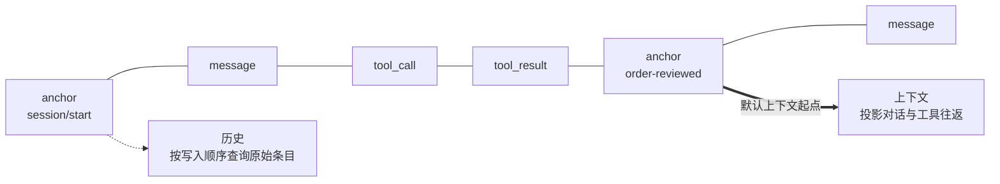

长期运行的 Agent 会面对两种不同的记忆问题。应用需要一份可信的记录，知道发生过什么；模型则需要一份小而相关的输入，完成下一次推理。如果把两者都当成同一个 `messages` 数组，就会被迫做出糟糕的选择：要么请求无限增长，要么裁剪上下文时毁掉唯一的历史记录。

Bub 把这两个关注点分开。**Tape 是持久记录，`TapeContext` 是这份记录面向模型的投影**。历史与上下文彼此关联，但不是同一个对象。

## 一份记录，两种视图 {#history-and-context}

可以把 Tape 看作同一份历史的写入侧，把 `TapeContext` 看作读取侧：



- **写入模型**追加 `TapeEntry`：对话消息、模型请求的工具调用、执行结果、anchor、错误，以及显式记录的业务事件。通过 `query()` 按写入顺序查询它们。
- **读取模型**用 `TapeContext` 选择条目并转换为 Republic 消息。`read_messages()` 返回面向模型的投影，而不是原始记录。

这是一种事件溯源视角：先保存事实，再为每个使用方派生所需视图。它把「发送了哪些参数」「返回了什么结果」等调试与审计问题，同提示词预算问题分开。

正常记录只追加条目，不改写旧条目，但 Tape 不是无条件不可变的日志。`reset()` 等显式操作可以清空记录，`TapeRecorder` 本身也不是完整的合规审计器。

`core.Agent` 和 `BubAgent` 共用这套机制，但默认存储和 Tape 命名方式不同。

## 上下文是投影，不是截断 {#context}

Agent 默认使用 `default_tape_context()`，读取最近一个 anchor 之后的条目，重建下一次请求所需的对话和工具往返：

| 条目类型 | 保存的事实 | 默认投影 |
| --- | --- | --- |
| `message` | 用户、助手、系统等对话消息 | 转换为对应消息 |
| `tool_call` | 模型请求的调用 | 转换为携带这些调用的助手消息 |
| `tool_result` | 工具执行返回的值 | 与前面的调用配对，转换为工具消息 |
| `anchor` | 上下文边界及可选状态 | 定义默认查询边界；边界本身不在选中范围内 |
| `event`、`system`、`error` | 业务事件、系统变化或记录的错误 | 不选择 |

标记为 `context=False` 的条目会在选择前被过滤。因此，普通业务事件可以留在历史中，而不自动消耗上下文 token。模型需要读取它们时，在自定义投影中显式纳入。

投影可以改变，历史不必改写。调试视图可以查询所有条目，模型视图则只选择当前阶段。这就是为什么移动 anchor 不等于删除此前消息。

`default_tape_context()` 还会重建工具往返。直接构造且没有选择器的 `TapeContext()` 只转换 `message` 条目，不要假定两种默认行为可以互换。

## anchor 标记认知阶段的转换 {#anchors}

**anchor** 不只是截断偏移量。它标记阶段边界：信息收集已经结束、订单已经审核，或者新任务即将开始。**handoff** 记录这种转换，把默认上下文起点向前移动，同时保留此前记录。

```python
async def start_next_phase() -> None:
    await agent.tape("customer-42").handoff(
        name="order-reviewed",
        state={"summary": "订单 A123 已发货，用户接下来需要物流信息。"},
    )
```

这种显式 handoff 是认知边界，不是自动摘要器。`handoff()` 不生成摘要，也不会自动把 `state` 注入下一次请求。需要摘要时，在 handoff 前生成，再通过下一条提示词或自定义选择器有意地提供它。

`Agent.session()` 和 `Agent.start()` 会为新会话创建 `session/start` anchor，仅调用 `agent.tape(name)` 不会创建。

### 选择其他起点 {#custom-selectors}

`TapeContext.anchor` 控制查询范围：

| 值 | 查询范围 |
| --- | --- |
| `LAST_ANCHOR`（默认） | 最近一个 anchor 之后 |
| `"order-reviewed"` | 指定名称的 anchor 之后 |
| `None` | 不按 anchor 过滤 |

需要沿用默认投影、只更换起点时，使用 `dataclasses.replace()`：

```python
from dataclasses import replace

from bub.core import Agent, default_tape_context


agent = Agent(
    context=replace(default_tape_context(), anchor="order-reviewed"),
)
```

需要不同投影时，向 `TapeContext(select=...)` 传入函数。它接收选中的条目和上下文，返回 Republic 消息或其 awaitable。自定义选择器会替换默认选择器，因此对话、工具往返、anchor 和业务事件都需要由你有意地组合。

### 上下文超长时自动 handoff {#context-overflow}

Agent 识别到上下文长度错误时，会自动 handoff 一次并重试原提示词。这是恢复机制，不是记忆摘要：它只移动起点，如果剩余请求仍然过大，重试还会失败。

需要按预算主动管理上下文时，使用 [`bub-context-budget` 插件](/zh-cn/docs/integrations/reuse-app/#other-hooks)。它让模型在接近上限时调用 `tape.handoff`。

## 决定什么值得持久化 {#state}

并非每个值都属于永久历史。传给 `agent.run()` 的 `state` 是本次 Run 共享的可变字典，不会自动持久化或恢复。

| 要保存的内容 | 存放位置 |
| --- | --- |
| 只在本次 Run 使用的临时值 | `state` |
| 需要事后查询的业务事实 | 通过 `append_event()` 显式写入 Tape 条目 |
| 下次 Run 要恢复的结构化状态 | 应用存储，或 anchor 的 `state` 加显式加载 |
| 对话和工具往返 | 由 `TapeRecorder` 写入的 Tape 条目 |

`TapeRecorder` 记录对话、工具往返和选定的生命周期事件。自定义业务事实必须显式写入，是否成为模型输入仍由 `TapeContext` 决定。

## Run 分支隔离记录，不隔离副作用 {#forks}

每次 `agent.run()` 都在 Tape 的分支上记录新条目。流关闭时，分支默认合并回父 Tape——正常结束、异常、取消和提前退出都会合并：

```python
async with agent.run("继续处理订单", tape="customer-42") as stream:
    async for event in stream:
        ...
```

传入 `merge_back=False` 可以在关闭时丢弃该分支的记录。也可以用 `agent.session(name, merge_back=...)` 或 `tape.fork_tape(merge_back=...)` 自行管理作用域。

:::caution
分支不是针对外部世界的事务。即使设置 `merge_back=False`，工具对文件的修改、已发送的请求和外部写入也不会回滚。
:::

并发 Run 需要读取彼此已完成的结果时，由应用协调执行顺序。`FileTapeStore` 不提供跨 worker 的会话锁；[FastAPI 示例](/zh-cn/docs/sdk/web-service/)演示了单进程内的锁。

## Sidecar 让并行记录留在主上下文之外 {#sidecars}

`TapeSidecar` 把关联数据存入与主 Tape 配套的另一份 Tape。通过 `Agent(sidecars=...)` 挂载后，它随主 Tape 分支、合并和重置，但条目不进入主上下文。

Bub 应用用 spill sidecar 保存大型工具结果。主对话只保留预览和句柄，Agent 再通过 `spill.read` 分块读取完整结果。[`BUB_SPILL_THRESHOLD`](/zh-cn/docs/reference/settings/#spill-settings) 用于配置触发阈值。

## 媒体有独立的存储边界 {#media}

模型请求可以包含图片、音频和视频，但 Tape 不是媒体文件存储。Run 的分支写入记录时，会剔除提示词中的非文本内容块，只保留文本，避免把内联媒体写进 JSONL 历史。

需要事后重放或审计时，由宿主把媒体保存到对象存储或文件系统，再在文本中记录可解析的引用。工具需要把媒体交回当前模型调用时，使用 [`content_result()`](/zh-cn/docs/sdk/tools/#media-results)。

## 为记录选择存储 {#storage}

普通 `Agent` 默认使用 `InMemoryTapeStore`，记录只存在于当前进程。需要跨进程重启保留时，提供文件存储：

```python
from pathlib import Path

from bub.core import Agent
from bub.core.store import FileTapeStore


agent = Agent(store=FileTapeStore(Path("sessions")))
```

`agent.run(..., tape="customer-42")` 按名称选择 Tape。重复使用同一名称会延续记录，不同名称彼此独立。

在 Run 之外，可以通过 `agent.tape(name)` 检查两种视图：

```python
async def inspect_history() -> None:
    tape = agent.tape("customer-42")
    messages = await tape.read_messages()
    entries = list(await tape.query().all())
    print(f"模型消息：{len(messages)}，存储条目：{len(entries)}")
```

`read_messages()` 应用投影，`query()` 返回原始条目。自定义后端需要实现 `bub.core.store.TapeStore` 或 `AsyncTapeStore`，完整替换示例见[存储集成](/zh-cn/docs/integrations/storage/)。

### 应用存储 {#app-storage}

内置应用通过 `provide_tape_store` 提供 `FuzzyFileTapeStore`，默认目录为 `~/.bub/tapes/`。Tape 名称由工作区路径和会话 ID 共同生成，因此不同工作区中的同名会话不会共享历史。

`BubAgent` 按以下顺序选择存储：

1. 显式传入的 `tape_store`；
2. 创建 Agent 时 `framework.get_tape_store()` 返回的存储；
3. 两者都没有时，使用内存存储。

需要使用 `framework.running()` 提供的存储时，在该作用域内创建 `BubAgent`。替换存储使用 `provide_tape_store`，替换投影策略使用 `build_tape_context`。

内置应用会从 Tape 恢复模型、推理力度和 code mode 等会话设置，其他应用状态需要显式持久化。
