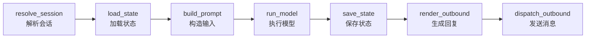

当你通过终端或聊天平台（如 Telegram、飞书）与 Bub 交互时，应用层收到的不只是一段发给模型的文本。它需要先确认这条消息属于哪个会话、恢复之前的状态、判断用户输入的是普通提问还是命令、运行 Agent、保存最新状态，最后把回复投递回对应的平台。

在 Bub 应用层中，处理一条入站消息的这整套生命周期就叫做一个 **Turn**，由 `BubFramework` 统一编排。核心层的 Agent Run 只是其中的模型执行阶段。

## 七个生命周期阶段 {#stages}

每次调用 `BubFramework.process_inbound()` 时，入站消息都会依次经过以下七个阶段：

| 阶段 | 职责 |
| --- | --- |
| `resolve_session` | 确定消息所属的 `session_id`（默认为 `<channel>:<chat_id>`） |
| `load_state` | 从存储中加载当前 Turn 所需的会话状态，并绑定运行时 Agent |
| `build_prompt` | 识别内部命令，或将原始消息构造为模型输入 |
| `run_model` | 运行 Agent Run（或流式的 `run_model_stream`），推进模型推理与工具调用 |
| `save_state` | 在模型阶段结束后保存跨 Turn 的应用状态 |
| `render_outbound` | 将模型输出包装为一条或多条待发送的渠道消息 |
| `dispatch_outbound` | 将待发送消息交给对应渠道投递 |

每个阶段都对应一个同名 Hook，插件可以在不改动核心代码的情况下扩展或替换任一阶段的行为。函数签名与调用规则见 [Hooks 参考](/zh-cn/docs/reference/hooks/#turn-hooks)。

在理解 Turn 时，建议把它和另外两个容易混淆的概念区分开：

- **Session**：跨多条消息的会话标识。同一聊天窗口连续发送 10 条消息属于 1 个 Session，但会触发 10 个独立的 Turn。`session_id` 仅是标识符，不含互斥锁；同会话并发由渠道准入策略或宿主程序控制。
- **Turn**：应用层处理一条入站消息的 7 阶段流程。
- **Run**：核心层 `core.Agent` 的一次模型与工具循环。普通消息在 Turn 的 `run_model` 阶段启动一次 Run；逗号命令（如 `,help`）在 Turn 内直接执行完毕，不启动 Run；通过 SDK 直接调用 `agent.run()` 则只执行 Run，不经过 Turn。

## TurnState：单次 Turn 内的共享字典 {#state}

在一次 Turn 的推进过程中，不同的 Hook、工具函数和事件处理器往往需要共享一些临时上下文（例如当前请求 ID、用户权限标记或渠道元数据）。Bub 为此提供了 `TurnState`。

`TurnState` 本质上是一个普通的 Python 字典（`dict[str, Any]`），**只在当前这一次 Turn 或 Run 内部有效，结束后即销毁，不会自动持久化**。

- 需要跨 Turn 保留的应用状态，应在 `save_state` 中显式保存，并在 `load_state` 中恢复。
- 对话历史和工具记录保存在 Tape 中，不要放入 `TurnState`（见[数据应该放在哪里](/zh-cn/docs/concepts/tape/#state)）。
- `_runtime_` 前缀的键由 Bub 内部维护，插件不要修改或覆盖。

## 异常与失败边界 {#failures}

在实际运行中，网络抖动、模型超时或工具报错都有可能中断某一次 Turn。Bub 的管道为此划定了明确的失败边界：

- **进入模型阶段后必执行 `save_state`**：只要流程进入 `run_model`，框架都会在 `finally` 块中调用 `save_state`。即便模型调用报错或超时，此前写入 `TurnState` 的状态依然会保存。
- **前置阶段报错不执行 `save_state`**：若异常发生在 `resolve_session`、`load_state` 或 `build_prompt` 阶段，模型尚未启动，`save_state` 不会执行。
- **`on_error` 仅观测不恢复**：未捕获的异常会先交给 `on_error` Hook 记录日志或告警，随后原样向上抛出。
- **Turn 不回滚外部副作用**：若工具已修改文件、发起网络请求或写入外部数据库，后续阶段报错不会回滚这些外部操作。
