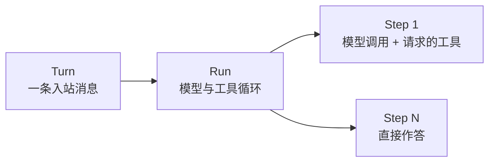
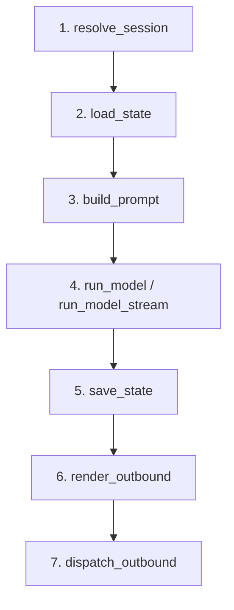

回复只是消息处理中可见的部分。在它背后，应用必须解析会话、恢复状态、准备输入、执行工作、保存结果并路由响应。如果让每个工具或模型适配器各自处理这些事情，不同执行路径就会产生不同的失败与顺序规则。

**Turn** 在 Bub 应用中为这些工作提供一条确定性的生命周期。确定性并不意味着模型答案固定，而是答案外围的阶段拥有明确顺序和错误边界。

## Turn、Run 与 Step {#definition}

三个层次以不同粒度描述同一份工作：



- **Turn** 拥有完整的应用交互，从接收 `Envelope` 一直到产生出站回复。
- **Run** 是 Turn 内部的 Agent 循环。它反复调用模型并执行工具，直到模型不再请求工具且没有待处理消息。
- **Step** 包含一次模型推理，以及该响应请求的全部工具调用。`BUB_MAX_STEPS` 限制的是 Step 数，而不是单个工具调用的数量。

并非每次交互都会用到全部三层。直接命令不会启动模型 Run，`Agent.run_once()` 只执行一个 Step，插件也可以替换整个模型阶段。脱离应用框架直接使用 `core.Agent` 时，外围的 Turn 职责由调用方承担。

## 七阶段确定性管道 {#stages}

`BubFramework.process_inbound()` 让每条普通入站消息经过同一条路径：



| 阶段 | 职责 | 默认行为 |
| --- | --- | --- |
| `resolve_session` | 建立会话边界 | 使用消息中的 `session_id`，否则生成 `channel:chat_id` |
| `load_state` | 恢复当前 Turn 所需数据 | 恢复会话设置并绑定 Agent |
| `build_prompt` | 构建模型输入 | 识别命令，为普通消息补充上下文、时间和媒体 |
| `run_model` / `run_model_stream` | 产生模型输出 | 调用 `BubAgent.run_stream()` |
| `save_state` | 结束消息生命周期并持久化应用状态 | 执行已注册的 save-state hooks |
| `render_outbound` | 把输出转换为渠道消息 | 把模型文本渲染为出站回复 |
| `dispatch_outbound` | 投递回复 | 把每条消息交给对应渠道 |

每个阶段都有对应的 hook。插件可以补充默认行为，也可以按照 hook 契约替换结果。这样既能定制管道，又不会让执行顺序变得隐式。签名、返回值和优先级见 [Hooks 参考](/zh-cn/docs/reference/hooks/#turn-hooks)。

### TurnState 天然是临时的 {#state}

各阶段需要共享数据，但不应因此把这些数据变成意外的长期记忆。`TurnState` 就是这块临时工作区：一个普通的 `dict[str, Any]`，由签名中接收 `state` 的 hooks、工具和事件处理器共享。

它的生命周期只有一次 Turn。请求相关的临时值放在这里；必须保留到下一个 Turn 的数据在 `save_state` 中持久化，再在 `load_state` 中恢复。对话和工具往返属于 Tape，而不是这个字典。

处理成功后，`process_inbound()` 返回一个 `TurnResult`：

| 字段 | 内容 |
| --- | --- |
| `session_id` | 解析后的会话 ID |
| `prompt` | 传给模型阶段的输入 |
| `model_output` | 汇总后的模型文本 |
| `outbounds` | 已生成并尝试投递的回复 |
| `state` | 当前 Turn 的状态字典 |

即使没有绑定发送渠道，宿主也可以通过 `TurnResult.outbounds` 自行处理回复。

## 失败也有明确路径 {#failures}

关键保障从模型阶段开始。一旦执行进入该阶段，`save_state` 就会在 `finally` 中运行。因此，模型出错或超时不会跳过应用的状态保存边界。

这项保障有精确的适用范围：

- `resolve_session`、`load_state` 或 `build_prompt` 的失败发生在 `finally` 之前，不会触发 `save_state`。
- 保存状态不代表回复已经成功渲染或投递。
- 未处理异常会交给 `on_error`，随后重新抛出。`on_error` 负责观察和报告，不会恢复原 Turn。
- Turn 不是数据库事务。工具已经修改的文件、发送的请求和其他副作用不会回滚。

通过 hooks 提供存储等资源时，在 `framework.running()` 作用域内处理消息：

```python
async with framework.running():
    result = await framework.process_inbound(message)
```

`bub run` 为一条消息打开该作用域；`bub chat` 和 `bub gateway` 在应用运行期间保持作用域。需要其中提供的存储时，也应在该作用域内创建 `BubAgent`。

## Turn 不负责什么 {#outside}

清晰的管道同样需要清晰的边缘：

| 需求 | 负责者 |
| --- | --- |
| 接收新消息，或把它交给当前 Run | `admit_message` hook 与渠道准入策略 |
| 合并短时间内到达的连续消息 | `BufferedMessageHandler` |
| 拦截单次模型或工具调用 | Agent 事件或应用拦截 hooks |
| 给下一个 Step 添加消息 | `continue_prompt` 或 `MessagesPending` |
| 持久化对话和工具往返 | `TapeRecorder` |
| 串行化同一会话中的并发工作 | 宿主应用 |

`process_inbound()` 不提供会话锁。渠道默认允许并发，因此需要「同一会话同时只有一个 Turn」的应用必须自行执行这项策略。

## 选择入口 {#entry-points}

根据所需生命周期，选择范围足够的最小入口：

| 入口 | 执行范围 | 调用方仍负责 |
| --- | --- | --- |
| `core.Agent.run()` | 一次模型 Run 或直接命令 | 会话、状态持久化和回复路由 |
| `BubAgent.run_stream()` | 可选的初始状态加载和一次模型 Run | 状态保存、出站渲染与投递、同会话并发 |
| `framework.process_inbound()` | 完整 Turn | 应用资源作用域、同会话并发和渠道设置 |

`process_inbound(stream_output=True)` 会向渠道交付流式输出，并在处理结束后返回完整的 `TurnResult`。
