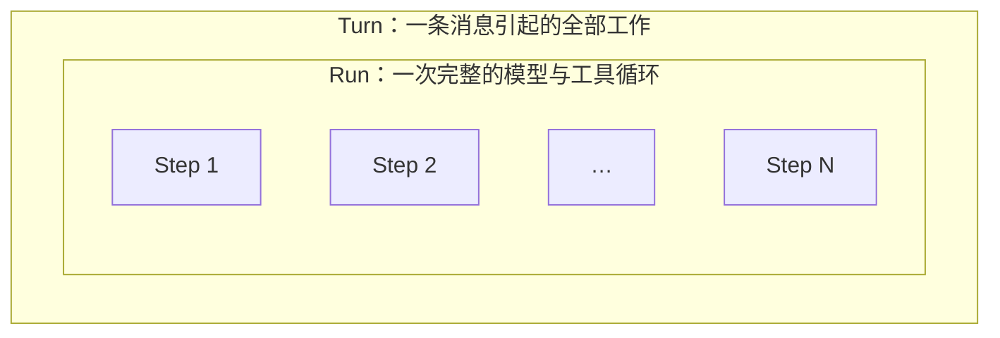

import { Aside, Steps } from '@astrojs/starlight/components';

## turn 是什么 {#definition}

turn 是 Agent 设计中的一个单位：**一条入站消息引起的全部工作**。

它由外向内分三层，逐层包裹：



**Turn** 是外壳。一条入站消息对应一个 turn，从消息到达开始，到回复发出结束。

**Run** 是中间层。一个 turn 包含一个 run，由 `Agent.start()` 执行一次。run 负责把模型与工具串成循环，不关心消息从哪来、回复发到哪。

**Step** 是最内层。一次模型调用，加上执行这次模型要求的全部工具调用，构成一个 step。模型不再要求工具时，run 结束。

一次 step 内部的动作是：`Agent.run_once()` 拼好消息并调用模型；模型返回工具调用时，框架执行这些工具，然后进入下一个 step；模型只返回文本时，run 到此结束。

工具调用与 step 不是一对一。一个 step 可以执行多个工具，也可以一个都不执行。step 的上限由 `BUB_MAX_STEPS` 控制。

消息以命令前缀（默认 `,`）开头时，这个 turn 里没有 run。`Agent.run_on()` 直接执行工具并返回结果，不调用模型。

单独使用模型循环时，每个调用点都要回答同样三个问题：这条消息属于哪个会话？上一轮的状态是否携带？回复发到哪个渠道？turn 就是把这几个问题的答案固定在框架里，让工具代码和模型代码不必关心它们。

## 在 Bub 中，turn 包含什么 {#stages}

`BubFramework.process_inbound()` 执行一个 turn。它把工作分成七个阶段，按固定顺序执行。每个阶段对应一个 hook。

<Steps>

1. **`resolve_session`：确定会话 ID。**

   优先使用消息自带的 `session_id`。消息没有带时，拼成 `channel:chat_id`。

   hook 取第一个非空结果。渠道调度器在准入检查前也调用这一步，所以同一条消息可能调用两次。

2. **`load_state`：装载本轮状态。**

   框架先写入 `_runtime_workspace` 和 `_runtime_steering_inbox`，再收集所有 hook 的返回值，按优先级从低到高合并。高优先级的值覆盖低优先级的值。

   内置实现提供 `session_id`、agent 实例、消息上下文，以及 tape 中记录的会话设置（模型、推理力度、code mode）。

   hook 收集全部，按优先级从低到高合并。

3. **`build_prompt`：生成模型输入。**

   内置实现分两种情况。消息以命令前缀开头时，返回原文本，并把消息类型标记为 `command`。其他情况下，追加上下文和时间戳，再附加图片、音频和视频。

   hook 取第一个非空结果。所有 hook 都没有返回结果时，框架直接使用入站文本。

4. **`run_model` / `run_model_stream`：执行模型阶段。**

   内置实现调用 `BubAgent.run_stream()`，进入核心循环。该阶段返回完整文本或一条事件流。

   hook 取第一个非空结果。流与文本可以互相转换，插件只实现其中一种也能工作。

   七个阶段中只有这个阶段执行时间长，也只有这个阶段会调用模型。

5. **`save_state`：保存状态。**

   内置实现只做一件事：退出消息携带的 lifespan。

   这一步在第 4 阶段的 `finally` 块中执行，因此第 4 阶段抛出异常时也会执行。hook 收集全部实现。

6. **`render_outbound`：生成出站消息。**

   内置实现用模型输出生成一条回复，沿用入站消息的 `channel` 和 `chat_id`。

   hook 收集全部返回值并展开批次。所有 hook 都没有返回结果时，框架用 `model_output` 生成一条默认回复。

7. **`dispatch_outbound`：发送出站消息。**

   内置实现把消息交给渠道 router。没有绑定 router 时返回 `False`，不发送任何消息。

   框架对每条出站消息调用所有实现，并且不使用返回值。`return False` 不会阻止后续处理。

</Steps>

前三个阶段准备输入。第 4 个阶段产生输出。后三个阶段保存并发送。

内置插件提供七个阶段的默认实现。其他插件按各 hook 的约定替换或补充。[Hooks 参考](/zh-cn/docs/reference/hooks/#turn-hooks)列出完整签名和优先级规则。

## 阶段之间传什么 {#what-crosses-stages}

上一个阶段的输出就是下一个阶段的输入。五个值在阶段之间传递，`TurnResult` 收集它们并返回给调用方。

| 值 | 类型 | 写入者 | 读取者 |
| --- | --- | --- | --- |
| `session_id` | `str` | 阶段 1 | 后续所有阶段、`TurnResult` |
| `state` | `TurnState`（`dict[str, Any]`） | 阶段 2，工具和事件处理器在运行中也会修改 | 阶段 3、4、5 |
| `prompt` | `list[UserContent]` | 阶段 3 | 阶段 4 |
| `model_output` | `str` | 阶段 4 | 阶段 5、6 |
| `outbounds` | `list[Envelope]` | 阶段 6 | 阶段 7、`TurnResult` |

其中只有 `session_id`、`state` 和 `prompt` 是阶段之间的输入。`model_output` 和 `outbounds` 是产出。

## 用 turn 做什么 {#using-a-turn}

了解这七个阶段之后，大部分定制需求可以定位到一个具体的 hook。下表把常见需求对应到做法。

七个 hook 的覆盖方式不同，先分清两类：**取首个结果的 hook 可以替换内置实现**，**收集全部的 hook 只能追加**。两者的优先级规则相同，但只有前者会“接管”这一阶段。

| 需求 | 做法 | 影响范围 | 能否替换内置实现 |
| --- | --- | --- | --- |
| 改模型看到的用户输入 | 实现 `build_prompt` | 本轮 | 可以 |
| 只追加系统指令，保留原输入 | 实现 `system_prompt` | 每次模型调用 | 不可以，按优先级拼接 |
| 换掉整个模型阶段（如接自有推理服务） | 实现 `run_model` 或 `run_model_stream` | 本轮 | 可以 |
| 改会话划分（如把多个群合并为一个会话） | 实现 `resolve_session` | 本轮及历史归属 | 可以 |
| 让状态跨轮保留 | 在 `save_state` 写出，在 `load_state` 读回 | 跨轮 | 不可以，全部执行 |
| 改回复格式（加签名、拆成多条） | 实现 `render_outbound` | 出站消息 | 不可以，全部执行 |
| 改发送目标或同时发到多处 | 实现 `dispatch_outbound` | 出站消息 | 不可以，全部执行 |
| 开启流式输出 | 配置 `BUB_STREAM_OUTPUT`，或在代码中传 `stream_output=True` | 全部或单次 | — |
| 限制一次对话的模型调用次数 | 配置 `BUB_MAX_STEPS` | 每个 run | — |
| 调整同一会话连续消息的合并间隔 | 配置 `BUB_DEBOUNCE_SECONDS`、`BUB_MAX_WAIT_SECONDS` | 渠道层，在 turn 之前 | — |

### 追加型 hook 的实际效果 {#additive-hooks}

`render_outbound` 属于收集全部结果的 hook。框架会执行内置实现和每一个插件实现，再把结果拼接。下面的插件给回复加上来源渠道：

```python
from bub import hookimpl
from bub.envelope import field_of


@hookimpl
def render_outbound(message, session_id, state, model_output):
    channel = field_of(message, "channel", "unknown")
    return [{
        "session_id": session_id,
        "channel": channel,
        "chat_id": field_of(message, "chat_id", "default"),
        "content": f"[{channel}] {model_output}",
    }]
```

结果不是一条带前缀的回复，而是两条回复：插件生成的那条，以及内置实现生成的那条。内置实现不会被插件替代。

需要完全接管出站消息时，有三种做法：

1. **不绑定渠道 router**。内置 `dispatch_outbound` 经 `dispatch_via_channel_router()` 发送，没有 router 时返回 `False`，不发送任何消息。两条出站消息都留在 `TurnResult.outbounds` 中，宿主自己挑选并发送。这是嵌入应用的通常做法。
2. **不加载内置 hooks**。不调 `load_builtin_hooks()` 和 `load_hooks()`，改为自己注册 `render_outbound` 和 `dispatch_outbound`。此时内置 agent、渠道和工具也需要自己提供。
3. **加载后注销内置实现**。`framework.load_hooks()` 之后执行 `framework.plugin_manager.unregister(name="builtin")`，再注册自己的实现。

第二种和第三种会同时去掉内置的 `run_model_stream`、`provide_tools` 和 `provide_channels`，不只是渲染。只想去掉重复回复、保留其他能力的场景，用第一种。

### 不能靠 hook 做的事 {#outside}

有几个需求看起来属于 turn，实际由其他部件负责。选错位置会白花时间。

| 需求 | 实际负责者 |
| --- | --- |
| 让同一会话的消息串行执行 | `ChannelManager`。`process_inbound()` 被并发调用时不会自己排队 |
| 决定进来的消息要不要处理 | `admit_message` hook，在 turn 之前执行，参数是 `TurnSnapshot` |
| 合并连续的多条消息 | `BufferedMessageHandler`，在 turn 之前执行 |
| 拦截或改写单次模型调用、单次工具调用 | `before_llm_call`、`after_llm_call`、`before_tool_call`、`after_tool_call`。它们属于 run |
| 给下一步追加用户消息 | `continue_prompt`，属于 run |
| 记录对话历史 | `TapeRecorder`。它订阅 agent 事件并写入 tape，turn 只提供生命周期 |

判断方法：需求影响「这条消息怎么被处理」，用 turn 的 hook。需求影响「这一次调用怎么做」，用 run 的 hook。需求影响「这条消息要不要处理」，用准入 hook。

## 选择入口 {#entry-points}

同一条消息有三种处理入口。选择哪一种，取决于需要多少个阶段。

| 入口 | 执行的阶段 | 缺少的 | 适用范围 |
| --- | --- | --- | --- |
| `core.Agent.run()` | 只有 run | 会话、状态、提示词、渲染、发送 | 自建服务的 SDK 用法 |
| `BubAgent.run_stream()` | 阶段 2 和 run | 阶段 5、6、7，以及并发管理 | 需要应用配置、技能和插件，但自己管输出 |
| `framework.process_inbound()` | 全部七个 | 并发管理与发送目标（需绑定渠道 router） | Bub 应用与网关 |

`BubAgent.run_stream()` 容易误判。它在 `state=None` 时会调用 `load_state`，看起来像执行了 turn。但它不调用 `save_state`、`render_outbound` 和 `dispatch_outbound`，也不管理同一会话的并发。宿主需要完整事务语义时，必须使用 `process_inbound()`。

三种入口都依赖 `bub[app]`，只有 `bub.turn` 模块属于内核。`bub.turn` 只定义两个类型：`TurnState` 是 `dict[str, Any]` 的别名，`TurnResult` 是保存结果的 dataclass。

`process_inbound()` 返回一个完成的 `TurnResult`，不返回迭代器。设置 `stream_output=True` 时，它先通过渠道 router 发送事件流，再拼接文本，最后仍然返回完整的 `TurnResult`。

```python
result = await framework.process_inbound(message, stream_output=True)
print(result.session_id, result.model_output, len(result.outbounds))
```

## 失败与资源 {#failures}

<Aside type="caution" title="save_state 的执行条件">
  `save_state` 只在执行进入第 4 阶段后运行。第 4 阶段抛出异常时，`save_state` 仍然运行。

  会话解析、状态装载和提示词构建失败时，执行不会进入 `finally` 块，`save_state` 不运行。内置实现正是在前三个阶段进入消息携带的 lifespan，例如 Telegram 的输入状态提示和 CLI 的界面状态。这三个阶段失败时，内置实现没有机会退出该 lifespan。插件在这三个阶段获取的资源需要自行释放。
</Aside>

第 4 阶段抛出未处理异常时，框架按以下顺序处理：运行 `save_state`，跳过阶段 6 和 7，调用 `on_error(stage="turn", ...)`，然后重新抛出异常。渠道调度器把这轮执行记为失败，不重试。

`on_error` 是观察者 hook。框架记录并忽略该 hook 抛出的异常。一个观察者失败不影响其他观察者。内置观察者在消息不为空时发送一条出站消息，内容为 `An error occurred at stage '...'`。

`resolve_session` 和 `admit_message` 在 turn 之前执行，报错时使用各自的阶段名。

关闭网关时，调度器取消正在执行的任务。框架关闭事件流，tape 的 fork 合并回父 tape。

hooks 需要存储或其他应用资源时，使用 `async with framework.running():`。该语句进入所有 lifespan provider，获取 tape store 和 steering inbox，退出时按相反顺序释放。`bub run` 为一条消息打开一次作用域。`bub chat` 和 `bub gateway` 调用 `ChannelManager.listen_and_run()`，在整个运行期间只打开一次。

在作用域外调用 `get_tape_store()` 返回 `None`。此时内置 agent 使用内存存储，历史记录不会写入磁盘。

## 小结 {#summary}

turn 是「一条消息引起的全部工作」这个单位。它把会话、状态、提示词、模型调用、保存、渲染和发送固定成七个有名字的阶段，因此每个业务需求都能落到一个具体位置。

一个 turn 接收一条入站 envelope，返回一个 `TurnResult`。阶段之间只传递 `session_id`、`state` 和 `prompt`。run 和 step 在其内部执行，模型调用次数的边界在 run，消息处理的边界在 turn。
