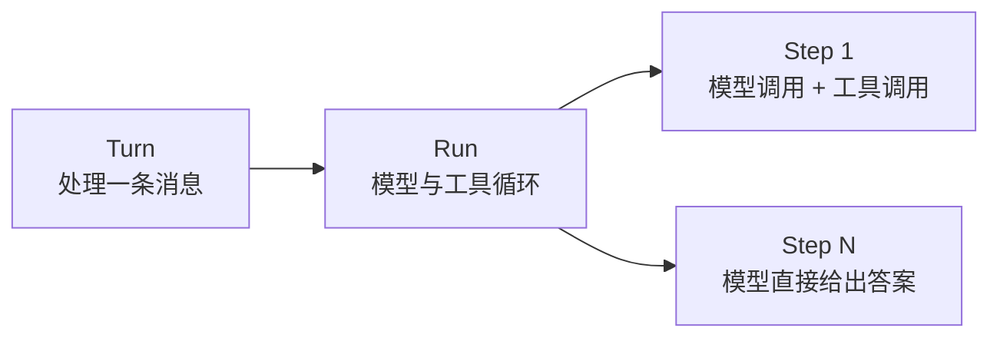

**Turn** 是应用处理一条入站消息的完整过程：找到会话、准备输入、运行模型、保存状态并发送回复。它把这些公共工作放在 Agent 循环之外，让工具和模型代码只关注当前任务。

## Turn、Run 和 Step {#definition}

一次 Turn 通常会启动一次 **Run**。Run 是模型与工具的循环，每次循环称为一个 **Step**：



一个 Step 包含一次模型调用，以及该响应请求的全部工具调用。模型不再请求工具，也没有待处理消息时，Run 结束。`BUB_MAX_STEPS` 限制的是 Step 数，不是工具调用数。

并非每次运行都有完整的三层结构：直接命令不启动 Run，`Agent.run_once()` 只执行一个 Step，插件也可以替换整个模型阶段。直接使用 `core.Agent` 时，会话、状态和回复路由由调用方负责。

## 七个处理阶段 {#stages}

`BubFramework.process_inbound()` 按以下顺序处理消息：

| 阶段 | 负责什么 | 默认行为 |
| --- | --- | --- |
| 1. `resolve_session` | 确定会话 | 使用消息中的 `session_id`，否则生成 `channel:chat_id` |
| 2. `load_state` | 恢复本轮状态 | 恢复会话设置并绑定 Agent |
| 3. `build_prompt` | 构建模型输入 | 识别命令，为普通消息补充上下文、时间和媒体 |
| 4. `run_model` / `run_model_stream` | 产生模型输出 | 调用 `BubAgent.run_stream()` |
| 5. `save_state` | 保存本轮状态 | 退出消息生命周期 |
| 6. `render_outbound` | 生成回复 | 把模型文本转换为出站消息 |
| 7. `dispatch_outbound` | 发送回复 | 交给对应渠道 |

每个阶段都有对应的 hook。插件可以补充默认行为，也可以按 hook 的约定替换结果；参数、返回值和优先级见 [Hooks 参考](/zh-cn/docs/reference/hooks/#turn-hooks)。

### 在阶段之间传递数据 {#state}

`TurnState` 是一个普通的 `dict[str, Any]`。签名中接收 `state` 的 hooks、工具和事件处理器共享同一个字典。

它只在当前 Turn 中存在。需要跨 Turn 保留的数据，应在 `save_state` 中写入存储，再在 `load_state` 中恢复；对话和工具往返则由 Tape 保存。

处理完成后，`process_inbound()` 返回 `TurnResult`：

| 字段 | 内容 |
| --- | --- |
| `session_id` | 本轮会话 ID |
| `prompt` | 模型阶段接收的输入 |
| `model_output` | 汇总后的模型文本 |
| `outbounds` | 生成并尝试发送的回复 |
| `state` | 本轮状态字典 |

即使没有绑定发送渠道，回复也会保留在 `TurnResult.outbounds` 中，方便宿主自行处理。

## 选择入口 {#entry-points}

根据你需要处理的范围选择入口：

| 入口 | 执行范围 | 调用方负责 |
| --- | --- | --- |
| `core.Agent.run()` | 模型 Run 或直接命令 | 会话、状态、消息路由 |
| `BubAgent.run_stream()` | 可选的初始状态加载和模型 Run | 保存状态、生成和发送回复、同会话并发 |
| `framework.process_inbound()` | 完整 Turn | 应用资源作用域、同会话并发、发送渠道 |

`process_inbound(stream_output=True)` 会向渠道交付流式输出，结束后仍返回完整的 `TurnResult`。

## 运行边界 {#outside}

Turn 不负责所有消息相关工作：

| 需求 | 负责者 |
| --- | --- |
| 决定是否接收新消息，或将其交给当前 Run | `admit_message` hook 与渠道准入策略 |
| 合并短时间内的连续消息 | `BufferedMessageHandler` |
| 拦截单次模型或工具调用 | Agent 事件或应用拦截 hooks |
| 给下一个 Step 添加消息 | `continue_prompt` 或 `MessagesPending` |
| 保存对话和工具往返 | `TapeRecorder` |

`process_inbound()` 不提供会话锁，也不是数据库事务。渠道默认允许并发；工具已经产生的文件修改、网络请求等副作用不会因后续失败而回滚。

## 错误与资源 {#failures}

进入模型阶段后，`save_state` 会在 `finally` 中执行，因此模型阶段失败时仍会保存状态。会话解析、状态加载或输入构建发生在进入该 `finally` 之前，这些阶段失败时不会调用 `save_state`。

未处理的异常会交给 `on_error`，随后重新抛出。`on_error` 用于观察和报告错误，不会恢复原来的 Turn。

通过 hooks 提供存储等资源时，在 `framework.running()` 作用域内处理消息：

```python
async with framework.running():
    result = await framework.process_inbound(message)
```

`bub run` 为一条消息打开作用域；`bub chat` 和 `bub gateway` 则在应用运行期间保持作用域。需要该作用域提供的存储时，也应在其中创建 `BubAgent`。
