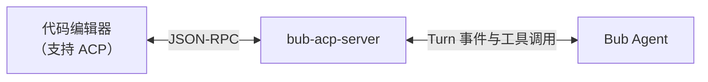

[Agent Client Protocol](https://agentclientprotocol.com/)（ACP）是让代码编辑器（如 Zed）与 Agent 通过 JSON-RPC 流式交换会话、提示词、工具调用和文件编辑操作的开放协议。

安装 `bub-acp-server` 插件后，就能把 Bub 接入 ACP 协议，在日常使用的 IDE 中直接唤出 Bub 进行代码编写、重构与排障。



## 开始之前 {#before-you-start}

- 已[安装 Bub 应用](/zh-cn/docs/getting-started/install/#app-install)并配置好模型。
- 已安装 [Zed](https://zed.dev/)（或其他兼容 ACP 的编辑器）。

:::note[查看 `bub` 绝对路径]
桌面应用启动时继承的 `PATH` 通常不包含你在 `~/.zshrc` 或 `~/.bashrc` 中配置的路径。请先在终端获取 `bub` 的绝对路径：

```bash
command -v bub
```
:::

## 1. 安装插件 {#install}

在包含 Bub 的 Python 环境中安装适配器插件：

```bash
bub install bub-acp-server@main
bub acp --help
```

输出 `Usage: bub acp [OPTIONS]` 即表示安装成功。`bub acp` 默认通过标准输入输出（`stdio`）与编辑器通信。

## 2. 配置 Zed {#zed}

在 Zed 中按 `Cmd+Shift+P`（macOS）或 `Ctrl+Shift+P`（Linux/Windows）打开命令面板，执行 `zed: open settings`，在 `settings.json` 中添加 `agent_servers` 配置。

### 方式 A：直接调用命令 {#global-install}

如果不需要加载项目目录下的 `.env` 文件，可直接指向 `bub`（若 Zed 提示找不到命令，请将 `"bub"` 替换为 `command -v bub` 输出的绝对路径）：

```json title="~/.config/zed/settings.json"
{
  "agent_servers": {
    "Bub": {
      "type": "custom",
      "command": "bub",
      "args": ["acp"],
      "env": {}
    }
  }
}
```

### 方式 B：使用启动包装脚本 {#wrapper-script}

如果 API Key 保存在项目根目录的 `.env` 中，或需要激活特定虚拟环境，建议创建包装脚本 `~/.bub/bub-acp-wrapper`：

```bash title="~/.bub/bub-acp-wrapper"
#!/usr/bin/env bash
set -euo pipefail

# 1. 可选：激活虚拟环境
# source /path/to/venv/bin/activate

# 2. 加载当前工作区的 .env
if [ -f "$PWD/.env" ]; then
  set -a
  source "$PWD/.env"
  set +a
fi

# 3. 用绝对路径启动 Bub ACP
exec /path/to/your/bub acp
```

赋予可执行权限并在 Zed 中配置该脚本路径：

```bash
chmod +x ~/.bub/bub-acp-wrapper
```

```json title="~/.config/zed/settings.json"
{
  "agent_servers": {
    "Bub": {
      "type": "custom",
      "command": "/Users/yourname/.bub/bub-acp-wrapper",
      "args": [],
      "env": {}
    }
  }
}
```

## 3. 在 Zed 中开始对话 {#start}

保存设置后重启 Zed 或重新加载配置：

1. 按 `Cmd+?`（macOS）或 `Ctrl+?`（Linux/Windows）打开 Zed 的 Agent 面板；
2. 将后端切换为 **Bub**；
3. 输入测试消息：
   ```text
   你好！请介绍一下你自己。
   ```
4. Bub 会将回复、思考过程与工具调用步骤逐一流式呈现在面板中。

:::tip[编辑器原生工具托管]
当 Zed 声明了文件系统与终端能力时，Bub 的 `bash`、`fs.read` 和 `fs.write` 会优先交由编辑器执行；若客户端未声明，则自动回退到 Bub 本地执行。
:::

## 4. 会话恢复与参数同步 {#sessions}

- **新建与恢复会话**：在 Zed 中新建 Thread 会创建新 Tape；切回历史 Thread 时，Bub 会从 Tape 存储中恢复对应的历史记录。会话索引保存在 `$BUB_HOME/acp-sessions.json`——只要 `BUB_HOME` 和工作区路径不变，重启编辑器后历史会话列表依然完好无损。
- **模型与推理强度**：在 Zed 面板中切换的模型或推理强度（Reasoning Effort）会自动同步到当前 ACP 会话。

## 5. 远程服务模式（HTTP / WebSocket） {#http}

在大多数本地开发场景中，默认的 `stdio` 是最轻量且低开销的选择。如果你把 Bub 部署在远程开发机或 Docker 容器内，需要本地编辑器远程连接，可以启用 HTTP 或 WebSocket 传输模式。

### 独立启动 {#standalone-service}

```bash
bub acp --transport http
# 或
bub acp --transport websocket
```

默认监听 `127.0.0.1:28200`（端点为 `http://127.0.0.1:28200/acp` 或 `ws://127.0.0.1:28200/acp`）。

### 作为网关渠道启动 {#gateway-channel}

通过网关模式可以同时维护会话池与后台连接：

```bash
bub gateway --enable-channel acp-server
```

| 环境变量 | 默认值 | 说明 |
| --- | --- | --- |
| `BUB_ACP_SERVER_HOST` | `127.0.0.1` | 监听地址（对外监听可设为 `0.0.0.0`） |
| `BUB_ACP_SERVER_PORT` | `28200` | 监听端口 |
| `BUB_ACP_SERVER_CERTFILE` | 空 | TLS 证书路径（启用 HTTPS/WSS 必填） |
| `BUB_ACP_SERVER_KEYFILE` | 空 | TLS 私钥路径 |

:::caution[公网安全]
HTTP/WebSocket 端点本身不包含用户鉴权。如需跨网络访问，请通过 SSH 端口转发，或前置 Nginx / Cloudflare Tunnel 配置鉴权与 TLS。
:::

## 故障排查 {#troubleshooting}

| 现象 | 排查与解决方法 |
| --- | --- |
| Zed 提示找不到 Agent Server | 将 `settings.json` 中的 `command` 改为 `command -v bub` 输出的绝对路径 |
| 启动失败或模型报缺少密钥 | 采用[方式 B](#wrapper-script) 包装脚本，确保 `.env` 被正确 `source` |
| 需要查看 JSON-RPC 通信日志 | 在 Zed 命令面板运行 `dev: open acp logs` |
| 会话历史无法保存 | 检查运行 Zed 的用户对 `$BUB_HOME`（默认 `~/.bub`）是否有读写权限 |
