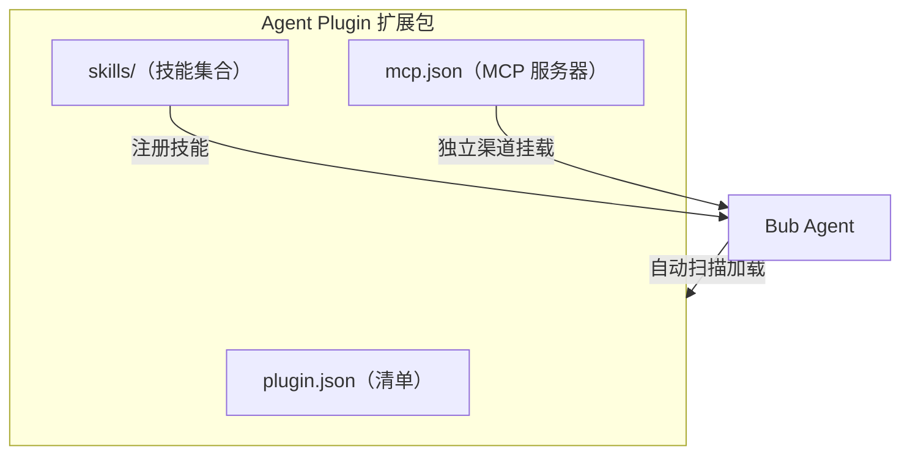

import { FileTree, Steps } from '@astrojs/starlight/components';

[Agent Plugins](https://agent-plugins.org/specification) 是跨平台的声明式 Agent 扩展包规范，支持将提示词技能（`skills/`）和 MCP 服务器（`mcp.json`）打包在同一个目录中，无需编写或修改任何 Python 代码，即可即插即用、跨项目复用。

安装 [`bub-agent-plugins`](https://github.com/bubbuild/bub-contrib/tree/main/packages/bub-agent-plugins) 插件后，Bub 会自动扫描并加载遵循该规范的扩展包。



## 快速接入 {#get-started}

下面我们会创建一个包含笔记总结技能与时间服务的扩展包。其中的验证命令会直接调用技能和工具，无需提前配置模型 API Key。

开始前请确认已[安装 Bub 应用](/zh-cn/docs/getting-started/install/#app-install)，且系统中已安装 [`uvx`](https://docs.astral.sh/uv/)。

<Steps>

1. **安装插件**

   ```bash
   bub install bub-mcp@main bub-agent-plugins@main
   bub hooks
   ```

   :::note
   `bub-agent-plugins` 依赖 `bub-mcp` 管理 MCP 连接生命周期，即使只使用扩展包中的技能也需一并安装。
   :::

   运行 `bub hooks`，确认 `load_state` 和 `provide_channels` 中均包含 `agent-plugins`。

2. **创建扩展包目录**

   在工作区下创建 `.agents/plugins/portable-notes/`：

   <FileTree>

   - .agents/
     - plugins/
       - portable-notes/
         - **plugin.json**
         - skills/
           - plugin-summary/
             - **SKILL.md**
         - **mcp.json**

   </FileTree>

   创建清单文件 `plugin.json`（`$schema` 和 `name` 为必填，`name` 必须与所在目录名一致）：

   ```json title=".agents/plugins/portable-notes/plugin.json"
   {
     "$schema": "https://agent-plugins.org/schemas/1.0.0/plugin.schema.json",
     "name": "portable-notes",
     "version": "1.0.0",
     "description": "提供笔记总结技能与时间工具的示例插件"
   }
   ```

   创建技能文件 `skills/plugin-summary/SKILL.md`：

   ```markdown title=".agents/plugins/portable-notes/skills/plugin-summary/SKILL.md"
   ---
   name: plugin-summary
   description: 总结会议或工作笔记，提取决策项和待办动作。
   ---

   阅读用户提供的笔记内容：
   1. 列出已做出的关键决策；
   2. 列出后续待办动作及负责人（未指定负责人时标为「待指派」）。
   ```

   创建 MCP 配置文件 `mcp.json`（必须包含 `$schema`，且每个服务必须显式声明 `type`：`stdio`、`streamable-http` 或 `sse`）：

   ```json title=".agents/plugins/portable-notes/mcp.json"
   {
     "$schema": "https://agent-plugins.org/schemas/1.0.0/mcp.schema.json",
     "mcpServers": {
       "time": {
         "type": "stdio",
         "command": "uvx",
         "args": ["mcp-server-time"]
       }
     }
   }
   ```

3. **验证技能加载**

   在当前工作区下运行内置命令：

   ```bash
   bub --workspace . run ',skill'
   bub --workspace . run ',skill name=plugin-summary'
   ```

   第一条命令应列出 `plugin-summary`，第二条命令会打印技能路径与正文（技能无需后台长连接，可通过 `bub run` 直接查看）。

4. **验证插件内的 MCP 工具**

   由于扩展包内的 MCP 工具需要后台长连接，启动 `bub chat`（会自动开启 `agent-plugins.mcp` 渠道）：

   ```bash
   bub --workspace . chat
   ```

   服务就绪后，直接调用插件中的时间工具（工具名包含插件名作为前缀）：

   ```text
   ,mcp.portable-notes.time_get_current_time timezone=UTC
   ```

   首次启动时 `uvx` 可能需要短暂下载服务包；若提示工具未找到，可查看启动日志待注册完成后重试。

   配置好 [模型](/zh-cn/docs/app/configure/) 后，也可以直接在对话中同时使用技能与工具：
   ```text
   请使用 $plugin-summary 技能总结今天的任务，并查一下当前 UTC 时间。
   ```

</Steps>

## 与全局 MCP 并存 {#with-mcp}

Agent Plugins 内的 MCP 服务与全局 `~/.bub/mcp.json` 相互隔离：

| 来源 | 配置文件 | 生命周期渠道 | 工具名称格式 |
|---|---|---|---|
| 全局配置 | `~/.bub/mcp.json` | `mcp.lifecycle` | `mcp.<server>_<tool>` |
| Agent Plugin | `<plugin>/mcp.json` | `agent-plugins.mcp` | `mcp.<plugin>.<server>_<tool>` |

两边可以同时定义同名服务（如 `time`）而不会冲突。注意 `bub mcp list` / `add` / `remove` 仅管理全局 `~/.bub/mcp.json`。

## 配置扫描路径与开关 {#discovery-paths}

Bub 默认自动扫描以下两个目录的直接子目录：
1. **工作区目录**：`<workspace>/.agents/plugins/`
2. **用户全局目录**：`~/.agents/plugins/`

如需自定义扫描路径或单独开关组件，可在 `~/.bub/config.yml` 中配置：

```yaml title="~/.bub/config.yml"
agent-plugins:
  paths:
    - /opt/shared-agent-plugins/dev-tools
  auto_discover: true
  skills_enabled: true
  mcp_enabled: true
  data_root: ~/.bub/agent-plugins
```

| 字段 | 默认值 | 说明 |
|---|---|---|
| `paths` | `[]` | 显式指定的插件目录列表（每个目录直接包含 `plugin.json`；相对路径基于当前工作区） |
| `auto_discover` | `true` | 是否扫描默认的 `.agents/plugins` 目录；设为 `false` 时仅加载 `paths` |
| `skills_enabled` | `true` | 是否加载扩展包内的技能 |
| `mcp_enabled` | `true` | 是否启动扩展包内的 MCP 服务器 |
| `data_root` | `~/.bub/agent-plugins` | 扩展包持久化数据的存储根目录 |

**优先级**：`paths` 显式路径 > 工作区目录 > 用户全局目录（同名插件以最先扫描到的有效包为准；工作区自身 `.agents/skills/` 下的技能始终优先于扩展包内的同名技能）。

环境变量使用 `BUB_AGENT_PLUGINS_` 前缀（列表使用 JSON 字符串）：

```bash
export BUB_AGENT_PLUGINS_PATHS='["/opt/shared-agent-plugins/dev-tools"]'
export BUB_AGENT_PLUGINS_AUTO_DISCOVER=false
```

启动 `stdio` 类型的 MCP 子进程时，Bub 会将默认工作目录设为该插件根目录，并注入 `PLUGIN_ROOT`（插件根目录绝对路径）和 `PLUGIN_DATA`（`data_root` 下对应该插件的数据目录）环境变量。`mcp.json` 的 `args`、`env` 值和 `cwd` 中也支持使用 `${PLUGIN_ROOT}` 与 `${PLUGIN_DATA}` 插值：

```json
{
  "command": "python",
  "args": ["${PLUGIN_ROOT}/server.py"]
}
```

下载或更新扩展包后，重启 Bub 即可加载最新内容。

## 故障排查 {#troubleshooting}

| 现象 | 排查与解决方法 |
| --- | --- |
| `bub hooks` 中无 `agent-plugins` | 确认已在当前环境中执行 `bub install bub-mcp@main bub-agent-plugins@main` |
| 未发现 `plugin-summary` 技能 | 检查 `plugin.json` 中的 `name` 是否与插件目录名一致，以及技能的 `name` 是否与技能子目录名一致 |
| 提示 `mcp.<plugin>...` 工具不存在 | MCP 工具需后台长连接，请使用 `bub chat` 或 `bub gateway`（`bub run` 不启动后台渠道） |
| 同名技能未生效 | 工作区 `.agents/skills/` 下的同名技能优先级更高，请重命名冲突技能 |
