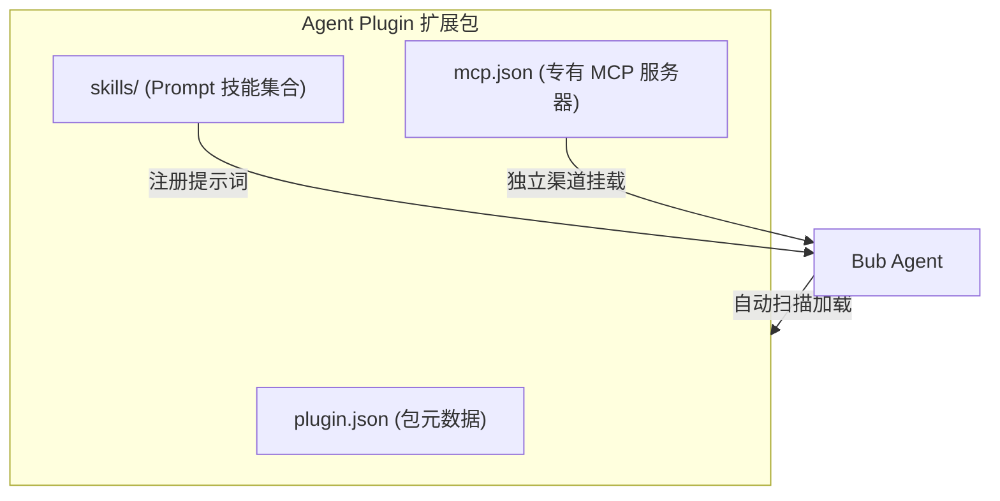

import { FileTree, Steps } from '@astrojs/starlight/components';

[Agent Plugins](https://agent-plugins.org/specification) 是一种跨平台的 Agent 扩展包规范。它采用纯声明式的目录结构，将提示词技能（Skills）和外部工具（MCP 服务器）打包在一起，无需编写或修改任何 Python 代码，即可实现即插即用和跨项目复用。



[bub-agent-plugins](https://github.com/bubbuild/bub-contrib/tree/main/packages/bub-agent-plugins) 插件让 Bub 原生支持这一规范，自动识别并加载插件包中的技能与工具。

## 如何接入 {#get-started}

开始前，请先[安装 Bub 应用](/zh-cn/docs/getting-started/install/#app-install)，并确保系统中安装了 [`uvx`](https://docs.astral.sh/uv/)。

<Steps>

1. **安装接入插件**

   ```bash
   bub install bub-mcp@main bub-agent-plugins@main
   bub hooks
   ```

   :::note
   `bub-agent-plugins` 依赖 `bub-mcp` 提供底层工具生命周期支持，即使你当前只打算使用插件包中的技能，也请一并安装。
   :::

   执行 `bub hooks` 检查输出，确认在 `load_state` 和 `provide_channels` 挂载列表中均出现了 `agent-plugins`。

2. **创建标准插件包**

   在当前项目工作区根目录下创建如下目录结构：

   <FileTree>

   - .agents/
     - plugins/
       - portable-notes/
         - plugin.json
         - skills/
           - plugin-summary/
             - SKILL.md
         - mcp.json

   </FileTree>

   编写清单文件 `plugin.json`：

   ```json
   {
     "$schema": "https://agent-plugins.org/schemas/1.0.0/plugin.schema.json",
     "name": "portable-notes",
     "version": "1.0.0",
     "description": "提供笔记总结技能与时间工具的示例插件"
   }
   ```

   编写技能文件 `skills/plugin-summary/SKILL.md`：

   ```markdown
   ---
   name: plugin-summary
   description: 快速总结会议或工作笔记，提取决策项和待办动作。
   ---

   阅读用户提供的笔记内容：
   1. 列出所有已经做出的关键决策；
   2. 列出后续待办动作，并注明具体责任人（若无明确人选，标记为「待指派」）。
   ```

   编写工具文件 `mcp.json`：

   ```json
   {
     "$schema": "https://agent-plugins.org/schemas/1.0.0/mcp.schema.json",
     "mcpServers": {
       "time": {
         "type": "stdio",
         "command": "uvx",
         "args": ["mcp-server-time"]
       }
     }
   }
   ```

3. **验证技能加载**

   在当前工作区运行 Bub 内置命令：

   ```bash
   bub --workspace . run ',skill'
   bub --workspace . run ',skill name=plugin-summary'
   ```

   - 第一条命令将列出当前工作区可用的全部技能，其中应包含 `plugin-summary`。
   - 第二条命令将打印出该技能的具体提示词内容和来源路径。由于技能本质是静态提示词注入，不需要常驻后台服务，因此可以通过 `bub run` 直接调用。

4. **验证并调用插件内的 MCP 工具**

   由于插件包内的 MCP 工具需要建立后台通道通信，请启动交互界面：

   ```bash
   bub --workspace . chat
   ```

   服务就绪后，直接在聊天窗口中测试插件工具（注意工具名称带插件名作为命名空间）：

   ```text
   ,mcp.portable-notes.time_get_current_time timezone=UTC
   ```

   也可以让配置好的大模型直接基于笔记执行总结或调用时间：
   ```text
   请使用 $plugin-summary 技能总结今天的任务，并帮我查一下当前的时间。
   ```

</Steps>

## 与全局 MCP 协同 {#with-mcp}

Agent Plugins 内部声明的 MCP 服务与全局配置 `~/.bub/mcp.json` 是相互隔离的，双方拥有独立的作用域和生命周期通道：

| 配置来源 | 配置文件路径 | 生命周期渠道 | 工具命名格式 |
|---|---|---|---|
| 全局独立配置 | `~/.bub/mcp.json` | `mcp.lifecycle` | `mcp.<server>_<tool>` |
| Agent Plugin 内部 | `<plugin>/mcp.json` | `agent-plugins.mcp` | `mcp.<plugin>.<server>_<tool>` |

这意味着你可以在两个配置中同时声明名为 `time` 的服务，而绝不会产生命名冲突。
`bub mcp list` / `add` 仅用于管理全局配置；插件内部的服务会在插件加载时由 `agent-plugins.mcp` 自动维系。

## 配置发现路径 {#discovery-paths}

Bub 默认会自动扫描以下两处目录的直接子文件夹：
1. **工作区目录**：`<workspace>/.agents/plugins/`（针对当前项目生效）
2. **用户根目录**：`~/.agents/plugins/`（对本机所有 Bub 任务生效）

如果需要加载系统其他目录下的插件，或需要单独开关某些功能，可以在 `~/.bub/config.yml` 中进行配置：

```yaml
agent-plugins:
  paths:
    - /opt/shared-agent-plugins/dev-tools
  auto_discover: true
  skills_enabled: true
  mcp_enabled: true
  data_root: ~/.bub/agent-plugins
```

| 配置字段 | 默认值 | 说明 |
|---|---|---|
| `paths` | `[]` | 显式指定插件根目录列表（相对路径基于当前工作区）。 |
| `auto_discover` | `true` | 是否自动扫描默认目录；设为 `false` 后仅加载 `paths` 中显式指定的插件。 |
| `skills_enabled` | `true` | 是否加载插件包内的技能（Skills）。 |
| `mcp_enabled` | `true` | 是否启动插件包内的 MCP 服务器。 |
| `data_root` | `~/.bub/agent-plugins` | 插件运行时持久化数据的根存储路径。 |

**优先级规则**：`paths` 中显式指定的插件 > 工作区目录插件 > 用户全局目录插件。若遇到同名清单插件，以最先扫描到的为准。

## 故障排查 {#troubleshooting}

| 常见问题 | 排查方法 | 解决办法 |
| --- | --- | --- |
| 无法识别 `plugin-summary` 技能 | 检查 `plugin.json` 中的 `name` 是否与插件目录名一致 | 规范要求目录名与 `name` 严格相同；确认执行命令时携带了 `--workspace .`。 |
| 提示 `mcp.<plugin>...` 工具未找到 | `bub-mcp` 未安装，或运行在 `bub run` 下 | 确认已执行 `bub install bub-mcp@main`，并在长会话模式 `bub chat` 下测试工具。 |
| stdio 工具报路径找不到错误 | 插件依赖环境与系统环境脱节 | 在 `mcp.json` 的 `command` 中使用系统的绝对路径，或确保依赖命令在系统的全局 `PATH` 中。 |
| 同名技能冲突 | 工作区定义了与插件同名的技能 | 工作区自身的技能（`skills/`）始终优先于插件内的同名技能。若想使用插件版本，重命名本地技能。 |
