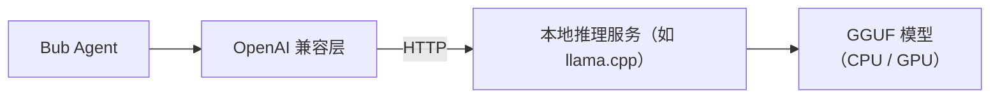

在离线、私有化部署或数据隐私敏感的场景下，你可以在本地运行开源大模型来驱动 Bub。

Bub 内置了标准的 OpenAI 兼容提供商，只要本地推理服务提供 `/v1/chat/completions` 接口（例如 `llama.cpp`、`vLLM` 或 `Ollama`），Bub 就能像调用云端模型一样无缝调用本地模型。



下面以 `llama.cpp` 搭配 [`ggml-org/gemma-4-E2B-it-GGUF`](https://huggingface.co/ggml-org/gemma-4-E2B-it-GGUF)（Q8 量化版）为例。

:::tip[本地模型选型建议]
- **连通性测试**：4B 左右的小模型可验证基础对话。
- **多步工具调用与编码**：建议选用 7B/8B 以上且支持 Tool Calling 的指令微调模型（如 `Qwen2.5-Coder-7B-Instruct` 或 `Llama-3.1-8B-Instruct`）。
:::

## 开始之前 {#before-you-start}

- 已[安装 Bub 应用](/zh-cn/docs/getting-started/install/#app-install)与 Docker。
- 预留至少 8 GB 可用内存（Q8 模型文件约 5 GB，另需 KV Cache 内存）。
- 将 GGUF 模型文件下载到 `~/.cache/llama.cpp/`：

```text
~/.cache/llama.cpp/ggml-org_gemma-4-E2B-it-GGUF_gemma-4-E2B-it-Q8_0.gguf
~/.cache/llama.cpp/ggml-org_gemma-4-E2B-it-GGUF_mmproj-gemma-4-E2B-it-Q8_0.gguf
```

*（`mmproj` 为多模态视觉投影文件；若仅需纯文本对话，可不下载该文件并在启动命令中去掉 `--mmproj` 参数。）*

## 1. 启动 llama-server {#start-server}

生成一个本地 API Key 并通过 Docker 启动 `llama.cpp` 服务：

```bash
export LLAMA_API_KEY="local-$(openssl rand -hex 8)"

docker run --rm -it \
  -p 127.0.0.1:8080:8080 \
  -v "$HOME/.cache/llama.cpp:/models:ro" \
  ghcr.io/ggml-org/llama.cpp:server \
  --host 0.0.0.0 \
  --port 8080 \
  --api-key "$LLAMA_API_KEY" \
  --alias gemma-4-E2B-it \
  -m /models/ggml-org_gemma-4-E2B-it-GGUF_gemma-4-E2B-it-Q8_0.gguf \
  --mmproj /models/ggml-org_gemma-4-E2B-it-GGUF_mmproj-gemma-4-E2B-it-Q8_0.gguf
```

- `-p 127.0.0.1:8080:8080`：仅绑定本机回环地址，防止暴露到局域网；
- `--alias`：指定请求 `/v1/chat/completions` 时使用的模型名称；
- 终端输出 `server is listening on http://0.0.0.0:8080` 即表示就绪。

## 2. 验证本地端点 {#verify-endpoint}

在另一个终端窗口中，用 `curl` 验证本地服务是否已经就绪：

```bash
curl -sS http://127.0.0.1:8080/v1/models \
  -H "Authorization: Bearer $LLAMA_API_KEY"

curl -sS http://127.0.0.1:8080/v1/chat/completions \
  -H "Authorization: Bearer $LLAMA_API_KEY" \
  -H "Content-Type: application/json" \
  -d '{
    "model": "gemma-4-E2B-it",
    "messages": [{"role": "user", "content": "请用一个词回复：你好"}],
    "max_tokens": 16
  }'
```

返回包含 `choices[0].message.content` 的 JSON 即说明服务正常。

## 3. 配置并运行 Bub {#configure-bub}

将 Bub 的 OpenAI 提供商地址指向本地服务：

```bash
export BUB_OPENAI_API_BASE="http://127.0.0.1:8080/v1"
export BUB_OPENAI_API_KEY="$LLAMA_API_KEY"
export BUB_MODEL="openai:gemma-4-E2B-it"
```

:::note[接入 Ollama]
如果你习惯使用 [Ollama](https://ollama.com/)，只需启动 Ollama 并将环境变量指向其默认端口 `11434` 即可（无需自定义 API Key）：
```bash
export BUB_OPENAI_API_BASE="http://127.0.0.1:11434/v1"
export BUB_OPENAI_API_KEY="ollama"
export BUB_MODEL="openai:qwen2.5-coder:7b"
```
:::

运行一次 Bub 任务做端到端验证：

```bash
bub run "用一句话介绍你自己，表明你运行在本地模型上。"
```

查看终端输出：如果看到 `[cli:local]` 开头并正常打印出模型的自我介绍，就说明 Bub 已经成功连上你的本地模型了。

## 4. 性能调优参数 {#tune}

Agent 工作流对上下文窗口和内存有特定要求，可根据你的硬件配置在启动命令中调整以下参数：

| 目标 | 参数调整 | 说明 |
| --- | --- | --- |
| **扩大上下文窗口** | 添加 `--ctx-size 8192`（或更大） | Agent 的系统提示词、工具 Schema 和历史较长，默认 2048 容易溢出 |
| **降低内存占用** | 换用 `Q4_K_M` 量化模型 | 内存/显存占用约减半，推理更快 |
| **GPU 加速** | 挂载 GPU 并添加 `--n-gpu-layers 33` | 将计算层卸载至显卡显存 |
| **纯文本模式** | 移除 `--mmproj` 参数 | 节省视觉投影模型的内存开销 |

:::caution
不要盲目调大 `--ctx-size`。KV Cache 消耗的内存与上下文长度成正比，请留出足够的物理内存，避免系统触发 OOM。
:::

## 故障排查 {#troubleshooting}

| 现象 | 可能原因 | 解决方法 |
| --- | --- | --- |
| 返回 `401 Unauthorized` | API Key 不一致 | 确认客户端与容器启动终端中的 `LLAMA_API_KEY` 一致 |
| 模型报 404 或找不到 | 模型别名不匹配 | 确认 `BUB_MODEL=openai:<alias>` 与 `--alias` 参数一致 |
| 无法调用工具或输出格式错乱 | 模型过小或不支持 Tool Calling | 换用 7B/8B 以上支持工具调用的模型 |
| 推理时容器崩溃退出 | 内存或显存不足（OOM） | 调小 `--ctx-size` 或换用 `Q4_K_M` 量化模型 |

## 清理环境 {#cleanup}

测试完成后，在运行 Docker 容器的终端按 `Ctrl+C` 停止容器，并清理当前终端的环境变量：

```bash
unset BUB_API_BASE BUB_API_KEY BUB_OPENAI_API_BASE BUB_OPENAI_API_KEY BUB_MODEL LLAMA_API_KEY
```

:::note
清除环境变量后，Bub 会自动恢复使用默认的云端模型配置。之前测试生成的 Tape 会话历史依然保留在 Bub 数据目录中。
:::
