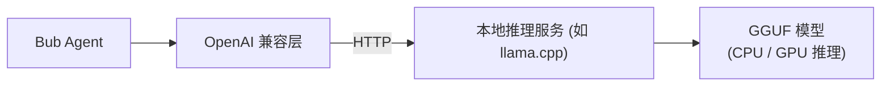

在离线、私有化部署或保护数据隐私的场景中，你可以在本地运行开源大模型来驱动 Bub。

Bub 内置了标准的 OpenAI 兼容提供商（Provider），这意味着只要本地推理引擎提供 `/v1/chat/completions` 接口（例如 `llama.cpp`、`vLLM` 或 `Ollama`），Bub 就能像调用云端模型一样无缝调用本地模型。



本指南以 `llama.cpp` 结合优秀的开源模型 [`ggml-org/gemma-4-E2B-it-GGUF`](https://huggingface.co/ggml-org/gemma-4-E2B-it-GGUF)（Q8 量化版本）为例进行演示。

:::tip[本地模型的选型]

Agent 依赖多轮工具调用与长上下文推理：

- 对于轻量测试，4B 左右的模型可以验证基本的会话连通性。
- 如果需要稳定可靠的工具调用与代码生成能力，推荐选用 7B/8B 以上并在指令与工具上微调过的模型（例如 `Qwen2.5-Coder-7B-Instruct` 或 `Llama-3.1-8B-Instruct`）。
:::

## 开始之前 {#before-you-start}

- 已[安装 Bub 应用](/zh-cn/docs/getting-started/install/#app-install)。
- 已安装 Docker，并确认 Docker 守护进程正常运行。
- 本机建议预留至少 8 GB 可用内存（Q8 量化模型文件约需 5 GB，还需预留上下文 KV Cache 空间）。
- 下载 GGUF 模型文件到本地目录 `~/.cache/llama.cpp/`：

```text
~/.cache/llama.cpp/ggml-org_gemma-4-E2B-it-GGUF_gemma-4-E2B-it-Q8_0.gguf
~/.cache/llama.cpp/ggml-org_gemma-4-E2B-it-GGUF_mmproj-gemma-4-E2B-it-Q8_0.gguf
```

*(其中 `mmproj` 为多模态视觉投影模型；如果仅处理纯文本交互，可以不下载该文件。)*

## 1. 启动 llama-server {#start-server}

为了保证本地服务接口的安全性，建议生成一个随机 API Key：

```bash
export LLAMA_API_KEY="local-$(openssl rand -hex 8)"
echo "生成的本地密钥: $LLAMA_API_KEY"
```

使用 Docker 启动 `llama.cpp` 服务容器：

```bash
docker run --rm -it \
  -p 127.0.0.1:8080:8080 \
  -v "$HOME/.cache/llama.cpp:/models:ro" \
  ghcr.io/ggml-org/llama.cpp:server \
  --host 0.0.0.0 \
  --port 8080 \
  --api-key "$LLAMA_API_KEY" \
  --alias gemma-4-E2B-it \
  -m /models/ggml-org_gemma-4-E2B-it-GGUF_gemma-4-E2B-it-Q8_0.gguf \
  --mmproj /models/ggml-org_gemma-4-E2B-it-GGUF_mmproj-gemma-4-E2B-it-Q8_0.gguf
```

**关键参数说明**：
- `-p 127.0.0.1:8080:8080`：仅绑定宿主机本地回环地址，避免暴露给局域网其他机器。
- `--alias`：定义在 `/v1/chat/completions` 中请求的模型别名。
- 当终端打印出 `server is listening on http://0.0.0.0:8080` 时，表明模型已成功载入内存。

## 2. 验证服务端点 {#verify-endpoint}

在另一个终端窗口中，使用 `curl` 验证本地服务是否已经就绪：

```bash
# 验证模型列表
curl -sS http://127.0.0.1:8080/v1/models \
  -H "Authorization: Bearer $LLAMA_API_KEY"
```

测试一次最简单的对话补全请求：

```bash
curl -sS http://127.0.0.1:8080/v1/chat/completions \
  -H "Authorization: Bearer $LLAMA_API_KEY" \
  -H "Content-Type: application/json" \
  -d '{
    "model": "gemma-4-E2B-it",
    "messages": [{"role": "user", "content": "请用一个词回复：你好"}],
    "max_tokens": 16
  }'
```

若返回带有 `choices[0].message.content` 的 JSON 数据，说明本地 OpenAI 兼容服务运行完全正常。

## 3. 配置 Bub {#configure-bub}

设置 Bub 的环境变量，让它把针对 OpenAI 提供商的请求重定向到本地端点：

```bash
export BUB_OPENAI_API_BASE="http://127.0.0.1:8080/v1"
export BUB_OPENAI_API_KEY="$LLAMA_API_KEY"
export BUB_MODEL="openai:gemma-4-E2B-it"
```

:::note[使用其他推理框架（如 Ollama）]

如果你习惯使用 [Ollama](https://ollama.com/)，只需启动 Ollama 后将环境变量指向其兼容接口即可（无需自定义 API Key）：
```bash
export BUB_OPENAI_API_BASE="http://127.0.0.1:11434/v1"
export BUB_OPENAI_API_KEY="ollama"
export BUB_MODEL="openai:qwen2.5-coder:7b"
```
:::

运行一次 Bub 任务进行端到端验证：

```bash
bub run "用一句话介绍你自己，表明你来自本地模型。"
```

观察终端输出，如果开头显示 `[cli:local]` 且打印出模型回复，说明链路已全线贯通！

## 4. 性能调优 {#tune}

Agent 的工作流对上下文窗口和内存有特定要求，可根据你的硬件配置在启动命令中优化以下参数：

| 调优目标 | 具体措施 | 原因与效果 |
| --- | --- | --- |
| **扩大上下文窗口** | 增加 `--ctx-size 8192` 或更大 | Agent 的系统提示词、工具定义以及 Tape 历史较长，默认 2048 容易超出上下文。 |
| **减少内存占用** | 改用 `Q4_K_M` 量化版本的 GGUF | 显存/内存占用减半，推理速度显著加快，精度损失极小。 |
| **GPU 硬件加速** | 挂载 GPU 并添加 `--n-gpu-layers 33` | 将计算层卸载到显存中，推理速度提升数倍至数十倍。 |
| **纯文本加速** | 去除 `--mmproj` 参数与对应镜像映射 | 省去图像模态初始化开销，降低系统内存占用。 |

:::caution
不要无限制盲目调大 `--ctx-size`。KV Cache 消耗的内存与上下文长度成正比，请确保留出足够的物理内存，防止系统触发 OOM。
:::

## 故障排查 {#troubleshooting}

| 常见问题 | 可能原因 | 解决办法 |
| --- | --- | --- |
| `curl` 返回 `401 Unauthorized` | 请求头中的 API Key 与容器启动时不一致 | 确认 `LLAMA_API_KEY` 变量值，或检查 `docker run` 中的 `--api-key`。 |
| 模型报错找不到或返回 404 | 请求中的模型别名与服务不匹配 | 检查 `BUB_MODEL` 后的名称是否与启动容器时的 `--alias` 完全一致。 |
| 无法调用工具或直接输出乱码 | 模型尺寸过小或未经 Function Calling 微调 | 换用 7B/8B 以上具备工具调用微调的模型（如 Qwen2.5-Coder、Llama-3.1）。 |
| 启动容器或推理时服务崩溃退出 | 物理内存或显存不足导致 OOM | 降低 `--ctx-size`，或换用更小量化等级（如 `Q4_K_M`）的模型文件。 |

## 清理 {#cleanup}

测试完成后，在运行 Docker 容器的终端按 `Ctrl+C` 停止容器，并清除当前终端的环境变量覆盖：

```bash
unset BUB_API_BASE BUB_API_KEY BUB_OPENAI_API_BASE BUB_OPENAI_API_KEY BUB_MODEL LLAMA_API_KEY
```

:::note
清除环境变量后，Bub 将恢复使用默认的云端模型配置。之前测试生成的 Tape 会话历史依然保留在 Bub 数据目录中。
:::
