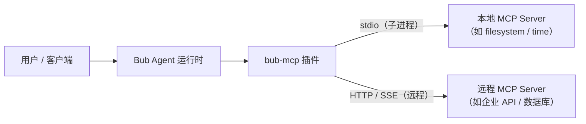

import { Steps } from '@astrojs/starlight/components';

[Model Context Protocol](https://modelcontextprotocol.io/)（MCP）是让 Agent 安全、标准化地调用本地或远程外部工具与数据源的开放协议。

通过安装 [`bub-mcp`](https://github.com/bubbuild/bub-contrib/tree/main/packages/bub-mcp) 插件，你可以将整个 MCP 生态中的工具无缝接入 Bub 应用。



## 快速接入 {#get-started}

开始前请确认已[安装 Bub 应用](/zh-cn/docs/getting-started/install/#app-install)，且系统中已安装 [`uvx`](https://docs.astral.sh/uv/)（用于免安装启动示例工具）。

<Steps>

1. **安装插件并验证**

   ```bash
   bub install bub-mcp@main
   bub hooks
   ```

   `bub install` 会从 [`bub-contrib`](https://github.com/bubbuild/bub-contrib) 解析并安装 `bub-mcp`。确认 `bub hooks` 输出中包含 `mcp`：

   ```text
   load_state: builtin, mcp
   provide_channels: builtin, mcp
   register_cli_commands: builtin, mcp
   ```

   :::note
   若未出现 `mcp`，请运行 `command -v bub` 确认当前 `bub` 所在的 Python 环境与安装插件的环境一致。
   :::

2. **配置 MCP 服务器**

   `bub-mcp` 默认读取 `~/.bub/mcp.json`（若设置了 `BUB_HOME`，则读取 `$BUB_HOME/mcp.json`）。以下配置官方时间服务 [`mcp-server-time`](https://pypi.org/project/mcp-server-time/)：

   ```bash
   mkdir -p ~/.bub
   cat > ~/.bub/mcp.json <<'EOF'
   {
     "mcpServers": {
       "time": {
         "command": "uvx",
         "args": ["mcp-server-time"]
       }
     }
   }
   EOF
   ```

   配置中包含 `command` 时自动使用本地 `stdio` 子进程传输，无需显式指定 `transport`。

3. **检查连接与工具列表**

   运行 `bub mcp list` 检查配置是否生效：

   ```bash
   bub mcp list
   ```

   连接正常时会列出发现的工具：

   ```text
   🔌 MCP Tools
   - time
     Status: Connected
     Tools: mcp.time_get_current_time, mcp.time_convert_time
   ```

   - MCP 工具统一以 `mcp.<server>_<tool>` 命名。
   - 为节省上下文，MCP 工具默认启用**延迟加载**（模型按需调用 `tool.describe` 获取完整参数定义）；如需将全部 Schema 直接注入系统提示词，可设置 `BUB_MCP_DEFERRED_TOOLS=false`。

4. **在会话中调用**

   MCP 连接由后台服务 `mcp.lifecycle` 维持，请使用长会话模式启动：

   ```bash
   bub chat
   ```

   直接提问：

   ```text
   现在 UTC 时间是多少？
   ```

   模型会自动推断并调用 `mcp.time_get_current_time` 工具来回答。

   :::tip[跳过模型直接测试工具]
   如果你想直接测试工具连通性，可以跳过模型推理，在 `bub chat` 中使用逗号前缀直接调用：
   ```text
   ,mcp.time_get_current_time timezone=UTC
   ```
   :::

</Steps>

## 配置更多服务器 {#add-servers}

你可以在 `~/.bub/mcp.json` 的 `mcpServers` 中追加多个服务。

### 远程服务（HTTP / SSE） {#remote-http-sse}

如果工具作为微服务运行在远程服务器或容器中，使用 `url`、`transport` 和可选的 `headers` 进行配置：

```json title="~/.bub/mcp.json"
{
  "mcpServers": {
    "weather": {
      "url": "https://weather.example.com/mcp",
      "transport": "http"
    },
    "internal_crm": {
      "url": "https://crm.corp.internal/mcp",
      "transport": "sse",
      "headers": {
        "Authorization": "Bearer YOUR_SECRET_TOKEN"
      }
    }
  }
}
```

### 本地文件系统服务 {#local-filesystem}

对于有权限限制的本地工具，可通过 `args` 限制其可访问的目录范围：

```json title="~/.bub/mcp.json"
{
  "mcpServers": {
    "filesystem": {
      "command": "npx",
      "args": ["-y", "@modelcontextprotocol/server-filesystem", "/tmp/bub-sandbox"]
    }
  }
}
```

### 使用 CLI 管理配置 {#manage-cli}

除了直接编辑 JSON 文件，也可以用 `bub mcp` 命令行工具快速添加或移除服务器：

```bash
# 添加本地 stdio 服务
bub mcp add --transport stdio time -- uvx mcp-server-time
bub mcp add --transport stdio --env API_KEY=secret custom -- node ./my-server.js

# 添加远程 HTTP 或 SSE 服务
bub mcp add --transport http weather https://weather.example.com/mcp
bub mcp add --transport sse --header "Authorization: Bearer token" events https://events.example.com/mcp

# 移除服务
bub mcp remove time
```

## 与 Agent Plugins 并存 {#with-agent-plugins}

全局 MCP 配置与 [Agent Plugins](/zh-cn/docs/integrations/agent-plugins/) 内的 MCP 配置拥有独立的后台渠道与工具命名前缀，可同时使用：

| 来源 | 配置文件 | 生命周期渠道 | 工具名称格式 |
|---|---|---|---|
| 全局 MCP | `~/.bub/mcp.json` | `mcp.lifecycle` | `mcp.<server>_<tool>` |
| Agent Plugin | `<plugin>/mcp.json` | `agent-plugins.mcp` | `mcp.<plugin>.<server>_<tool>` |

## 故障排查 {#troubleshooting}

| 现象 | 可能原因 | 解决方法 |
| --- | --- | --- |
| `bub hooks` 中无 `mcp` | 插件未安装到当前 Python 环境 | 检查 `command -v bub`，在对应环境中重新执行 `bub install bub-mcp@main` |
| `bub mcp list` 显示 `Disconnected` | 外部命令执行失败或远程地址不可达 | 在终端单独运行 `uvx mcp-server-time` 或 `curl` 目标 URL 排查报错 |
| `bub run "..."` 中无法使用 MCP 工具 | `bub run` 不启动 `mcp.lifecycle` 后台服务 | 改用 `bub chat` 或 `bub gateway` |
| `bub mcp add` 退出时打印 `CancelledError` | 子进程关闭时的清理日志，配置通常已写入 | 运行 `bub mcp list` 确认是否已保存 |
| 写入配置时报 `Permission denied` | `~/.bub/` 目录无写权限 | 修复 `~/.bub` 目录权限，或设置 `BUB_HOME` 指向可写目录 |
