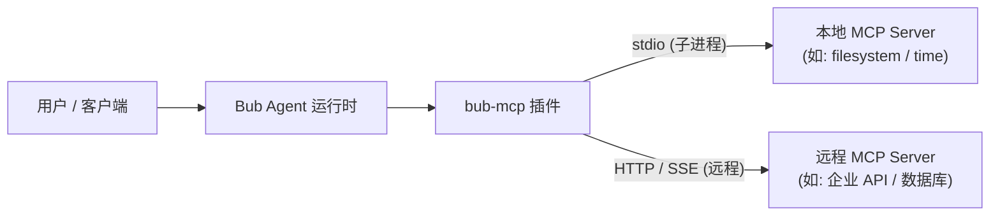

import { Steps } from '@astrojs/starlight/components';

[Model Context Protocol](https://modelcontextprotocol.io/)，即 **MCP**，是一种让 Agent 安全、标准化地调用本地或远程的外部工具与数据源的开放协议。

通过安装 [bub-mcp](https://github.com/bubbuild/bub-contrib/tree/main/packages/bub-mcp) 插件，你可以将整个 MCP 生态中的工具无缝接入 Bub 应用。



## 如何接入 {#get-started}

开始前，请确保已[安装 Bub 应用](/zh-cn/docs/getting-started/install/#app-install)，且系统中已安装 [`uvx`](https://docs.astral.sh/uv/)（用于免安装启动示例工具）。

<Steps>

1. **安装插件并验证环境**

   ```bash
   bub install bub-mcp@main
   bub hooks
   ```

   `bub install` 会从 [`bub-contrib`](https://github.com/bubbuild/bub-contrib) 解析安装 `bub-mcp`。执行 `bub hooks` 检查插件是否已正确挂载：

   ```text
   load_state: builtin, mcp
   provide_channels: builtin, mcp
   register_cli_commands: builtin, mcp
   ```

   :::note
   如果列表中没有出现 `mcp`，说明插件安装到了其他 Python 环境。请确认当前运行的 `bub` 路径（可通过 `command -v bub` 查看）与安装环境一致。
   :::

2. **配置 MCP 服务器**

   `bub-mcp` 会默认读取 `~/.bub/mcp.json`（若定义了 `BUB_HOME`，则读取 `$BUB_HOME/mcp.json`）。这里以官方时间工具 [`mcp-server-time`](https://pypi.org/project/mcp-server-time/) 为例：

   ```bash
   mkdir -p ~/.bub
   cat > ~/.bub/mcp.json <<'EOF'
   {
     "mcpServers": {
       "time": {
         "command": "uvx",
         "args": ["mcp-server-time"]
       }
     }
   }
   EOF
   ```

   填写说明：

    - 对于本地命令行服务（stdio），只需填写 `command` 和可选的 `args` / `env`。
    - 带有 `command` 的配置会自动采用 stdio 传输，无需显式声明 `transport`。

3. **测试连接与工具发现**

   运行 `bub mcp list` 检查配置是否生效：

   ```bash
   bub mcp list
   ```

   正常情况下，输出将显示连接就绪并列出发现的工具：

   ```text
   🔌 MCP Tools
   - time
     Status: Connected
     Tools: mcp.time_get_current_time, mcp.time_convert_time
   ```

   注意：

    - 每个 MCP 工具都会以 `mcp.<server>_<tool>` 命名并注入 Bub。
    - 为了节约提示词 token，Bub 默认采用**延迟加载**策略（模型在需要时通过 `tool.describe` 获取详细模式）。如果希望完整模式直接进入系统提示词，可设置环境变量 `BUB_MCP_DEFERRED_TOOLS=false`。

4. **在会话中调用工具**

   MCP 工具由后台生命周期渠道 `mcp.lifecycle` 维持长连接。因此，请使用长连接模式运行：

   ```bash
   bub chat
   ```

   在交互界面中直接提问：

   ```text
   现在 UTC 时间是多少？
   ```

   模型会自动推断并触发 `mcp.time_get_current_time` 工具完成应答。

   :::tip[无需模型的直接测试]
   如果你想直接测试工具连通性，可以跳过模型推理，在 `bub chat` 中使用前导逗号直接执行工具命令：
   ```text
   ,mcp.time_get_current_time timezone=UTC
   ```
   :::

</Steps>

## 添加其他服务器 {#add-servers}

在 `~/.bub/mcp.json` 的 `mcpServers` 字典中可以追加多个服务。

### 远程服务 (HTTP/SSE) {#remote-http-sse}

如果工具作为微服务运行在远程服务器或本地容器中，使用 `url` 和 `transport` 进行配置：

```json
{
  "mcpServers": {
    "weather": {
      "url": "https://weather.example.com/mcp",
      "transport": "http"
    },
    "internal_crm": {
      "url": "https://crm.corp.internal/mcp",
      "transport": "sse",
      "headers": {
        "Authorization": "Bearer YOUR_SECRET_TOKEN"
      }
    }
  }
}
```

### 本地服务 (文件系统) {#local-filesystem}

对于有权限限制的本地工具，可通过 `args` 限制其操作目录范围：

```json
{
  "mcpServers": {
    "filesystem": {
      "command": "npx",
      "args": ["-y", "@modelcontextprotocol/server-filesystem", "/tmp/bub-sandbox"]
    }
  }
}
```

### 命令行管理 {#manage-cli}

除了直接编辑 JSON 文件，也可以直接使用 `bub mcp` 命令行工具快速注册或删除：

```bash
# 注册 stdio 本地工具
bub mcp add --transport stdio time -- uvx mcp-server-time
bub mcp add --transport stdio --env API_KEY=secret custom -- node ./my-server.js

# 注册远程 HTTP 或 SSE 服务（带认证 Header）
bub mcp add --transport http weather https://weather.example.com/mcp
bub mcp add --transport sse --header "Authorization: Bearer token" events https://events.example.com/mcp

# 移除指定服务
bub mcp remove time
```

## 与 Agent Plugins 一起使用 {#with-agent-plugins}

Bub 同样支持标准的 [Agent Plugins](/zh-cn/docs/integrations/agent-plugins/)。两者中的 MCP 服务器分别拥有独立的生命周期渠道与工具命名空间，可以同时无缝运行：

| 来源 | 配置文件 | 运行渠道 | 工具名称前缀 |
|---|---|---|---|
| 全局 MCP | `~/.bub/mcp.json` | `mcp.lifecycle` | `mcp.<server>_<tool>` |
| Agent Plugin | `<plugin>/mcp.json` | `agent-plugins.mcp` | `mcp.<plugin>.<server>_<tool>` |

## 故障排查 {#troubleshooting}

| 常见现象 | 可能原因 | 解决办法 |
| --- | --- | --- |
| `bub hooks` 中无 `mcp` | 插件未装入当前运行的 Python 环境 | 运行 `command -v bub`，确认当前执行环境后重新执行 `bub install bub-mcp@main`。 |
| `bub mcp list` 显示 `Status: Disconnected` | 外部服务未启动或命令无法执行 | 独立在终端运行 `uvx mcp-server-time` 或用 `curl` 访问 `url`，确认其是否正常响应。 |
| `bub run "..."` 中无法调用 MCP 工具 | `bub run` 是单次执行任务，不启动后台生命周期渠道 | 长期运行请使用 `bub chat` 或 `bub gateway`；如需一次性调用，请在交互中使用 `,mcp.<tool>`。 |
| `bub mcp add` 保存时打印 `CancelledError` | 进程提前退出，但配置通常已持久化 | 执行 `bub mcp list` 确认条目是否已写入 `mcp.json`。 |
| 提示 `Permission denied` 无法写入配置 | `~/.bub/` 目录所有者权限不匹配 | 检查 `~/.bub` 目录权限，或设置 `BUB_HOME` 指向当前用户拥有写权限的路径。 |
