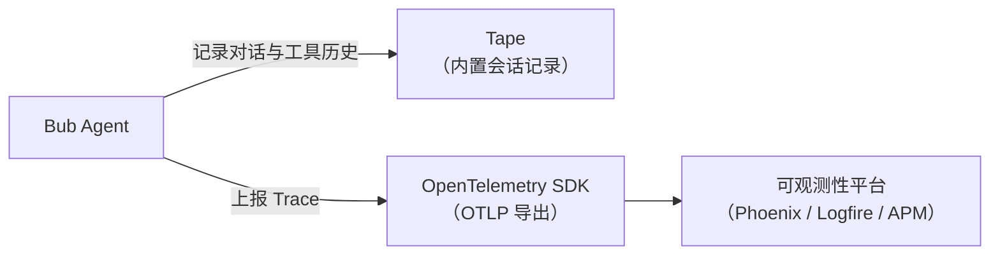

Bub 提供了两条互补的途径来观察和排查 Agent 的运行情况：

- **检查会话 Tape**（内置）：查看当前会话记录了多少条目、最近一次模型调用的 Token 消耗与提示词缓存命中率，并检索历史事件——无需安装任何外部组件。
- **导出 OpenTelemetry 调用链**：追踪每次模型调用与工具执行的细分耗时和异常堆栈，导出到 Arize Phoenix、Pydantic Logfire 等平台。



## 检查会话 Tape {#inspect-tape}

Tape 是 Bub 内置的会话记录机制。无需任何配置，直接运行内置命令就能查看当前会话的健康状况：

```bash
bub run "你有哪些工具？各自适合做什么？"
bub run ",tape.info"
```

输出示例：

```text
name: becda04eb9f7369c__065943a03cbe6395
entries: 98
anchors: 2
last_anchor: session/start
entries_since_last_anchor: 44
last_token_usage: 7458
last_token_cache_hit_rate: 72.50%
```


### 指标说明 {#core-metrics}

| 字段 | 含义 |
|---|---|
| `entries` | 会话记录的条目总数（含对话消息、工具往返与事件） |
| `anchors` / `last_anchor` | 历史 anchor 总数与最近一个 anchor 名称（默认模型上下文的读取起点） |
| `entries_since_last_anchor` | 自最近一个 anchor 以来的新条目数；过高时可执行 `tape.handoff` 前移起点 |
| `last_token_usage` | 最近一次模型调用的 Token 总消耗量 |
| `last_token_cache_hit_rate` | 最近一次模型调用的提示词缓存（Prompt Cache）命中率 |

### 检索历史事件 {#search-events}

当需要确认某次工具调用是否成功或定位特定步骤时，无需手动翻看完整日志，直接用 `,tape.search` 按关键词检索即可：

```bash
bub run ",tape.search query=loop.step"
```

## 导出 OpenTelemetry 调用链 {#export-traces}

当需要分析模型延迟、工具执行耗时与异常堆栈时，可通过 OpenTelemetry（OTLP）将调用链导出到专业分析面板。

### Arize Phoenix（本地 Docker） {#arize-phoenix}

1. 启动本地 [Arize Phoenix](https://github.com/Arize-ai/phoenix) 容器（Web 控制台位于 `http://localhost:6006`）：

   ```bash
   docker run --rm --name bub-phoenix -p 6006:6006 arizephoenix/phoenix:latest
   ```

2. 在 Bub 环境中安装 `trace` 可选依赖：

   ```bash
   # 项目或虚拟环境安装
   uv add "bub[app,trace]"

   # 或在 Bub 源码仓库中同步
   uv sync --extra app --extra trace
   ```

3. 设置 OTLP 环境变量并运行任务：

   ```bash
   export OTEL_SERVICE_NAME=bub
   export OTEL_EXPORTER_OTLP_TRACES_ENDPOINT=http://localhost:6006/v1/traces
   export OTEL_EXPORTER_OTLP_TRACES_PROTOCOL=http/protobuf

   bub run "请使用工具列出当前工作区的文件。"
   ```

刷新 `http://localhost:6006` 的 Default 项目，即可查看包含模型调用（`chat <model>`）与工具执行（`execute_tool <tool>`）的调用瀑布流：


### Pydantic Logfire {#pydantic-logfire}

如果你不想在本地维护 Docker 容器，可以直接使用托管的 [Pydantic Logfire](https://logfire.pydantic.dev/)：

```bash
# 清除自定义 OTLP 端点，让 Logfire SDK 接管
unset OTEL_EXPORTER_OTLP_TRACES_ENDPOINT OTEL_EXPORTER_OTLP_ENDPOINT

uv add "bub[logfire]"
logfire auth
logfire projects use

bub run "检查这个仓库并总结它的目录结构。"
```

登录 Logfire Web 控制台，在 Agents 页面下即可实时查看 Bub 的运行调用栈与子 Agent 链路。

### 在 Python SDK 中启用 {#python-config}

如果你正在通过 Python SDK 复用 Bub，也可以在程序初始化时调用 `configure_otlp()` 显式开启遥测（自动读取 `OTEL_EXPORTER_OTLP_TRACES_ENDPOINT` 等标准环境变量）：

```python
from bub.tracing import configure_otlp

configure_otlp()
```

## 故障排查 {#troubleshooting}

| 现象 | 可能原因 | 解决方法 |
| --- | --- | --- |
| Phoenix 中无 Trace 数据 | 端点路径或协议不匹配 | 确认 `OTEL_EXPORTER_OTLP_TRACES_ENDPOINT` 以 `/v1/traces` 结尾，且协议为 `http/protobuf` |
| 报缺少 `opentelemetry` 模块 | 未安装 `trace` 可选依赖 | 运行 `uv add "bub[app,trace]"` 或 `pip install "bub[app,trace]"` |
| Logfire 未收到数据 | 环境变量冲突或未授权 | 执行 `unset OTEL_EXPORTER_OTLP_TRACES_ENDPOINT` 并重新运行 `logfire auth` |

## 清理测试环境 {#cleanup}

测试完成后，停止并移除本地 Phoenix 容器并清理环境变量：

```bash
docker rm -f bub-phoenix
unset OTEL_SERVICE_NAME OTEL_EXPORTER_OTLP_TRACES_ENDPOINT OTEL_EXPORTER_OTLP_TRACES_PROTOCOL
```
