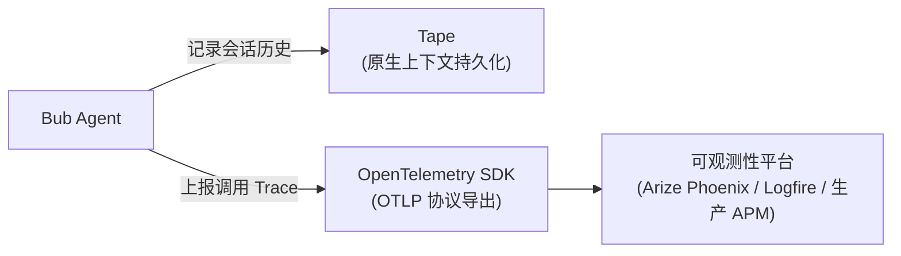

Bub 的可观测性遵循「**双轨并行**」原则：
- **状态内省（Tape）**：检查 Agent **记住了什么**、上下文窗口消耗趋势以及提示词缓存命中率（原生支持，无需外部组件）。
- **运行遥测（Traces）**：追踪每一轮对话 **具体怎么执行**、模型与工具的耗时瓶颈以及错误调用堆栈（通过 OpenTelemetry 导出到外部 APM）。



## 开始之前 {#before-you-start}

- 已[安装 Bub 应用](/zh-cn/docs/getting-started/install/#app-install)，并正确配置模型。
- 若在本地测试 Phoenix，需确保已安装 Docker 或 Podman。

## 检查 Tape {#inspect-tape}

Tape 是 Bub 内置的会话记录机制。无需任何配置，你可以直接使用内置指令查看当前会话的健康状况：

```bash
bub run "你有哪些工具？各自适合做什么？"
bub run ",tape.info"
```

预期终端输出类似：

```text
name: becda04eb9f7369c__065943a03cbe6395
entries: 98
anchors: 2
last_anchor: session/start
entries_since_last_anchor: 44
last_token_usage: 7458
last_token_cache_hit_rate: 72.50%
```


### 核心指标解读 {#core-metrics}

| 字段 | 含义与排查意义 |
|---|---|
| `entries` | 会话中记录的事件总数（含输入、输出、工具调用）。 |
| `anchors` / `last_anchor` | 历史 anchor 数量及最新上下文边界，决定模型调用的上下文起点。 |
| `entries_since_last_anchor` | 自上个 anchor 以来的新条目数；数值过高时建议通过交接（handoff）移动上下文起点。 |
| `last_token_usage` | 最近一次大模型调用的 Token 总消耗量。 |
| `last_token_cache_hit_rate` | 提示词缓存（Prompt Cache）命中率。命中率高代表响应更快且成本更低。 |

### 快速检索历史事件 {#search-events}

当需要排查工具调用是否成功或查找特定步骤时，无需手动翻看完整日志，使用 `,tape.search`：

```bash
# 检索包含循环步骤或工具调用的事件
bub run ",tape.search query=loop.step"
```

## 导出调用链 {#export-traces}

当需要分析大模型延迟、工具执行耗时与异常报错时，可通过 OpenTelemetry（OTLP）将调用链导出到专业的分析面板。

### Arize Phoenix（本地部署） {#arize-phoenix}

[Arize Phoenix](https://github.com/Arize-ai/phoenix) 是一款出色的开源 AI 遥测工具，通过 Docker 一键即可启动：

```bash
docker run --rm --name bub-phoenix \
  -p 6006:6006 \
  arizephoenix/phoenix:latest
```

启动后可在浏览器打开控制台界面：`http://localhost:6006`。

在 Bub 所在的环境中安装追踪依赖包：

```bash
# 源码安装
uv sync --extra app --extra trace

# 或发行版安装
uv add "bub[app,trace]"
```

配置标准的 OpenTelemetry 环境变量并运行任务：

```bash
export OTEL_SERVICE_NAME=bub
export OTEL_EXPORTER_OTLP_TRACES_ENDPOINT=http://localhost:6006/v1/traces
export OTEL_EXPORTER_OTLP_TRACES_PROTOCOL=http/protobuf

bub run "请使用工具列出当前工作区的文件。"
```

运行完成后，刷新 Phoenix 控制台界面，进入 Default 项目，你将看到完整的调用瀑布流，清晰展现每一次模型调用（`chat <model>`）与工具执行（`execute_tool <tool>`）的细分耗时：


### Pydantic Logfire {#pydantic-logfire}

如果你不想在本地维护 Docker 容器，可以使用 [Pydantic Logfire](https://logfire.pydantic.dev/)：

```bash
# 清除显式 OTLP 端点（让 Logfire 自动接管）
unset OTEL_EXPORTER_OTLP_TRACES_ENDPOINT OTEL_EXPORTER_OTLP_ENDPOINT

# 安装 logfire 依赖
uv add "bub[logfire]"

# 登录并绑定项目
logfire auth
logfire projects use

# 运行任务
bub run "检查这个仓库并总结它的目录结构。"
```

登录 Logfire Web 控制台，在 Agents 页面下即可实时查看 Bub 的运行调用栈与子 Agent 链路。

### Python 代码配置 {#python-config}

如果你正在通过 Python SDK 复用 Bub，也可以在程序初始化时显式启动遥测：

```python
from bub.tracing import configure_otlp

# 自动读取 OTEL_EXPORTER_OTLP_TRACES_ENDPOINT 等标准环境变量
configure_otlp()
```

## 故障排查 {#troubleshooting}

| 常见问题 | 可能原因 | 解决办法 |
| --- | --- | --- |
| Phoenix 界面中看不到任何 Trace | OTLP 协议或端点配置有误 | 确认 `OTEL_EXPORTER_OTLP_TRACES_ENDPOINT` 带有 `/v1/traces`，且协议为 `http/protobuf`。 |
| 终端提示找不到 `opentelemetry` 依赖 | 缺少 `trace` 可选依赖 | 执行 `uv sync --extra app --extra trace` 或 `pip install "bub[app,trace]"`。 |
| Logfire 无法上报数据 | 未登录或未清除 OTLP 变量 | 显式 `unset OTEL_EXPORTER_OTLP_TRACES_ENDPOINT`，并运行 `logfire auth` 重新授权。 |
| `,tape.info` 提示无活跃 Tape | 当前工作区或会话未运行过任务 | 先执行任意一条 `bub run "..."` 命令生成会话记录。 |

## 清理 {#cleanup}

停止并移除本地测试用的 Phoenix 容器：

```bash
docker rm -f bub-phoenix
unset OTEL_SERVICE_NAME OTEL_EXPORTER_OTLP_TRACES_ENDPOINT OTEL_EXPORTER_OTLP_TRACES_PROTOCOL
```
