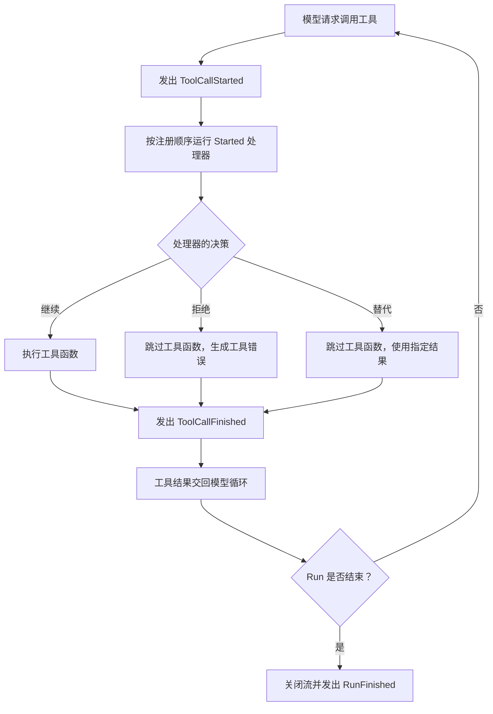

工具负责具体的业务逻辑（如查询订单或更新状态）。但在实际开发中，我们经常需要在调用前后补充额外逻辑，例如记录日志、清洗输入参数、校验权限或统计耗时。

Agent 事件提供了这些运行阶段的钩子。通过监听和处理事件，你可以在不修改工具本身的前提下，扩展 Agent 的行为。

本节将主要介绍如何监听事件并实现自定义逻辑。

## Agent 事件与 App Hooks 的区别 {#events-and-app-hooks}

在开始前，先明确 Bub 中的两种扩展机制：

| 机制 | 作用范围 | 常见用途 |
| --- | --- | --- |
| **Agent 事件** | 核心 Agent 的运行过程 | 监听模型或工具调用、修改参数、记录 Run 状态 |
| **Bub App Hooks** | Bub 应用的处理流程 | 构建提示词、提供工具、处理消息或扩展应用生命周期 |

简单来说：

* 如果你使用 `bub.core.Agent` 并想在模型或工具调用的某个阶段添加逻辑，请使用 `agent.events`。
* 如果你要编写应用插件，请参考[插件与 Hooks](/zh-cn/docs/app/plugins/)。

## 监听工具调用 {#listen-to-tool-calls}

下面以查询订单工具为例，展示如何记录日志。工具函数只负责业务查询，事件处理器负责记录调用。

```python
from bub.core import Agent
from bub.core.events import ToolCallFinished, ToolCallStarted
from bub.core.tools import tool


@tool
def get_order(order_id: str) -> dict[str, str]:
    """按订单号查询订单状态。"""
    return {"order_id": order_id, "status": "shipped"}


agent = Agent(
    tools=[get_order],
    system_prompt="用户询问订单状态时，使用 get_order 工具查询。",
)

```

使用 `agent.events.on(EventType)` 注册事件处理器。比如我们现在希望在工具执行前记录，那么就需要监听并处理 `ToolCallStarted` 事件：

```python
from bub.core.events import ToolCallStarted

@agent.events.on(ToolCallStarted)
def log_tool_start(event: ToolCallStarted) -> None:
    print(f"开始调用：{event.call.tool}")
    print(f"调用参数：{event.call.arguments}")

```

如果之后需要动态移除，可以将处理器作为函数传给 `on()` 和 `off()`：

```python
def record_tool_start(event: ToolCallStarted) -> None:
    print(f"开始调用：{event.call.tool}")


# 注册
agent.events.on(ToolCallStarted, record_tool_start)

# 注销
agent.events.off(ToolCallStarted, record_tool_start)

```

工具执行结束后，`ToolCallFinished` 会提供结果、错误信息及耗时，所以我们一样：

```python
from bub.core.events import ToolCallFinished

@agent.events.on(ToolCallFinished)
def log_tool_finish(event: ToolCallFinished) -> None:
    status = "error" if event.result.error else "ok"
    print(
        f"调用结束：{event.result.tool}，"
        f"{status}，耗时 {event.result.duration_ms}ms"
    )

```

## 工具调用流程 {#tool-call-order}

在 Agent 循环中，工具调用的基本流程如下：



`ToolCallStarted` 事件处理器会在工具运行前执行。多个处理器按注册顺序依次运行；如果某处理器设置了拒绝或替代决策，后续处理器和原工具函数将被跳过。

无论工具正常执行、被拒绝还是被替代，都会发出 `ToolCallFinished`。注意，一次工具调用结束并不代表整个 Agent 调用的结束；若需判断最终状态，请监听 `RunFinished` 事件。


## 在工具执行前修改参数 {#modify-tool-call}

除了观察调用，事件处理器还可以在工具执行前修改参数。例如，清理订单号中的空格并统一为大写：

```python
from dataclasses import replace
from bub.core.events import ToolCallStarted


@agent.events.on(ToolCallStarted)
def normalize_order_id(event: ToolCallStarted) -> None:
    if event.call.tool != "get_order":
        return

    arguments = {
        **event.call.arguments,
        "order_id": event.call.arguments["order_id"].strip().upper(),
    }
    # ToolCall 是不可变对象，使用 replace 创建新对象并重新赋值
    event.call = replace(event.call, arguments=arguments)

```

## 检查权限与决策控制 {#control-tool-call}

通过设置 `event.decision`，你可以在工具执行前决定是继续、拒绝还是使用替代结果。所以 Bub 有如下处理方式：

| 处理方式 | 原工具是否执行 | 模型收到的内容 |
| --- | --- | --- |
| 不设置决策（默认） | 是 | 工具实际返回的结果或错误 |
| 替换 `event.call` | 是 | 新调用的执行结果或错误 |
| `ToolCallDecision.deny(message)` | 否 | 拒绝原因（作为工具错误） |
| `ToolCallDecision.replace(result)` | 否 | 指定的替代结果 |


### 1. 拒绝调用 {#deny-a-call}

如果需要根据参数拦截某些操作（如禁止查询特例订单）：

```python
from bub.core.events import ToolCallDecision, ToolCallStarted


@agent.events.on(ToolCallStarted)
def check_order_access(event: ToolCallStarted) -> None:
    if (
        event.call.tool == "get_order"
        and event.call.arguments.get("order_id") == "A123"
    ):
        event.decision = ToolCallDecision.deny("当前不允许查询这个订单。")

```

设置 `ToolCallDecision.deny(...)` 后，原工具函数不会执行，拒绝原因会作为工具错误返回给模型。

### 2. 使用替代结果 {#replacement-result}

如果有直接可用的数据（如命中缓存），可以跳过工具函数并返回替代结果：

```python
@agent.events.on(ToolCallStarted)
def use_cached_order(event: ToolCallStarted) -> None:
    if (
        event.call.tool == "get_order"
        and event.call.arguments.get("order_id") == "A123"
    ):
        event.decision = ToolCallDecision.replace(
            {"order_id": "A123", "status": "shipped"}
        )

```

## 监听模型调用、单步与 Run 事件 {#other-events}

因为 Agent 的完整运行由模型交互（LLM）、单步执行（Step）和全局运行（Run）共同组成。因此除了工具层外，你还可以监听其他生命周期事件来实现如指标监控、用量统计和日志审计等逻辑。

### 1. 模型调用 {#model-calls}

在每次向大模型发起请求和收到响应时触发，常用于追踪 Token 用量、耗时或捕获大模型侧的异常：

```python
from bub.core.events import LLMCallFinished, LLMCallStarted


@agent.events.on(LLMCallStarted)
def log_llm_start(event: LLMCallStarted) -> None:
    print(f"正在请求大模型，输入消息数：{len(event.request.messages)}")


@agent.events.on(LLMCallFinished)
def log_llm_finish(event: LLMCallFinished) -> None:
    if event.result.error:
        print(f"模型调用失败：{event.result.error}")
    else:
        print(f"模型调用成功，Token 用量：{event.result.usage}")

```

### 2. 单步执行事件 {#step-events}

Agent 的一次任务（Run）通常包含多个循环步骤。一个步骤内可能包含「模型思考 → 决定调用工具 → 工具返回」多轮迭代。因此你可以通过 `StepStarted` 和 `StepFinished` 追踪 Agent 执行了多少轮迭代：

```python
from bub.core.events import StepFinished, StepStarted


@agent.events.on(StepStarted)
def log_step_start(event: StepStarted) -> None:
    print(f"--- 开始执行第 {event.step} 步 ---")


@agent.events.on(StepFinished)
def log_step_finish(event: StepFinished) -> None:
    print(f"--- 第 {event.step} 步完成 ---")

```

### 3. 全局运行事件 {#run-events}

`RunStarted` 和 `RunFinished` 用于掌控整个对话任务的起止。特别需要注意的是 `RunFinished`，它在整场运行的事件流关闭时触发（包括正常完成、异常中断或提前取消）。

```python
from bub.core.events import RunFinished, RunStarted


@agent.events.on(RunStarted)
def log_run_start(event: RunStarted) -> None:
    print("Agent 任务开始运行...")


@agent.events.on(RunFinished)
def log_run_result(event: RunFinished) -> None:
    print(f"Agent 任务结束：status={event.status}，总步数={event.steps}")
```
