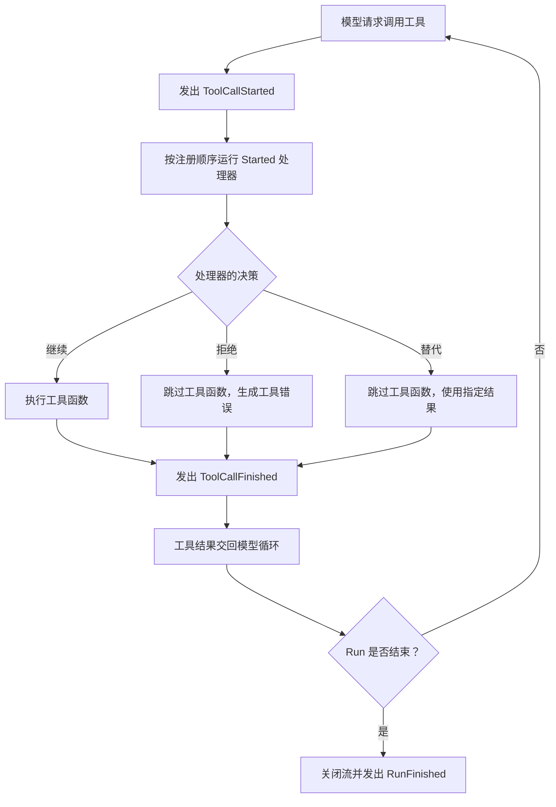

工具负责完成具体操作，例如查询订单或更新任务。实际应用通常还需要在操作前后做其他事情：记录调用情况、整理参数、检查权限，或在调用结束后统计结果。

SDK Agent 事件提供了一个接入点，让这些额外逻辑能够在 Agent 运行过程中的特定时机执行。本节会从工具调用开始，逐步介绍如何监听事件，以及如何用事件扩展工具调用前后的行为。

## SDK Agent 事件和 Bub App Hooks {#events-and-app-hooks}

Bub 提供两种相关但用途不同的扩展机制：

| 机制 | 作用范围 | 常见用途 |
| --- | --- | --- |
| SDK Agent 事件 | 核心 Agent 的运行过程 | 监听模型或工具调用、修改调用、记录 Run 状态 |
| Bub App Hooks | Bub 应用的处理流程 | 构建提示词、提供工具、处理消息或扩展应用生命周期 |

如果你直接使用 `bub.core.Agent`，并想在模型或工具调用的某个阶段添加逻辑，可以使用 `agent.events`。如果你要扩展 Bub 应用或编写应用插件，请看[插件与 Hooks](/zh-cn/docs/app/plugins/)。

## 让额外逻辑接入工具调用 {#listen-to-tool-calls}

下面先定义一个查询订单的工具，再监听它的调用。工具函数只负责查询；事件处理器则负责记录调用情况。

```python
from bub.core import Agent
from bub.core.events import ToolCallFinished, ToolCallStarted
from bub.core.tools import tool


@tool
def get_order(order_id: str) -> dict[str, str]:
    """按订单号查询订单状态。"""
    return {"order_id": order_id, "status": "shipped"}


agent = Agent(
    tools=[get_order],
    system_prompt="用户询问订单状态时，使用 get_order 工具查询。",
)
```

使用 `agent.events.on(EventType)` 注册事件处理器。工具开始执行前，`ToolCallStarted` 会通知处理器：

```python
@agent.events.on(ToolCallStarted)
def log_tool_start(event: ToolCallStarted) -> None:
    print(f"开始调用：{event.call.tool}")
    print(f"调用参数：{event.call.arguments}")
```

也可以把处理器作为参数传给 `on()`。这种写法便于之后按需移除：

```python
def record_tool_start(event: ToolCallStarted) -> None:
    print(f"开始调用：{event.call.tool}")


agent.events.on(ToolCallStarted, record_tool_start)
```

不再需要时，使用同一个事件类型和处理器函数调用 `off()`：

```python
agent.events.off(ToolCallStarted, record_tool_start)
```

用装饰器注册时，处理器函数也可以直接传给 `off()`：

```python
agent.events.off(ToolCallStarted, log_tool_start)
```

工具调用结束后，`ToolCallFinished` 会提供结果、错误和耗时：

```python
@agent.events.on(ToolCallFinished)
def log_tool_finish(event: ToolCallFinished) -> None:
    status = "error" if event.result.error else "ok"
    print(
        f"调用结束：{event.result.tool}，"
        f"{status}，耗时 {event.result.duration_ms}ms"
    )
```

这样，日志逻辑就不必写进每个工具函数。事件处理器可以集中处理多个工具调用；工具函数仍然只负责自己的业务操作。

### 一次工具调用的顺序 {#tool-call-order}

在模型循环中，工具调用前后的大致顺序如下：



`ToolCallStarted` 的处理器会在工具函数运行前完成。多个处理器按注册顺序执行；如果某个处理器设置了拒绝或替代决策，后续 `Started` 处理器不会收到这次事件。无论工具正常执行、被拒绝，还是使用替代结果，都会发出 `ToolCallFinished`，然后把结果或错误交回模型循环。

模型可能根据工具结果继续请求其他工具，也可能结束当前 Run。因此，一次工具调用结束不代表整个 Run 已结束；要观察 Run 的最终状态，应监听 `RunFinished`。

`event.call` 和 `event.result` 中包含更多信息，见[事件核心概念](/zh-cn/docs/concepts/events/)。

## 在工具执行前整理参数 {#modify-tool-call}

除了观察调用，事件处理器也可以在工具执行前修改调用。例如，清理订单号中的空格并统一字母大小写：

```python
from dataclasses import replace

from bub.core.events import ToolCallStarted


@agent.events.on(ToolCallStarted)
def normalize_order_id(event: ToolCallStarted) -> None:
    if event.call.tool != "get_order":
        return

    arguments = {
        **event.call.arguments,
        "order_id": event.call.arguments["order_id"].strip().upper(),
    }
    event.call = replace(event.call, arguments=arguments)
```

`ToolCall` 是不可变对象，不能直接修改它的字段。用 `dataclasses.replace()` 创建新的调用对象，再赋给 `event.call`。之后 Agent 执行的是修改后的调用。

## 在工具执行前检查并决定是否继续 {#control-tool-call}

有些操作不能只做参数整理，还需要在执行前检查是否允许调用。下面的处理器会拒绝查询订单 `A123`：

```python
from bub.core.events import ToolCallDecision, ToolCallStarted


@agent.events.on(ToolCallStarted)
def check_order_access(event: ToolCallStarted) -> None:
    if (
        event.call.tool == "get_order"
        and event.call.arguments.get("order_id") == "A123"
    ):
        event.decision = ToolCallDecision.deny("当前不允许查询这个订单。")
```

设置 `ToolCallDecision.deny(...)` 后，原工具函数不会执行。拒绝原因会作为工具错误交回模型；这次调用结束时，`ToolCallFinished` 仍会触发。

如果已经有可用结果，也可以跳过原工具函数，直接将替代结果交给模型：

```python
from bub.core.events import ToolCallDecision, ToolCallStarted


@agent.events.on(ToolCallStarted)
def use_cached_order(event: ToolCallStarted) -> None:
    if (
        event.call.tool == "get_order"
        and event.call.arguments.get("order_id") == "A123"
    ):
        event.decision = ToolCallDecision.replace(
            {"order_id": "A123", "status": "shipped"}
        )
```

工具调用前的几种处理方式有不同结果：

| 处理方式 | 原工具是否执行 | 模型收到什么 |
| --- | --- | --- |
| 不设置决策 | 是 | 工具实际返回的结果或错误 |
| 替换 `event.call` | 是，执行替换后的调用 | 新调用的结果或错误 |
| `ToolCallDecision.deny(message)` | 否 | 拒绝原因，作为工具错误 |
| `ToolCallDecision.replace(result)` | 否 | 指定的替代结果 |

拒绝或替代结果只影响当前工具调用，不会自动结束整个 Run。完整决策行为见[事件核心概念：调用前控制](/zh-cn/docs/concepts/events/#call-control)。

## 监听模型调用和 Run {#other-events}

工具调用之外，SDK Agent 也会在模型调用和 Run 生命周期的关键时刻发出事件。

例如，可以用 `LLMCallFinished` 记录模型用量或错误：

```python
from bub.core.events import LLMCallFinished


@agent.events.on(LLMCallFinished)
def log_model_result(event: LLMCallFinished) -> None:
    if event.result.error:
        print(f"模型调用失败：{event.result.error}")
    else:
        print(f"模型用量：{event.result.usage}")
```

也可以用 `RunFinished` 查看一次 Run 的最终状态：

```python
from bub.core.events import RunFinished


@agent.events.on(RunFinished)
def log_run_result(event: RunFinished) -> None:
    print(f"Run 结束：status={event.status}，steps={event.steps}")
```

`RunFinished` 在 Run 的事件流关闭时触发，包括提前取消的情况。模型和工具的 `Finished` 事件不一定覆盖所有取消路径，因此统计 Run 的最终状态时，可以使用 `RunFinished`。

SDK 还提供了 `LLMCallStarted`、`RunStarted`、`StepStarted`、`StepFinished` 和 `MessagesPending` 等事件。完整列表和各事件的字段见[事件核心概念](/zh-cn/docs/concepts/events/)。
