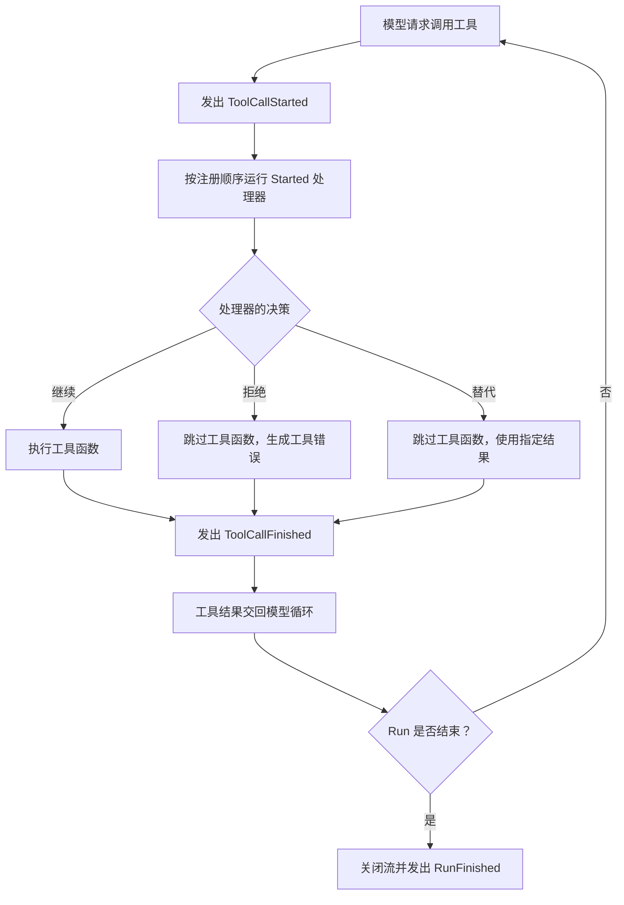

工具负责具体的业务逻辑（如查询订单或更新状态）。但在实际开发中，我们经常需要在调用前后补充额外逻辑，例如记录日志、清洗输入参数、校验权限或统计耗时。

Agent 事件提供了这些运行阶段的钩子。通过监听和处理事件，你可以在不修改工具本身的前提下，扩展 Agent 的行为。三类数据如何分工、同步分发有哪些规则，见 [Agent 事件](/zh-cn/docs/concepts/events/#three-kinds)。

## Agent 事件与 App Hooks 的区别 {#events-and-app-hooks}

两者的职责边界见[与 App Hooks 的分工](/zh-cn/docs/concepts/events/#app-hooks)。在 SDK 中，通过 `agent.events` 在模型或工具调用阶段添加逻辑。

## 注册与注销 {#register}

`EventBus.on()` 既可以直接注册，也可以作为装饰器；`off()` 移除处理器：

```python
from bub.core.events import StepFinished, ToolCallStarted


def record_tool_start(event: ToolCallStarted) -> None:
    print(f"开始调用：{event.call.tool}")


# 注册
agent.events.on(ToolCallStarted, record_tool_start)

# 装饰器写法等价
@agent.events.on(ToolCallStarted)
def log_tool_start(event: ToolCallStarted) -> None:
    print(f"调用参数：{event.call.arguments}")


# 注销
agent.events.off(ToolCallStarted, record_tool_start)
```

注册到基类的处理器也会接收子类事件：监听 `AgentEvent` 可以统一处理所有事件，监听 `TapeEvent` 则能拿到 `event.tape`。处理器可以是同步函数，也可以是 `async def`。

## 监听工具调用 {#listen-to-tool-calls}

下面以查询订单工具为例，展示如何记录日志。工具函数只负责业务查询，事件处理器负责记录调用。

```python
from bub.core import Agent
from bub.core.events import ToolCallStarted
from bub.core.tools import tool


@tool
def get_order(order_id: str) -> dict[str, str]:
    """按订单号查询订单状态。"""
    return {"order_id": order_id, "status": "shipped"}


agent = Agent(
    tools=[get_order],
    system_prompt="用户询问订单状态时，使用 get_order 工具查询。",
)

```

工具执行结束后，`ToolCallFinished` 提供结果、错误信息及耗时：

```python
from bub.core.events import ToolCallFinished

@agent.events.on(ToolCallFinished)
def log_tool_finish(event: ToolCallFinished) -> None:
    status = "error" if event.result.error else "ok"
    print(
        f"调用结束：{event.result.tool}，"
        f"{status}，耗时 {event.result.duration_ms}ms"
    )

```

## 工具调用流程 {#tool-call-order}

在 Agent 循环中，工具调用的基本流程如下：



`ToolCallStarted` 事件处理器会在工具运行前执行。多个处理器按注册顺序依次运行；如果某处理器设置了拒绝或替代决策，后续处理器和原工具函数将被跳过。

无论工具正常执行、被拒绝还是被替代，都会发出 `ToolCallFinished`。注意，一次工具调用结束并不代表整个 Agent 调用的结束；若需判断最终状态，请监听 `RunFinished` 事件。

通过 代码模式 的 `tools.<name>()` 和文本命令发起的工具调用同样发出这两个事件。

## 在工具执行前修改参数 {#modify-tool-call}

除了观察调用，事件处理器还可以在工具执行前修改参数。例如，清理订单号中的空格并统一为大写：

```python
from dataclasses import replace
from bub.core.events import ToolCallStarted


@agent.events.on(ToolCallStarted)
def normalize_order_id(event: ToolCallStarted) -> None:
    if event.call.tool != "get_order":
        return

    arguments = {
        **event.call.arguments,
        "order_id": event.call.arguments["order_id"].strip().upper(),
    }
    # ToolCall 是不可变对象，使用 replace 创建新对象并重新赋值
    event.call = replace(event.call, arguments=arguments)

```

## 检查权限与决策控制 {#control-tool-call}

通过设置 `event.decision`，可以在工具执行前继续、拒绝或使用替代结果。四种处理的语义见[决策先于副作用](/zh-cn/docs/concepts/events/#call-control)，下面展示具体写法。

### 1. 拒绝调用 {#deny-a-call}

如果需要根据参数拦截某些操作（如禁止查询特例订单）：

```python
from bub.core.events import ToolCallDecision, ToolCallStarted


@agent.events.on(ToolCallStarted)
def check_order_access(event: ToolCallStarted) -> None:
    if (
        event.call.tool == "get_order"
        and event.call.arguments.get("order_id") == "A123"
    ):
        event.decision = ToolCallDecision.deny("当前不允许查询这个订单。")

```

设置 `ToolCallDecision.deny(...)` 后，原工具函数不会执行。模型循环会把拒绝作为工具错误交回模型；直接命令没有模型可以接收这个错误，因此向调用方抛出该错误。

### 2. 使用替代结果 {#replacement-result}

如果有直接可用的数据（如命中缓存），可以跳过工具函数并返回替代结果：

```python
@agent.events.on(ToolCallStarted)
def use_cached_order(event: ToolCallStarted) -> None:
    if (
        event.call.tool == "get_order"
        and event.call.arguments.get("order_id") == "A123"
    ):
        event.decision = ToolCallDecision.replace(
            {"order_id": "A123", "status": "shipped"}
        )

```

### 3. 修改模型调用 {#control-llm-call}

`LLMCallStarted` 上可以替换整个请求，或直接产生输出而跳过供应商：

```python
from dataclasses import replace

from bub.core.events import LLMCallDecision, LLMCallStarted


@agent.events.on(LLMCallStarted)
def guard_llm_call(event: LLMCallStarted) -> None:
    if event.request.max_tokens and event.request.max_tokens > 8000:
        event.request = replace(event.request, max_tokens=8000)
    if event.state.get("offline"):
        event.decision = LLMCallDecision.finish("当前处于离线演示模式。")
```

## 自定义事件 {#custom-events}

事件对象是普通 dataclass，继承 `AgentEvent` 即可发布；需要携带当前 Tape 时继承 `TapeEvent`：

```python
from dataclasses import dataclass

from bub.core.events import TapeEvent


@dataclass(kw_only=True)
class OrderReviewed(TapeEvent):
    order_id: str


@agent.events.on(OrderReviewed)
async def record_review(event: OrderReviewed) -> None:
    await event.tape.append_event("order.reviewed", {"order_id": event.order_id})


async def mark_reviewed() -> None:
    tape = agent.tape("customer-42")
    await agent.events.emit(
        OrderReviewed(state=tape.context.state, tape=tape, order_id="A123")
    )
```

几点约定：

- `TapeRecorder` 不会自动记录自定义事件，上例显式写入了一条。
- Tracing 与 Tape 记录相互独立：关闭 tracing 不会停止 `TapeRecorder`，也不会禁用对话和工具往返的 Tape 记录。
- 自定义事件没有内置的 `decision` 协议。需要返回数据时定义可变字段；需要让决策结束派发时覆写 `stopped` 属性。
- 工具可以通过 `context.events` 发布事件。

## 监听模型调用、单步与 Run 事件 {#other-events}

Agent 的执行有三个可观测粒度：模型调用（LLMCall）、Step 和 Run，可以分别监听来做指标、用量统计和日志审计。

### 1. 模型调用 {#model-calls}

```python
from bub.core.events import LLMCallFinished, LLMCallStarted


@agent.events.on(LLMCallStarted)
def log_llm_start(event: LLMCallStarted) -> None:
    print(f"正在请求大模型，输入消息数：{len(event.request.messages)}")


@agent.events.on(LLMCallFinished)
def log_llm_finish(event: LLMCallFinished) -> None:
    if event.result.error:
        print(f"模型调用失败：{event.result.error}")
    else:
        print(f"模型调用成功，Token 用量：{event.result.usage}")

```

### 2. 单步执行事件 {#step-events}

`StepFinished` 的 `status` 说明本步之后运行是否继续（`continue`）或结束（`ok`）：

```python
from bub.core.events import StepFinished, StepStarted


@agent.events.on(StepStarted)
def log_step_start(event: StepStarted) -> None:
    print(f"--- 开始执行第 {event.step} 步 ---")


@agent.events.on(StepFinished)
def log_step_finish(event: StepFinished) -> None:
    print(f"--- 第 {event.step} 步完成：{event.status}，{event.elapsed_ms}ms ---")

```

设置 `StepFinished.next_prompt` 可以为继续 Run 的下一个 Step 提供一条用户消息；`MessagesPending` 处理器则通过 `event.messages` 补入 Run 期间到达的消息。

### 3. Run 事件 {#run-events}

`RunStarted` 和 `RunFinished` 用于掌控整个任务的起止。特别需要注意的是 `RunFinished`，它在整场运行的事件流关闭时触发（包括正常完成、异常中断或提前取消）。尚未迭代就关闭的 Run 以 `cancelled` 结束，Step 数为零。

```python
from bub.core.events import RunFinished, RunStarted


@agent.events.on(RunStarted)
def log_run_start(event: RunStarted) -> None:
    print("Agent 任务开始运行...")


@agent.events.on(RunFinished)
def log_run_result(event: RunFinished) -> None:
    print(f"Agent 任务结束：status={event.status}，总步数={event.steps}")
```

完整事件列表、字段与触发时机见 [Python API：事件](/zh-cn/docs/reference/python-api/#events)。
