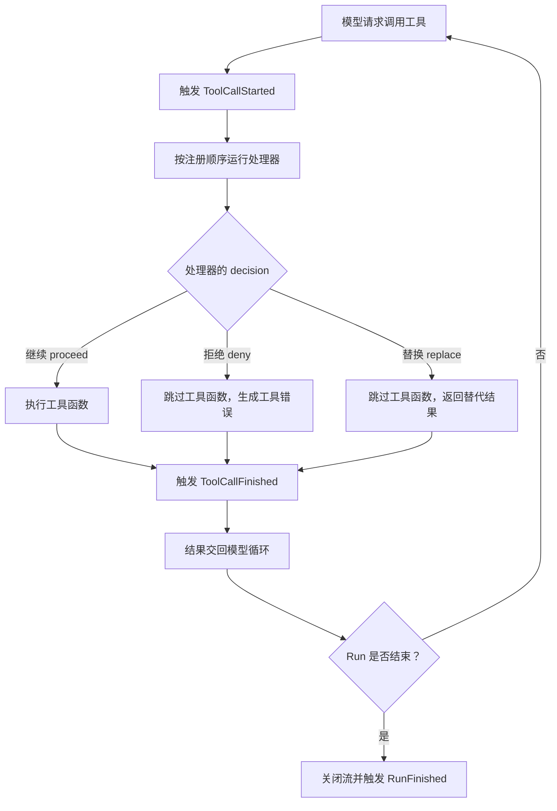

工具负责具体的业务逻辑（比如查询订单或更新状态），但在实际开发中，我们经常需要在调用前后补充额外逻辑——记录日志、清洗参数、校验权限或统计耗时。通过 `agent.events` 事件总线，你可以在不修改工具函数本身的前提下，把这些横切逻辑优雅地挂上去。

三种数据类型的区分与同步分发规则见 [Agent 事件](/zh-cn/docs/concepts/events/#three-kinds)；与 App Hooks（`@hookimpl`）的对比见[Agent 事件与 App Hooks 的区别](/zh-cn/docs/concepts/events/#app-hooks)。

## 注册与注销处理器 {#register}

`agent.events.on()` 支持直接调用或作为装饰器使用；`off()` 用于移除处理器：

```python "agent.events.on" "agent.events.off"
from bub.core.events import ToolCallStarted


def record_tool_start(event: ToolCallStarted) -> None:
    print(f"开始调用：{event.call.tool}")


# 直接注册
agent.events.on(ToolCallStarted, record_tool_start)


# 装饰器注册
@agent.events.on(ToolCallStarted)
def log_tool_start(event: ToolCallStarted) -> None:
    print(f"调用参数：{event.call.arguments}")


# 注销
agent.events.off(ToolCallStarted, record_tool_start)
```

处理器支持同步函数和 `async def` 异步函数。注册到基类的处理器会收到其所有子类事件（如监听 `AgentEvent` 可接收全部事件，监听 `TapeEvent` 可接收所有含 `event.tape` 的事件）。

## 监听工具调用 {#listen-to-tool-calls}

下面以查询订单工具为例，看看怎样把「查订单」和「记日志」解耦：工具函数只管业务查询，事件处理器负责记录调用。先定义工具并初始化 Agent：

```python
from bub.core import Agent
from bub.core.tools import tool


@tool
def get_order(order_id: str) -> dict[str, str]:
    """按订单号查询订单状态。"""
    return {"order_id": order_id, "status": "shipped"}


agent = Agent(
    tools=[get_order],
    system_prompt="用户询问订单状态时，使用 get_order 工具查询。",
)
```

监听 `ToolCallFinished` 记录工具执行结果与耗时：

```python
from bub.core.events import ToolCallFinished


@agent.events.on(ToolCallFinished)
def log_tool_finish(event: ToolCallFinished) -> None:
    status = "error" if event.result.error else "ok"
    print(f"调用结束：{event.result.tool}，{status}，耗时 {event.result.duration_ms}ms")
```

## 工具事件执行顺序 {#tool-call-order}

在 Agent 循环中，一次工具调用会按以下路径流转：



- 多个 `ToolCallStarted` 处理器按注册顺序执行；一旦某个处理器设置了 `deny` 或 `replace`，后续处理器和原工具函数都会被跳过。
- 无论工具正常执行、被拒绝还是被替换，都会触发 `ToolCallFinished`。注意：一次工具调用结束并不代表整个 Agent 运行结束；若需判断最终状态，请监听 `RunFinished`。
- 代码模式中的 `tools.<name>()` 和直接命令触发的工具调用，同样会发出这两个事件。

## 在执行前修改工具参数 {#modify-tool-call}

除了观察调用，事件处理器还可以在工具执行前清洗或改写参数。因为 `ToolCall` 是不可变对象，在 `ToolCallStarted` 处理器中用 `dataclasses.replace()` 替换 `event.call` 即可（例如去除订单号首尾空格并转为大写）：

```python {14}
from dataclasses import replace
from bub.core.events import ToolCallStarted


@agent.events.on(ToolCallStarted)
def normalize_order_id(event: ToolCallStarted) -> None:
    if event.call.tool != "get_order":
        return

    arguments = {
        **event.call.arguments,
        "order_id": event.call.arguments["order_id"].strip().upper(),
    }
    event.call = replace(event.call, arguments=arguments)
```

## 拦截调用与替换结果 {#control-tool-call}

在工具真正执行前，你还可以通过设置 `event.decision` 来做权限校验、直接拦截或返回缓存结果（详细语义见[调用前拦截与控制](/zh-cn/docs/concepts/events/#call-control)）：

### 1. 拒绝工具调用 {#deny-a-call}

```python "ToolCallDecision.deny"
from bub.core.events import ToolCallDecision, ToolCallStarted


@agent.events.on(ToolCallStarted)
def check_order_access(event: ToolCallStarted) -> None:
    if event.call.tool == "get_order" and event.call.arguments.get("order_id") == "A123":
        event.decision = ToolCallDecision.deny("无权查询该订单。")
```

设置 `ToolCallDecision.deny(...)` 后，原工具不会执行。模型循环会将拒绝原因作为工具错误传回模型；若是直接命令调用，则直接向调用方抛出异常。

### 2. 返回替代结果 {#replacement-result}

命中缓存或 Mock 时，跳过工具函数并直接返回指定结果：

```python "ToolCallDecision.replace"
@agent.events.on(ToolCallStarted)
def use_cached_order(event: ToolCallStarted) -> None:
    if event.call.tool == "get_order" and event.call.arguments.get("order_id") == "A123":
        event.decision = ToolCallDecision.replace({"order_id": "A123", "status": "shipped"})
```

### 3. 修改或跳过模型调用 {#control-llm-call}

在 `LLMCallStarted` 中可修改请求参数（如限制 `max_tokens`），或用 `LLMCallDecision.finish(text)` 跳过模型请求直接返回文本：

```python "LLMCallDecision.finish"
from dataclasses import replace
from bub.core.events import LLMCallDecision, LLMCallStarted


@agent.events.on(LLMCallStarted)
def guard_llm_call(event: LLMCallStarted) -> None:
    if event.request.max_tokens and event.request.max_tokens > 8000:
        event.request = replace(event.request, max_tokens=8000)
    if event.state.get("offline"):
        event.decision = LLMCallDecision.finish("当前处于离线演示模式。")
```

## 发布自定义事件 {#custom-events}

除了监听内置事件，你也可以在业务代码中定义并发布自己的事件。事件对象就是一个普通的 Python `dataclass`，继承 `AgentEvent`（或需要当前会话 Tape 时继承 `TapeEvent`）即可：

```python "class OrderReviewed(TapeEvent):" "await agent.events.emit"
from dataclasses import dataclass
from bub.core.events import TapeEvent


@dataclass(kw_only=True)
class OrderReviewed(TapeEvent):
    order_id: str


@agent.events.on(OrderReviewed)
async def record_review(event: OrderReviewed) -> None:
    await event.tape.append_event("order.reviewed", {"order_id": event.order_id})


async def mark_reviewed() -> None:
    tape = agent.tape("customer-42")
    await agent.events.emit(
        OrderReviewed(state=tape.context.state, tape=tape, order_id="A123")
    )
```

注意事项：

- **需显式写入 Tape**：内置的 `TapeRecorder` 不会自动记录自定义事件；如需持久化到会话历史，请在处理器中调用 `event.tape.append_event(...)`。
- **自定义字段与停止分发**：自定义事件不含 `decision` 属性。可在事件类上定义可变字段回传数据，或覆写 `stopped` 属性提前停止分发。
- **在工具内发事件**：工具函数可通过 `context.events.emit(...)` 发布事件。

## 监听模型、Step 与 Run 事件 {#other-events}

除了工具调用，Agent 的运行还提供了三个层级的生命周期事件：模型调用、Step 和 Run。你可以按需监听它们来收集监控指标、统计 Token 用量或记录审计日志。

### 1. 模型调用事件 {#model-calls}

```python
from bub.core.events import LLMCallFinished, LLMCallStarted


@agent.events.on(LLMCallStarted)
def log_llm_start(event: LLMCallStarted) -> None:
    print(f"请求模型，消息数：{len(event.request.messages)}")


@agent.events.on(LLMCallFinished)
def log_llm_finish(event: LLMCallFinished) -> None:
    if event.result.error:
        print(f"模型调用失败：{event.result.error}")
    else:
        print(f"模型调用成功，用量：{event.result.usage}")
```

### 2. Step 事件 {#step-events}

每完成一次「模型推理 + 工具执行」触发一次 `StepFinished`。`event.status` 为 `"continue"` 表示还需进入下一步，为 `"ok"` 表示已得出最终回答：

```python
from bub.core.events import StepFinished, StepStarted


@agent.events.on(StepStarted)
def log_step_start(event: StepStarted) -> None:
    print(f"--- Step {event.step} 开始 ---")


@agent.events.on(StepFinished)
def log_step_finish(event: StepFinished) -> None:
    print(f"--- Step {event.step} 结束：{event.status}，{event.elapsed_ms}ms ---")
```

在 `StepFinished`（当 `status == "continue"` 时）设置 `event.next_prompt` 可向下一轮推理追加用户提示；监听 `MessagesPending` 并向 `event.messages` 追加内容，则可注入运行期间到达的外部引导消息。

### 3. Run 事件 {#run-events}

`RunStarted` 和 `RunFinished` 分别在整次 Run 开始和**事件流关闭时**触发。若创建了 `agent.run()` 但未迭代流就直接关闭，`RunFinished` 会以 `status="cancelled"`、`steps=0` 触发：

```python
from bub.core.events import RunFinished, RunStarted


@agent.events.on(RunStarted)
def log_run_start(event: RunStarted) -> None:
    print("Run 开始...")


@agent.events.on(RunFinished)
def log_run_result(event: RunFinished) -> None:
    print(f"Run 结束：status={event.status}，steps={event.steps}")
```

所有事件类的字段定义见 [Python API：事件](/zh-cn/docs/reference/python-api/#events)。
