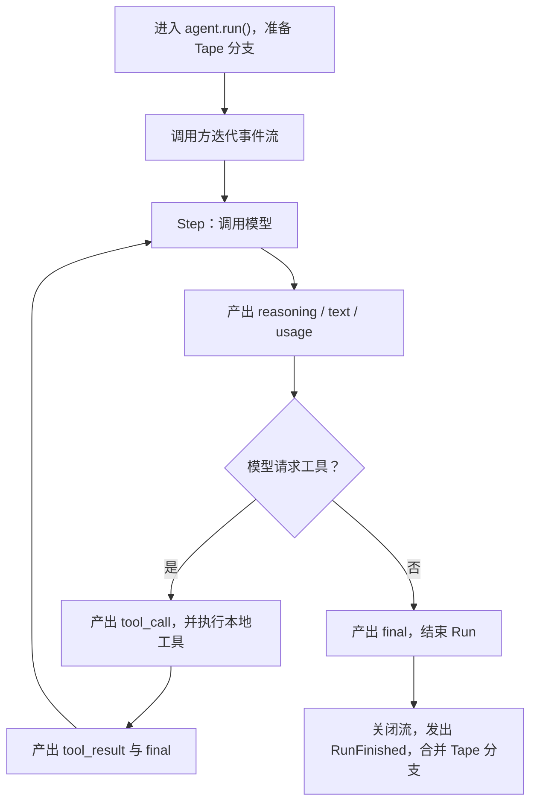

`bub.core.Agent` 是可以嵌入宿主程序的 Agent 内核。它负责驱动模型与工具循环，但不替你管理 Web 框架、配置文件或渠道生命周期。

这组文档分为两部分：

1. **Agent 循环**：运行最小助手，理解事件流。
2. **[工具](/zh-cn/docs/sdk/tools/)**：通过独立的订单查询场景，学习工具契约与错误处理。
3. **[记忆与 Tape](/zh-cn/docs/sdk/tape/)**：用两轮简短对话理解历史、上下文和持久化。
4. **[事件](/zh-cn/docs/sdk/events/)**：通过独立的退款场景，学习审计与执行前拦截。
5. **[综合案例：FastAPI Todo 后端](/zh-cn/docs/sdk/web-service/)**：把前面的能力组装成一个完整的 FastAPI 后端服务。

前几节的小例子彼此独立，不需要保留上一节的代码。最后的综合案例会把这些知识串起来。如果你不想自行组装这些组件，而是希望复用 Bub 应用的配置、技能、插件或完整 Turn，请直接阅读[复用 Bub 应用](/zh-cn/docs/integrations/reuse-app/)。

## 运行第一个 Agent {#quickstart}

安装核心包。`bub` 已包含 `republic`，这里用它创建模型连接：

```bash
uv init bub-first-agent
cd bub-first-agent
uv add bub
```

创建 `main.py`：

```python
import asyncio

import republic

from bub.core import Agent


async def main() -> None:
    agent = Agent(
        system_prompt="你是一个简洁、可靠的助手。不确定时直接说明，不要编造事实。",
        max_steps=6,
    )

    async with republic.get_model("openai:gpt-5-mini") as model:
        async with agent.run(
            "用三句话解释：为什么 Agent 有时需要调用工具？",
            model=model,
            tape="quickstart",
            options={"max_tokens": 512},
            state={"session_id": "quickstart"},
        ) as stream:
            async for event in stream:
                if event.kind == "text":
                    print(event.data["delta"], end="", flush=True)
        print()


if __name__ == "__main__":
    asyncio.run(main())
```

设置模型凭据并运行：

```bash
export REPUBLIC_OPENAI_API_KEY=sk-...
uv run python main.py
```

你会看到回答逐段打印，而不是等整段生成完后一次出现。

`options` 会传给本次 Run 的每次模型调用。模型连接由宿主的 `async with` 管理；退出 Run 时，Agent 不会替你关闭它。

## Run 和 Step 有什么区别 {#run-and-step}

一次 `agent.run()` 是一个 **Run**，也就是一次完整的用户请求。

一个 Run 包含一个或多个 **Step**。每个 Step 调用一次模型；如果模型请求工具，Bub 执行工具，再带着工具结果进入下一 Step：



当前例子没有工具，通常只需要一个 Step。下一节加入工具后，就能看到多个 Step 如何衔接。

## 消费事件流，Agent 才会继续工作 {#consume-the-stream}

进入 `agent.run()` 后，Bub 会准备会话并发出 `RunStarted`。但模型与工具循环是由 `async for` 按需推进的：只创建流、不消费它，Agent 不会自己跑完。

始终使用 `async with`：

```python
async with agent.run(prompt, model=model, tape="quickstart") as stream:
    async for event in stream:
        ...
```

这样即使提前 `break`、发生异常或任务被取消，流也会被关闭。未正常跑完的 Run 以 `cancelled` 结束。关闭时，已经写入分支的记录默认仍会合并回主 Tape；这不是事务回滚，详见[记忆与 Tape](/zh-cn/docs/sdk/tape/#forks-and-merges)。

### 不要在第一个 `final` 处结束响应 {#final-event}

`final` 表示**当前 Step 结束**，不一定是整个 Run 结束。工具调用后也会产生 `final`，随后可能还有下一 Step。

因此，无论返回 HTTP 响应还是通知前端“全部完成”，都应等待事件流迭代结束。

## 按事件类型读取数据 {#stream-events}

不同 `kind` 的 `event.data` 结构不同：

| `kind` | 关键载荷 | 含义 |
| --- | --- | --- |
| `reasoning` | `{"delta": "..."}` | 模型提供的推理增量 |
| `text` | `{"delta": "..."}` | 面向用户的文本增量 |
| `tool_call` | `{"tool_calls": [{"id", "name", "arguments"}, ...]}` | 一次模型响应请求的工具调用；`arguments` 是 JSON 字符串 |
| `tool_result` | `{"tool_results": [...]}` | 与工具调用顺序对应的结果；一般工具错误也在这里返回给模型 |
| `usage` | `{"usage": {...}, "elapsed_seconds": ...}` | 当前 Step 的模型用量 |
| `final` | `{"ok": True, "text": ...}` 或工具调用与结果 | 当前 Step 的汇总 |

例如，只打印文本和工具名称：

```python
async for event in stream:
    if event.kind == "tool_call":
        for call in event.data["tool_calls"]:
            print(f"模型请求调用：{call['name']}")
    elif event.kind == "text":
        print(event.data["delta"], end="", flush=True)
```

工具事件包含列表，不是单个 `name` 和 `args`。是否把 `reasoning`、工具参数或工具结果转发给终端用户，是宿主的产品与安全决策；不要默认把所有事件原样暴露出去。

## 异常和资源由谁负责 {#stream-lifecycle}

模型、存储和事件处理器的异常可能直接从事件迭代中抛出。**不要只等待一个 `error` 事件来代替异常处理**：

```python
try:
    async with agent.run(prompt, model=model, tape="quickstart") as stream:
        async for event in stream:
            ...
except Exception as exc:
    # 记录服务端异常，并向调用方返回稳定的错误响应。
    report_error(exc)
```

工具参数校验失败或普通工具异常通常会转换成工具结果，让模型看到失败并调整后续回答；这与中断整个 Run 的异常不同。

组装应用前，先明确每类资源由谁负责：

| 资源 | 所有者与结束时机 |
| --- | --- |
| 模型连接 | 宿主创建并关闭，通常覆盖整个应用生命周期 |
| Run 事件流 | `async with agent.run(...)`，退出时关闭 |
| 单次 Run 的 `state` | 本次 Run 内共享，不会自动持久化 |
| Tape 分支记录 | 流关闭时默认合并；`merge_back=False` 可丢弃记录 |
| 工具产生的外部副作用 | 业务代码负责；关闭流或丢弃 Tape 都不会回滚 |

下一节用一个独立的订单查询例子，看看工具如何进入这个循环：[工具](/zh-cn/docs/sdk/tools/)。
