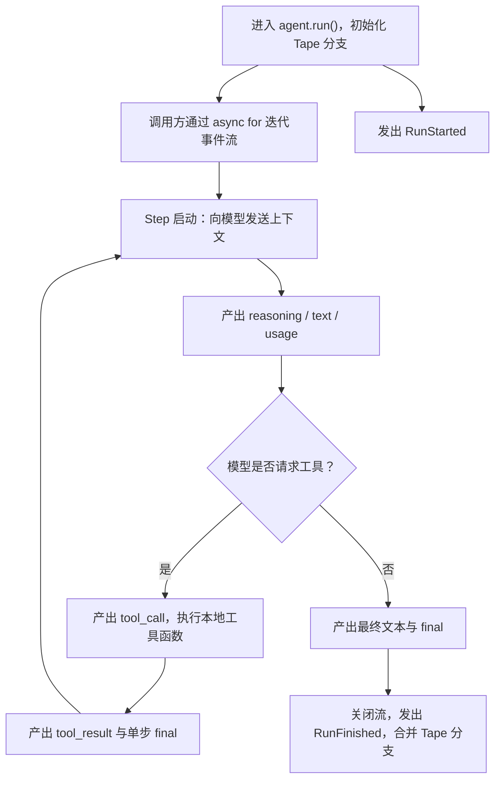

`bub.core.Agent` 是 `bub` 的最小内核，负责驱动大模型与本地工具之间的交互循环。你可以直接将它嵌入任何 Python 服务、后端框架或自定义脚本中。

在 [快速上手](/zh-cn/docs/getting-started/quickstart/) 中我们已经体验过如何初始化并运行一个 Agent：

```py
import asyncio
import republic
from bub.core import Agent


async def main() -> None:
    # 初始化核心 Agent，指定系统提示词
    agent = Agent(system_prompt="Be concise.")

    # 使用 republic 获取底层大模型连接
    async with republic.get_model("openai:gpt-5-mini") as model:
        # 启动一次 Run，指定对话 Tape 名称
        async with agent.run("What can you do?", model=model, tape="demo") as stream:
            async for event in stream:
                if event.kind == "text":
                    print(event.data.get("delta", ""), end="", flush=True)


asyncio.run(main())
```

本文介绍如何消费运行流、处理流式事件并管理 Tape；Run、Step 与 Turn 的定义见 [Agent 循环](/zh-cn/docs/concepts/agent/#loop)。

## 1. 运行流程 {#run-and-step}

下面是一次包含工具调用的多步 Run：



## 2. 消费事件流 {#consume-the-stream}

进入 `agent.run()` 后，`bub` 会初始化会话并发出 `RunStarted`，但底层的模型与工具循环采用了**惰性求值（Lazy Evaluation）**设计：只有当你通过消费事件流时，Agent 才会真正开始步进和工作。仅仅创建上下文而不消费流，任务将不会执行。下面是一个简单的例子：

```python
async with agent.run(prompt, model=model, tape="quickstart") as stream:
    async for event in stream:
        ...
```

始终建议将 `agent.run()` 放在 `async with` 上下文管理器中，这样可以确保无论是因为正常跑完、中途异常退出还是被外部取消，底层连接和流都能被安全清理。未正常跑完的 Run 会以 `cancelled` 状态收尾。

所有事件你均可以通过 `event.kind` 来获取。

:::caution
当出现 `final` 事件时，仅表示**当前 Step 的结束**，而不是整个 Run 的终点。
如果模型在当前 Step 请求调用了工具，工具执行完毕后，Agent 必然会带着工具结果进入下一个 Step，并产生新的事件。因此，无论你是向客户端返回流式响应，还是统计任务完成状态，都必须**等待整个 `async for event in stream` 循环完整结束**才开始执行。
:::

## 3. 事件类型与数据 {#stream-events}

在迭代 `stream` 时，你会收到不同 `kind` 的事件。每个事件的 `event.data` 数据结构如下：

| 事件类型 | `event.data` 示例 | 说明 |
| --- | --- | --- |
| `reasoning` | `{"delta": "..."}` | 模型思考过程（Chain of Thought / Reasoning）的文本增量 |
| `text` | `{"delta": "..."}` | 面向用户的正式回复文本增量 |
| `tool_call` | `{"tool_calls": [{"id", "name", "arguments"}, ...]}` | 模型请求调用的工具列表（`arguments` 为 JSON 字符串） |
| `tool_result` | `{"tool_results": [...]}` | 与工具调用顺序对应的执行结果，异常信息也在此回传给模型 |
| `usage` | `{"usage": {...}, "elapsed_seconds": ...}` | 当前 Step 的模型 Token 消耗量与耗时统计 |
| `final` | `{"ok": True, "text": ...}` 或工具汇总 | 当前 Step 的汇总结果 |

因为，在宿主程序中，通常需要根据 `event.kind` 分流处理，这也就是为什么叫 Agent 循环，因为本质上就是在一个循环中不断分流处理事件：

```python
async for event in stream:
    if event.kind == "tool_call":
        for call in event.data["tool_calls"]:
            print(f"[{event.step_index}] 模型请求调用工具：{call['name']}")
    elif event.kind == "text":
        print(event.data["delta"], end="", flush=True)
```

## 4. Tape 与记忆分支管理 {#tape-management}

示例中的 `tape="demo"` 指定本次 Run 使用的历史记录。连续对话、持久化以及分支合并的操作见 [SDK：Tape 与记忆](/zh-cn/docs/sdk/tape/)，历史与模型上下文的区别见 [Tape 概念](/zh-cn/docs/concepts/tape/)。
