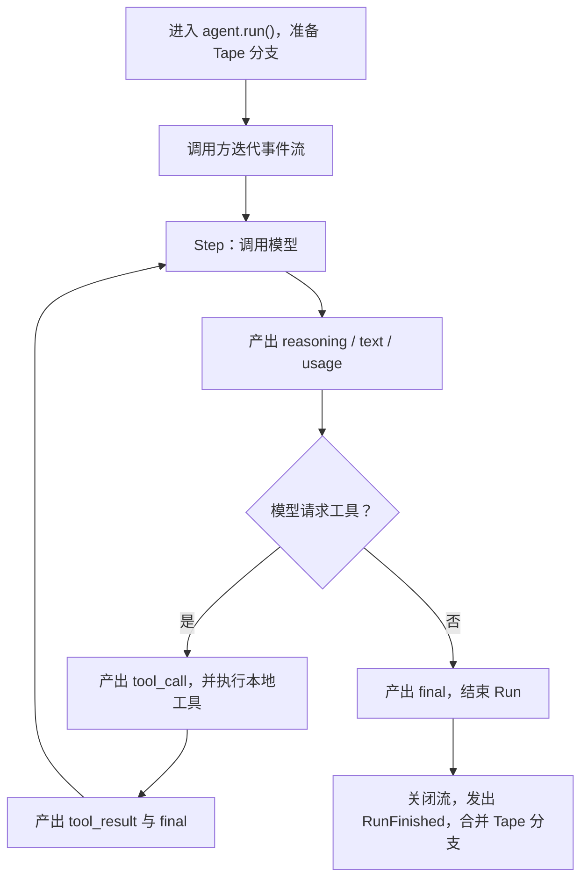

`bub.core.Agent` 是一个嵌入宿主程序的 Agent 内核：它驱动模型与工具循环，但不替你管理 Web 框架、配置发现或渠道生命周期。

这组教程会逐步构建同一个**订单助手**，最后将它组装成支持多轮记忆和 SSE 的 FastAPI 服务：

1. **Agent 循环**：运行最小助手，理解事件流。
2. **[工具](/zh-cn/docs/sdk/tools/)**：让模型查询订单，处理参数、返回值和工具错误。
3. **[记忆与 Tape](/zh-cn/docs/sdk/tape/)**：跨请求保存会话，区分历史与模型上下文。
4. **[事件](/zh-cn/docs/sdk/events/)**：增加审计日志，并在退款前执行权限策略。
5. **[综合案例：FastAPI 服务](/zh-cn/docs/sdk/web-service/)**：处理应用生命周期、同会话并发和流式输出。

如果你不想自行组装这些组件，而是希望复用 Bub 应用的配置、技能、插件或完整 Turn，请直接阅读[复用 Bub 应用](/zh-cn/docs/integrations/reuse-app/)。

## 创建第一个助手 {#quickstart}

安装核心包。`bub` 已包含 `republic`，这里用它创建模型连接：

```bash
uv init bub-order-agent
cd bub-order-agent
uv add bub
```

创建 `main.py`：

```python
import asyncio

import republic

from bub.core import Agent


async def main() -> None:
    agent = Agent(
        system_prompt="你是订单客服助手。回答简洁；不知道订单信息时明确说明。",
        max_steps=6,
    )

    async with republic.get_model("openai:gpt-5-mini") as model:
        async with agent.run(
            "你能帮我处理哪些订单问题？",
            model=model,
            tape="customer-42",
            options={"max_tokens": 512},
            state={"session_id": "customer-42"},
        ) as stream:
            async for event in stream:
                if event.kind == "text":
                    print(event.data["delta"], end="", flush=True)
                elif event.kind == "reasoning":
                    print(event.data["delta"], end="", flush=True)
        print()


if __name__ == "__main__":
    asyncio.run(main())
```

设置模型凭据并运行：

```bash
export REPUBLIC_OPENAI_API_KEY=sk-...
uv run python main.py
```

`options` 会传递给本次 Run 的每次模型调用。模型连接由宿主的 `async with` 管理；Agent 不会在退出 Run 时替你关闭这个连接。

## Run、Step 与事件流 {#how-the-loop-works}

一次 `agent.run()` 是一个 **Run**。每个 Run 包含一个或多个 **Step**：每个 Step 调用一次模型，执行模型请求的工具；有工具调用时，再用工具结果进入下一 Step。



### 消费事件才会推进模型循环

进入 `agent.run()` 会准备会话并发出 `RunStarted`，但模型与工具循环由 `async for` 按需推进。不要只创建流而不消费它。

`async with` 负责关闭流，包括提前 `break`、异常和取消。尚未正常跑完就关闭的 Run 以 `cancelled` 结束。默认情况下，关闭时已经写入分支的记录仍会合并回主 Tape；这不等于事务回滚，详见[记忆与 Tape](/zh-cn/docs/sdk/tape/#forks-and-merges)。

### `final` 表示 Step 结束，不一定是 Run 结束

工具调用后也会产生 `final`，随后可能还有下一 Step。因此，不要用收到第一个 `final` 作为 HTTP 响应或前端“全部完成”的依据；应等待事件流迭代结束。

## 正确处理事件载荷 {#stream-events}

不同 `kind` 的 `event.data` 结构不同。工具事件包含列表，不是单个 `name` 和 `args`：

| `kind` | 关键载荷 | 含义 |
| --- | --- | --- |
| `reasoning` | `{"delta": "..."}` | 模型提供的推理增量 |
| `text` | `{"delta": "..."}` | 面向用户的文本增量 |
| `tool_call` | `{"tool_calls": [{"id", "name", "arguments"}, ...]}` | 一次模型响应请求的工具调用；`arguments` 是 JSON 字符串 |
| `tool_result` | `{"tool_results": [...]}` | 与工具调用顺序对应的结果；一般工具错误也在这里返回给模型 |
| `usage` | `{"usage": {...}, "elapsed_seconds": ...}` | 当前 Step 的模型用量 |
| `final` | `{"ok": True, "text": ...}` 或工具调用与结果 | 当前 Step 的汇总 |

例如，观察工具名称而不暴露参数：

```python
async for event in stream:
    if event.kind == "tool_call":
        for call in event.data["tool_calls"]:
            print(f"模型请求调用：{call['name']}")
    elif event.kind == "text":
        print(event.data["delta"], end="", flush=True)
```

是否把 `reasoning`、工具参数或工具结果转发给终端用户，是宿主的产品与安全决策；不要默认把所有事件原样暴露出去。

## 流的生命周期、异常与资源边界 {#stream-lifecycle}

模型、存储和事件处理器的异常可能直接从事件迭代中抛出。**不要只等待一个 `error` 事件来代替异常处理**：

```python
try:
    async with agent.run(prompt, model=model, tape="customer-42") as stream:
        async for event in stream:
            ...
except Exception as exc:
    # 记录服务端异常，并向调用方返回稳定的错误响应。
    report_error(exc)
```

工具参数校验失败或普通工具异常通常会转换成工具结果，让模型看到失败并调整后续回答；这与中断整个 Run 的异常不同。

在组装服务时，先明确每类资源由谁负责：

| 资源 | 所有者与结束时机 |
| --- | --- |
| 模型连接 | 宿主创建并关闭，通常覆盖整个应用生命周期 |
| Run 事件流 | `async with agent.run(...)`，退出时关闭 |
| 单次 Run 的 `state` | 本次 Run 内共享，不会自动持久化 |
| Tape 分支记录 | 流关闭时默认合并；`merge_back=False` 可丢弃记录 |
| 工具产生的外部副作用 | 业务代码负责；关闭流或丢弃 Tape 都不会回滚 |

下一步给这个助手增加订单查询能力：[工具](/zh-cn/docs/sdk/tools/)。
