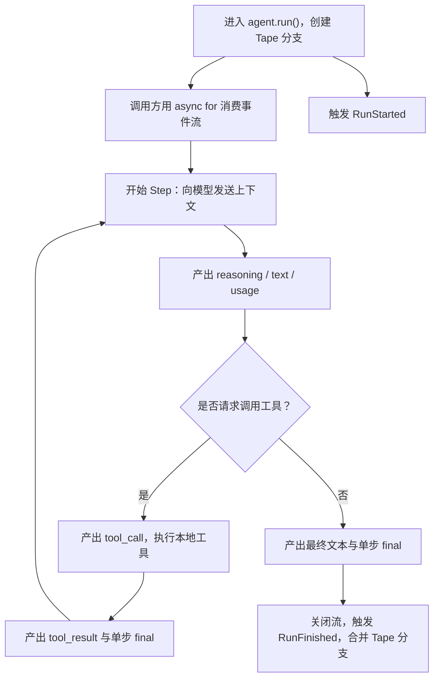

`bub.core.Agent` 是 Bub 的最小内核，负责驱动模型与本地工具的交互循环。你可以将它直接嵌入任何 Python 服务、后端框架或脚本。

在[快速上手](/zh-cn/docs/getting-started/quickstart/)中我们已经体验过如何初始化并运行一个 Agent：

```py title="main.py" {8, 13}
import asyncio
import republic
from bub.core import Agent


async def main() -> None:
    # 创建 Agent 并设置系统提示词
    agent = Agent(system_prompt="Be concise.")

    # 通过 republic 连接大模型
    async with republic.get_model("openai:gpt-5-mini") as model:
        # 启动一次 Run 并指定会话 Tape 名称
        async with agent.run("What can you do?", model=model, tape="demo") as stream:
            async for event in stream:
                if event.kind == "text":
                    print(event.data.get("delta", ""), end="", flush=True)


asyncio.run(main())
```

接下来我们重点看看如何消费运行流、处理各类流式事件，以及用 Tape 管理记忆。Run、Step 与 Turn 的概念说明见 [Agent 循环](/zh-cn/docs/concepts/agent/#loop)。

## 1. 运行流程 {#run-and-step}

一次包含工具调用的 Run 按以下流程推进：



## 2. 消费事件流 {#consume-the-stream}

进入 `agent.run()` 后，Bub 会初始化会话并触发 `RunStarted`，但底层循环采用了**惰性执行**设计：只有当你用 `async for` 迭代事件流时，模型推理与工具调用才会真正开始——仅仅创建上下文而不消费流，任务并不会运行。

```python
async with agent.run(prompt, model=model, tape="quickstart") as stream:
    async for event in stream:
        ...
```

请始终在 `async with` 块中使用 `agent.run()`，以确保无论正常结束、抛出异常还是被取消，底层流和连接都能安全关闭。未迭代完就被关闭的 Run 状态为 `cancelled`。

:::caution
`event.kind == "final"` 仅代表**当前 Step 结束**，不代表整次 Run 结束。若模型在当前 Step 调用了工具，Agent 会带着工具结果继续进入下一个 Step 并产出新事件。请以整个 `async for event in stream` 循环自然结束作为 Run 完成的标志。
:::

## 3. 流事件类型 {#stream-events}

在迭代 `stream` 时，你会按顺序收到不同 `kind` 的事件。通过 `event.kind` 和 `event.data` 读取每条流式事件：

| `event.kind` | `event.data` 结构 | 说明 |
| --- | --- | --- |
| `reasoning` | `{"delta": "..."}` | 模型思考过程的文本增量 |
| `text` | `{"delta": "..."}` | 面向用户的回复文本增量 |
| `tool_call` | `{"tool_calls": [{"id", "name", "arguments"}, ...]}` | 模型请求调用的工具列表（`arguments` 为 JSON 字符串） |
| `tool_result` | `{"tool_results": [...]}` | 工具执行结果列表（与 `tool_calls` 顺序对应，含错误结果） |
| `usage` | `{"usage": {...}, "elapsed_seconds": ...}` | 当前 Step 的 Token 用量与耗时 |
| `final` | `{"ok": True, "text": ...}` 或工具汇总 | 当前 Step 的结束汇总 |

在宿主程序中，通常只需要在循环里按 `event.kind` 分流处理你关心的事件：

```python
async for event in stream:
    if event.kind == "tool_call":
        for call in event.data["tool_calls"]:
            print(f"调用工具：{call['name']}")
    elif event.kind == "text":
        print(event.data["delta"], end="", flush=True)
```

## 4. Tape 与会话记忆 {#tape-management}

示例中的 `tape="demo"` 指定了本次 Run 读写的会话记录名称。想要了解多轮对话、持久化存储与分支合并，可以继续阅读 [SDK：Tape 与记忆](/zh-cn/docs/sdk/tape/)；历史与模型上下文的区别见 [Tape 概念](/zh-cn/docs/concepts/tape/)。
