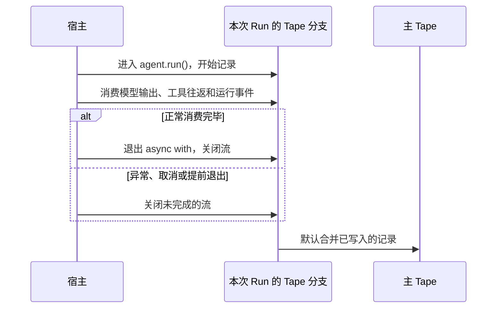

如果每次请求都只把当前消息交给模型，Agent 就无法接续之前的对话。要让它记得用户刚才说过什么，需要保存运行记录，并在下一轮把相关历史交给模型。

Bub 用 **Tape** 保存对话、工具往返和运行记录，再用 **TapeContext** 决定哪些记录进入下一次模型输入。可以把 Tape 想成 Agent 的记忆库：它保存经历；TapeContext 则挑选这次回答需要回想的内容。

## 让 Agent 记住上一轮对话 {#remember-previous-turn}

先让用户告诉 Agent 一个回答偏好，再在下一轮询问它。关键是两次 `agent.run()` 使用同一个 Tape 名称：

```python
import asyncio

import republic

from bub.core import Agent


async def run_turn(agent: Agent, model, prompt: str) -> None:
    async with agent.run(prompt, model=model, tape="demo-user") as stream:
        async for event in stream:
            if event.kind == "text":
                print(event.data["delta"], end="", flush=True)
    print()


async def main() -> None:
    agent = Agent(
        system_prompt="你是一个简洁的助手，并记住用户明确提出的回答偏好。",
        max_steps=6,
    )

    async with republic.get_model("openai:gpt-5-mini") as model:
        await run_turn(agent, model, "以后请用简短的编号清单回答。记住了吗？")
        await run_turn(agent, model, "我偏好什么回答格式？")


if __name__ == "__main__":
    asyncio.run(main())
```

两个 Run 都使用 `tape="demo-user"`，所以第二轮可以接续第一轮的对话。这里使用默认的 `InMemoryTapeStore`：它能在同一个 Agent 实例的多个 Run 之间保留记录，但进程退出后就会丢失。如果每个请求都重新创建 Agent，即使 Tape 名称相同，也不会共享默认的内存历史。

## 保存记忆，让进程重启后也能继续 {#persist-memory}

要在进程退出后保留对话，可以给 Agent 配置 `FileTapeStore`：

```python
from pathlib import Path

from bub.core import Agent
from bub.core.store import FileTapeStore


agent = Agent(
    store=FileTapeStore(Path("sessions")),
    system_prompt="你是一个简洁的助手，并记住用户明确提出的回答偏好。",
)
```

再次运行程序时，使用同一个存储目录和 Tape 名称即可读取先前记录。上面的会话会保存在 `sessions/demo-user.jsonl`。

`InMemoryTapeStore` 适合测试和临时脚本；`FileTapeStore` 适合单机开发和单节点服务；需要数据库或分布式存储时，可以实现自定义存储。存储的完整接口和数据库示例见[存储集成](/zh-cn/docs/integrations/storage/)。

## Tape 保存历史，TapeContext 决定模型能看到什么 {#history-and-context}

保存下来的所有记录不一定都会放进下一次模型请求。Tape 有两个常用的读取视图：

| 你想了解什么 | 读取方式 | 含义 |
| --- | --- | --- |
| Tape 里记录了什么 | `tape.query()` / `store.fetch_all()` | 原始历史，包括消息、工具往返、anchor 和运行事件 |
| 下一次模型能看到什么 | `tape.read_messages()` | TapeContext 投影出来的模型上下文 |

可以在两轮对话后分别查看它们：

```python
tape = agent.tape("demo-user")
entries = list(await tape.store.fetch_all(tape.query()))
messages = await tape.read_messages()

print("历史条目：", [entry.kind for entry in entries])
print("模型消息：", [message.role for message in messages])
```

默认的 `default_tape_context()` 会选择最近一个 anchor 之后的对话和工具往返，并过滤普通运行事件。因此，某条记录可以留在历史中供查询，却不会自动占用模型上下文。

`agent.session()` 和 `agent.start()` 会为新会话创建 `session/start` anchor。显式调用 `handoff()` 会把默认上下文起点向前移动，但不会删除之前的历史，也不会自动生成摘要。需要调整历史选择方式时，见 [Tape 核心概念：上下文](/zh-cn/docs/concepts/tape/#context)。

## 本次运行的数据应该放在哪里 {#state-and-metadata}

`state`、`metadata` 和 Tape 都能关联运行数据，但生命周期和用途不同：

| 数据 | 适合存什么 | 是否自动持久化或进入模型输入 |
| --- | --- | --- |
| `state={...}` | 本次 Run 内共享的请求数据、权限或回调 | 不会自动持久化，也不会自动恢复 |
| `metadata={...}` | Run 级别的观测信息，例如请求标识 | 记录在运行信息中，但不会自动进入模型提示 |
| Tape 条目 | 跨 Run 保存的对话、工具往返或业务事实 | 会保存；是否进入模型输入由 TapeContext 决定 |

例如，请求 ID 可以放入 `state` 和观测元数据；需要稍后查询的订单备注可以显式追加到 Tape；希望模型在下一轮自然接续的对话，则依赖消息记录和上下文投影。

如果工具需要读取本次 Run 的状态，可以用 `ToolContext`：

```python
from bub.core.tools import ToolContext, tool


@tool(context=True)
async def add_order_note(note: str, *, context: ToolContext) -> str:
    """向当前会话追加一条订单备注。"""
    await context.tape.append_event(
        "order.note",
        {"text": note, "request_id": context.state.get("request_id")},
    )
    return "备注已记录。"
```

普通业务事件写入 Tape 后不会自动成为模型输入。如果希望模型在后续 Run 中看到这些数据，需要让 TapeContext 以合适的方式选入它们。工具如何取得 `ToolContext`，见[工具：给工具传入本次 Run 的数据](/zh-cn/docs/sdk/tools/#tool-context)。

## Run 结束时，记录会怎样处理 {#forks-and-merges}

每次 `agent.run()` 都会在 Tape 分支上记录本次运行的新条目。流关闭时，Bub 默认把已写入的记录合并回主 Tape：



默认合并发生在流关闭时，不要求 Run 成功完成。这意味着网络异常、任务取消或提前退出后，已经写入分支的部分对话和运行记录仍可能保留在主 Tape 中。`RunFinished` 的 `ok`、`error` 和 `cancelled` 描述 Run 的状态，不是数据库事务的提交或回滚。

如果某次运行的记录不应保留，可以设置 `merge_back=False`：

```python
async with agent.run(
    prompt,
    model=model,
    tape="preview-demo",
    merge_back=False,
) as stream:
    async for event in stream:
        ...
```

这只会丢弃本次 Run 的 Tape 分支记录，不会撤销已经执行的工具操作或其他外部副作用。工具写入、发送邮件等副作用仍由业务代码负责，见[工具：工具结果和错误会怎样处理](/zh-cn/docs/sdk/tools/#results-and-errors)。

## 选择记忆存储 {#storage}

通过 `Agent(store=...)` 选择 Tape 的存储位置：

| 存储 | 生命周期 | 适用场景 |
| --- | --- | --- |
| `InMemoryTapeStore`（默认） | 当前 Agent 实例与进程 | 测试、临时脚本 |
| `FileTapeStore` | 每个 Tape 一个 `.jsonl` 文件 | 单机 CLI、开发环境、单节点服务 |
| 自定义 `TapeStore` / `AsyncTapeStore` | 由宿主实现决定 | Redis、SQL、分布式存储 |

自定义存储协议提供 `list_tapes`、`reset`、`fetch_all` 和 `append` 等操作。完整协议见[Python API](/zh-cn/docs/reference/python-api/)；数据库接入示例见[存储集成](/zh-cn/docs/integrations/storage/)。

`FileTapeStore` 会把 Tape 名称用于文件名。Web 服务应使用服务端生成的安全标识，或严格限制名称字符与长度；多租户服务还应把租户和用户身份纳入会话命名空间。

## 同一会话的多个请求需要宿主协调 {#concurrency}

两个 Run 同时使用同一个 Tape 名称时，会各自基于启动时可见的历史创建分支。Bub Core 不会替应用决定这些请求应该排队、覆盖还是交错执行。

- 不同会话通常可以并行。
- 同一会话的后续请求如果依赖前一次结果，应由宿主按会话串行处理。
- `asyncio.Lock` 只能协调单个进程；`FileTapeStore` 不提供跨 worker 或跨实例的锁。

[FastAPI 综合案例](/zh-cn/docs/sdk/web-service/)展示了单进程会话锁及其边界。下一节会介绍如何监听 Agent 运行过程，并在工具调用前后添加逻辑：[事件](/zh-cn/docs/sdk/events/)。
