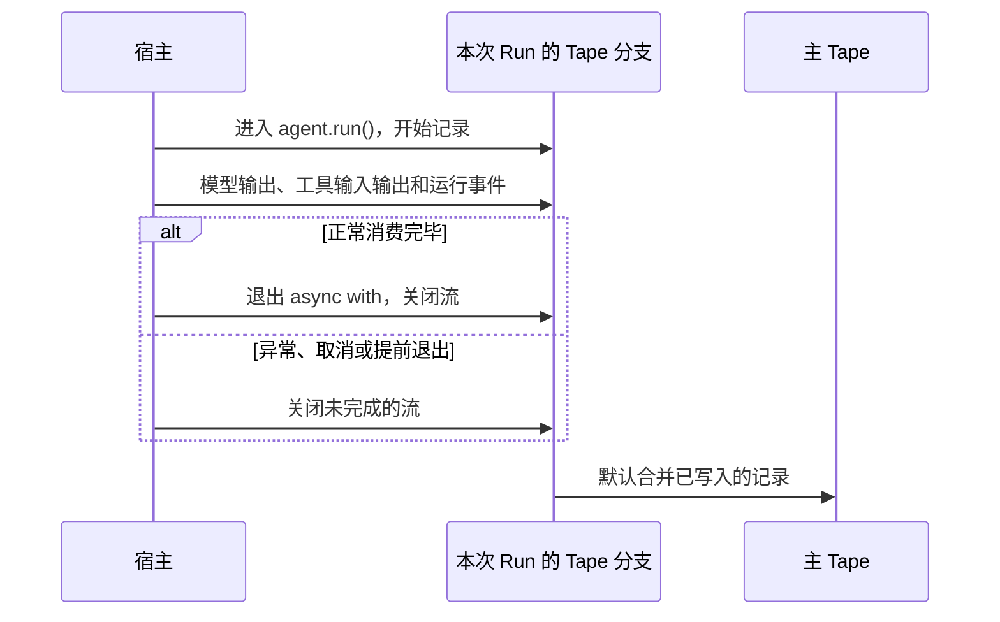

如果每次请求都只把当前消息交给模型，Agent 就无法接续之前的对话。要让它记得你刚才说过什么，就需要保存对话记录，并在下一轮请求中把相关历史交给模型。

Bub 用 [Tape](/zh-cn/docs/concepts/tape/) 保存对话、工具调用输入输出和运行记录，让你的 Agent 可以具备记忆和连续对话的能力。

## 连续对话 {#remember-previous-turn}

要让模型能与你连续对话或记住你所说的，关键在于调用 `agent.run()` 时要使用同一个 Tape 名称：

```python
import asyncio

import republic

from bub.core import Agent


async def run_turn(agent: Agent, model, prompt: str) -> None:
    async with agent.run(prompt, model=model, tape="demo-user") as stream:
        async for event in stream:
            if event.kind == "text":
                print(event.data["delta"], end="", flush=True)
    print("DONE")


async def main() -> None:
    agent = Agent(
        system_prompt="你是一个简洁的助手，并记住用户明确提出的回答偏好。",
        max_steps=6,
    )

    async with republic.get_model("openai:gpt-5-mini") as model:
        await run_turn(agent, model, "以后请用简短的编号清单回答。记住了吗？")
        await run_turn(agent, model, "我偏好什么回答格式？")


if __name__ == "__main__":
    asyncio.run(main())

```

两次调用都使用 `demo-user` 这一 Tape 记忆，所以第二轮可以接续第一轮的对话。Bub 默认使用 `InMemoryTapeStore` 来存储 Tape，但当你进程退出后就会丢失。此外，如果每个请求都重新创建 Agent，即使 Tape 名称相同，也不会共享默认的内存历史。

## 记忆持久化 {#persist-memory}

Bub 内置了一个 `FileTapeStore`，用于帮助你将 Tape 以持久化的方式写入到本地，后续即便退出进程重新进入时也能恢复历史对话，前提是你必须在创建 Agent 时配置：

```python
from pathlib import Path

from bub.core import Agent
from bub.core.store import FileTapeStore

agent = Agent(
    store=FileTapeStore(Path("sessions")),
    system_prompt="你是一个简洁的助手，并记住用户明确提出的回答偏好。",
)

```

于是再次运行程序时，使用同一个存储目录和 Tape 名称即可读取历史记录。于是上面的会话会保存在 `sessions/demo-user.jsonl` 文件中。

### 存储方案怎么选？ {#storage}

| 存储 | 生命周期 | 适用场景 |
| --- | --- | --- |
| `InMemoryTapeStore`（默认） | 当前 Agent 实例与进程 | 测试、临时脚本 |
| `FileTapeStore` | 每个 Tape 一个 `.jsonl` 文件 | 单机 CLI、开发环境、单节点服务 |
| 自定义 `TapeStore` / `AsyncTapeStore` | 由宿主实现决定 | Redis、SQL、分布式存储 |

:::note[注意事项]

* `FileTapeStore` 会把 Tape 名称用于文件名。如 Tape 名称由用户传入，需进行必要安全校验，如严格限制名称字符与长度或使用随机生成的标识；对于多租户服务还应把租户和用户身份纳入会话命名空间。
* 面向生产时建议自定义并实现 Tape 存储。完整协议见 [Python API](/zh-cn/docs/reference/python-api/#tape)。也可参考数据库接入示例见 [存储集成](/zh-cn/docs/integrations/storage/)。
:::

## TapeContext {#history-and-context}

在 Bub 中，**Tape** 与模型上下文（Messages）是有严格区分的：

* **Tape（完整日志）**：是只追加（Append-only）的底层事件流，记录了用户输入、大模型回复、工具调用、工具返回、Anchor 以及所有自定义业务事件。
* **TapeContext（投影逻辑）**：决定了“如何从 Tape 中挑选并转换出大模型能够直接消费的消息列表”。

通过 `agent.tape(name)` 可以获取指定的 Tape 实例。你可以分别查看原始日志与投射后的模型消息：

```python
tape = agent.tape("demo-user")

# 1. 获取 Tape 里的所有原始底层条目
entries = list(await tape.query().all())

# 2. 获取经过 TapeContext 投影后，下一次模型实际能看到的消息
messages = await tape.read_messages()

print("Tape 原始条目类型：", [entry.kind for entry in entries])
print("大模型看到的角色：", [message.role for message in messages])

```

### 默认上下文与自定义 {#default-context}

每个 Agent 都绑定了一个 `context`（默认是 `default_tape_context()`）。上面的 `agent` 等价于：

```python
from bub.core import Agent, default_tape_context

agent = Agent(
    context=default_tape_context(),  # 默认值：每个 agent.tape(name) 都会携带它
    # ...
)

```

### TapeContext 的构成 {#tape-context-fields}

`TapeContext` 是一个数据类，控制着上下文的裁剪与转换行为。其核心字段包括：

| 字段 | 默认值 | 作用说明 |
| --- | --- | --- |
| `anchor` | `LAST_ANCHOR` | 过滤锚点（见下文）：只读取最近一个 anchor 之后的条目；可传具体的 anchor 名称字符串，或传 `None` 表示不按 anchor 过滤。 |
| `select` | `None` | 自定义转换函数：将选中的 Tape 条目转换为模型消息列表。若为 `None`，则使用运行时内置的标准转换规则（支持标准消息、工具往返等）。 |
| `state` | `{}` | 关联的临时状态字典。每次 `agent.run(state=...)` 或 `agent.tape(state=...)` 都会写入这里，工具内部的 `ToolContext.state` 访问的也是同一个字典。 |

:::tip[关于类与工厂函数]
直接调用 `TapeContext()` 构造的是一个极简的底层基础上下文（通常仅处理基础文本消息）；而 `default_tape_context()` 是官方提供的 **全功能工厂函数**，能够完美处理多轮对话、工具调用（`tool_call` / `tool_result`）与 Anchor。

如果你想保留默认的所有强大特性，只是想更改一下起始的 `anchor`，推荐使用 Python 标准库的 `dataclasses.replace()` 进行微调：

```python
from dataclasses import replace
from bub.core import Agent, default_tape_context

agent = Agent(
    context=replace(default_tape_context(), anchor="order-reviewed"),
    # ...
)

```

:::

### 临时切换读取模式 {#read-with-another-context}

如果你不想修改 Agent 默认的上下文配置，只是想在某次读取时换一种视角（例如临时跳过 anchor 限制查看全量对话），可以使用 `tape.with_context()`：

```python
from bub.core import default_tape_context

tape = agent.tape("demo-user")

# 临时创建一个不按 anchor 过滤、使用默认转换规则的上下文来读取全部消息
full_messages = await tape.with_context(
    replace(default_tape_context(), anchor=None)
).read_messages()

```

这只改变本次读取的行为，不会修改 Tape 本身的存储，也不会影响 Agent 后续的调用。

### anchor 和 handoff {#anchors-and-handoff}

随着对话轮次增加，Tape 记录会无限增长，但大模型的上下文窗口是有限的。Bub 采用 **Anchor（锚点）** 机制来实现“只移动模型读取起点，而不丢弃历史记录”。

* **Anchor**：Tape 中的一个特殊边界标记，带有名称和可选的 `state`。默认的 `TapeContext` 配合 `anchor=LAST_ANCHOR` 时，只会将“最近一个 anchor 之后”的条目投影给模型。更早的历史依然完整躺在 Tape 中，可随时通过 `tape.query().all()` 查询。
* **Handoff**：向 Tape 写入一个 anchor 的操作。它表示“当前阶段已完成，进入下一阶段”，随后默认上下文的读取起点自动后移。

:::tip
Handoff 不是自动摘要器。它不会主动删除旧消息或自动生成摘要。如果需要摘要，应当在 handoff 之前由大模型生成摘要文本，然后显式存入 Tape 或随新提示词一同提交。
:::

需要说明的是：

* 当调用 `agent.run()`、`agent.start()` 或 `agent.session()` 开启新会话时，如果 Tape 中尚无 anchor，系统会自动写入一个名为 `session/start` 的初始 anchor。
* 仅仅调用 `agent.tape(name)` 获取引用不会自动创建 anchor。如果一个手动初始化的空 Tape 没有任何 anchor，直接用默认的 `LAST_ANCHOR` 读取会抛出错误。对于完全空白的 Tape，要么先执行一次 `run()`，要么显式调用 `handoff()`，或者在读取时使用 `TapeContext(anchor=None)`。

### 手动执行 Handoff {#manual-handoff}

你可以在业务逻辑的关键节点（如订单确认、步骤切换）手动写入 anchor：

```python
tape = agent.tape("demo-user")

await tape.handoff(
    name="order-reviewed",
    state={"summary": "订单 A123 已完成审核并通过。"},
)

```

* `name`：后续可以通过 `TapeContext(anchor="order-reviewed")` 作为起点重新切入。
* `state`：可以携带该阶段的结构化快照供应用层读取。

Handoff 之后，默认的 `read_messages()` 将只会加载该 anchor 之后的对话，但历史数据依然完好：

```python
# 获取所有历史 anchor 列表及其状态
anchors = await tape.anchors()

# 依然可以查询到最原始、完整的历史条目
history = list(await tape.query().all())

```

### 该怎么使用它们？ {#when-to-use-anchors}

| 需求场景 | 推荐做法 |
| --- | --- |
| 业务阶段推进（如：查完物流后进入售后） | 当前阶段结束时调用 `await tape.handoff(name="after-shipping")` |
| 希望从某个历史存档点恢复上下文 | 配置 `TapeContext(anchor="存档名称")` |
| 需要获取绝对完整的上帝视角历史 | 配置 `TapeContext(anchor=None)` |
| 应对超长上下文溢出 | 在触发大模型长度报错时，系统会自动兜底执行一次 `handoff(name="auto_handoff/context_overflow")` 并重试 |

## 数据应该放在哪 {#state-and-metadata}

在[工具](/zh-cn/docs/sdk/tools/#tool-context)一节中，我们展示过如何通过 `state` 临时传递数据；而本节的 Tape 用于持久化记忆。此外，Bub 还提供了 `metadata` 这么一个参数入口，方便设置某些观测数据或请求标识以满足链路追踪等需要。

所以它们能持有运行数据，但生命周期和用途不同：

| 数据 | 适合存什么 | 限制 |
| --- | --- | --- |
| `state={...}` | 调用内共享临时数据 | 不会自动持久化，也不会自动恢复 |
| `metadata={...}` | 调用级别的观测信息，例如请求标识 | 记录在运行信息中，但不会自动进入模型提示词中 |
| Tape 记录 | 不同调用的对话、工具输入输出结果等 | 会保存；是否进入模型输入由 TapeContext 决定 |

例如，请求 ID 可以放入 `state` 和观测元数据；需要稍后查询的订单备注可以显式追加到 Tape；希望模型在下一轮自然接续的对话，则依赖消息记录和上下文投影。

```python
from bub.core.tools import ToolContext, tool

@tool(context=True)
async def add_order_note(note: str, *, context: ToolContext) -> str:
    """向当前会话追加一条订单备注。"""
    await context.tape.append_event(
        "order.note",
        {"text": note, "request_id": context.state.get("request_id")},
    )
    return "备注已记录。"

```

普通业务事件写入 Tape 后不会自动成为模型输入。如果希望模型在后续调用中看到这些数据，需要用 TapeContext 以合适的方式选入它们。

## 调用结束时如何处理会话历史 {#forks-and-merges}

每次 `agent.run()` 都会在 Tape 分支上记录本次运行的新条目。当调用流关闭时，Bub 默认把已写入的记录合并回主 Tape，见如下时序图：



默认合并发生在流关闭时，不要求调用成功完成。这意味着网络异常、任务取消或提前退出后，已经写入分支的部分对话和运行记录仍可能保留在主 Tape 中。如果不想保留某次运行记录，可以设置 `merge_back=False` 参数：

```python
async with agent.run(
    prompt,
    model=model,
    tape="preview-demo",
    merge_back=False,
) as stream:
    async for event in stream:
        ...

```

这将丢弃本次调用的 Tape 分支记录，但不会撤销**已经执行的工具操作或其他外部副作用**。

## 会话限制 {#concurrency}

当两个不同的 Agent 同时使用同一个 Tape 名称时，会各自基于启动时可见的历史创建分支。Bub 不会替你决定这些请求应该排队、覆盖还是交错执行。所以对于同一会话 Tape 被使用时，如同一会话的后续请求如果依赖前一次结果，应由宿主按会话串行处理；如果涉及到并发或者跨 Worker 或实例调用，那么需要考虑会话锁的问题。
