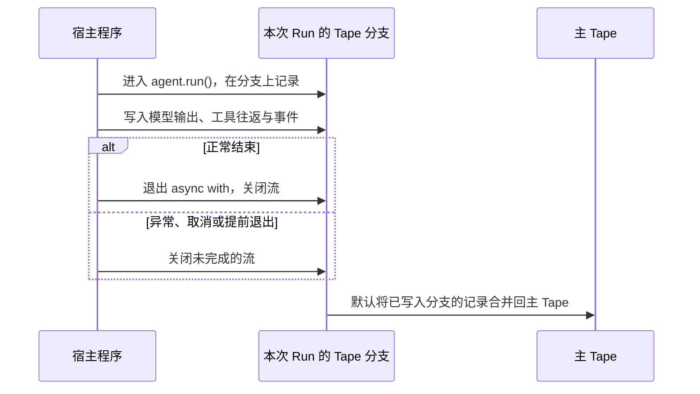

如果每次请求都只把当前消息交给模型，Agent 就无法接续之前的对话。要让它记得你刚才说过什么，就需要保存对话记录，并在下一轮请求中把相关历史交给模型。Bub 用 Tape 保存对话消息、工具调用往返和运行事件，让 Agent 具备多轮记忆能力。Tape 与模型上下文的分工见 [Tape 与模型上下文](/zh-cn/docs/concepts/tape/#history-and-context)。

## 保持多轮连续对话 {#remember-previous-turn}

要让模型能与你连续对话、记住你的偏好，关键在于多次调用 `agent.run()` 时传入同一个 `tape` 名称：

```python 'tape="demo-user"'
import asyncio
import republic
from bub.core import Agent


async def run_turn(agent: Agent, model, prompt: str) -> None:
    async with agent.run(prompt, model=model, tape="demo-user") as stream:
        async for event in stream:
            if event.kind == "text":
                print(event.data["delta"], end="", flush=True)
    print("\nDONE")


async def main() -> None:
    agent = Agent(
        system_prompt="你是一个简洁的助手，记住用户要求的回答格式。",
        max_steps=6,
    )

    async with republic.get_model("openai:gpt-5-mini") as model:
        await run_turn(agent, model, "以后请用简短的编号清单回答。记住了吗？")
        await run_turn(agent, model, "我偏好什么回答格式？")


if __name__ == "__main__":
    asyncio.run(main())
```

`Agent` 默认使用内存存储 `InMemoryTapeStore`：数据仅在当前 `Agent` 实例与当前进程内有效，进程退出或每次请求新建 `Agent` 实例都会丢失历史。

## 持久化到磁盘或数据库 {#persist-memory}

如果你想让记忆在进程重启后依然保留，可以传入 Bub 内置的 `FileTapeStore`，将每个 Tape 持久化为本地 `.jsonl` 文件：

```python "FileTapeStore"
from pathlib import Path
from bub.core import Agent
from bub.core.store import FileTapeStore

agent = Agent(
    store=FileTapeStore(Path("sessions")),
    system_prompt="你是一个简洁的助手，记住用户要求的回答格式。",
)
```

上例中的 `tape="demo-user"` 会保存在 `sessions/demo-user.jsonl`。

### Tape 命名与隔离 {#tape-names}

`agent.run(..., tape="customer-42")` 按名称隔离会话：同名接续历史，不同名相互独立。`core.Agent` 不会自动添加工作区或用户前缀，命名规则由宿主程序自行管理。

### 选择存储后端 {#storage}

| 存储实现 | 生命周期 | 适用场景 |
| --- | --- | --- |
| `InMemoryTapeStore`（默认） | 当前 `Agent` 实例与进程内 | 测试、一次性脚本 |
| `FileTapeStore` | 每个 Tape 对应一个本地 `.jsonl` 文件 | 本地 CLI、开发环境、单机服务 |
| 自定义 `TapeStore` / `AsyncTapeStore` | 由后端决定 | 生产环境的 SQL 数据库、Redis 或分布式存储 |

:::note[安全与生产建议]
- `FileTapeStore` 直接将 Tape 名称用作文件名。若名称来自用户输入，**必须先校验字符范围与长度**（或映射为随机 UUID）；多租户服务应将租户与用户 ID 拼入名称，防止越权访问。
- 生产环境存储协议见 [Python API：`TapeStore`](/zh-cn/docs/reference/python-api/#tape-store)，数据库接入见[使用数据库存储会话历史](/zh-cn/docs/integrations/storage/)。
:::

### 在 Run 之外查询历史 {#inspect}

通过 `agent.tape(name)` 可随时读取转换后的模型消息或原始存储条目：

```python
async def inspect_history(agent: Agent) -> None:
    tape = agent.tape("customer-42")
    messages = await tape.read_messages()          # 经 TapeContext 筛选后的模型消息
    entries = list(await tape.query().all())       # 存储在 Tape 中的原始条目
    print(f"模型消息：{len(messages)}，原始条目：{len(entries)}")
```

## 自定义 TapeContext {#history-and-context}

每个 `Agent` 都绑定了一个 `context`（默认为 `default_tape_context()`）：

```python
from bub.core import Agent, default_tape_context

agent = Agent(
    context=default_tape_context(),
)
```

### TapeContext 字段 {#tape-context-fields}

| 字段 | 默认值 | 说明 |
| --- | --- | --- |
| `anchor` | `LAST_ANCHOR` | 读取起点：默认只读最近一个 anchor 之后的条目；可传指定 anchor 名称，或传 `None` 从头读取全部条目 |
| `select` | `None` | 自定义消息选择器函数；为 `None` 时使用内置转换规则 |
| `state` | `{}` | 请求级临时状态字典（与 `agent.run(state=...)` 和 `ToolContext.state` 共享） |

:::tip[`TapeContext()` 与 `default_tape_context()`]
直接调用 `TapeContext()` 构造的是极简的底层上下文，而 `default_tape_context()` 则是全功能工厂函数，预设了完整的多轮对话、工具往返与 anchor 转换规则。

如果你想保留默认的所有强大特性，只是想微调一下起始的 `anchor`，推荐使用 `dataclasses.replace()` 基于 `default_tape_context()` 修改：

```python
from dataclasses import replace
from bub.core import Agent, default_tape_context

agent = Agent(
    context=replace(default_tape_context(), anchor="order-reviewed"),
)
```
:::

### 指定读取起点（`anchor`） {#custom-anchors}

| `anchor` 取值 | 读取范围 |
| --- | --- |
| `LAST_ANCHOR`（默认） | 最近一个 anchor 之后的条目 |
| `"order-reviewed"` | 名为 `"order-reviewed"` 的 anchor 之后的条目 |
| `None` | 不按 anchor 截断，从头读取全部条目 |

### 自定义消息选择器（`select`） {#custom-selectors}

如需将自定义业务事件（`kind="event"`）也拼入模型上下文，可向 `TapeContext(select=...)` 传入选择器函数：

```python showLineNumbers {23}
from collections.abc import Iterable
import republic
from bub.core import Agent, TapeContext, default_tape_context
from bub.core.tape import TapeEntry, build_messages


def with_order_notes(
    entries: Iterable[TapeEntry], _context: TapeContext
) -> list[republic.Message]:
    """在默认对话消息基础上，将订单备注作为系统消息追加给模型。"""
    entries = list(entries)
    messages = build_messages(entries, default_tape_context())
    notes = [
        entry.payload.get("data", {})
        for entry in entries
        if entry.kind == "event" and entry.payload.get("name") == "order.note"
    ]
    if notes:
        messages.append(republic.system(f"已知订单备注：{notes}"))
    return messages


agent = Agent(context=TapeContext(anchor=None, select=with_order_notes))
```

编写自定义选择器时，有两个细节容易踩坑：

1. **先用 `list(entries)` 转为列表**：传入的 `entries` 可能是单次消费的生成器，多次遍历前必须先转为列表。
2. **向 `build_messages()` 传入新的 `default_tape_context()`**：不要将当前带有自定义 `select` 的 `_context` 传给 `build_messages()`，否则会导致无限递归。

自定义选择器会整体替换默认选择器；写入时带 `context=False` 的条目会在进入选择器前被自动过滤。

### 单次读取时临时切换上下文 {#read-with-another-context}

如果你不想修改 Agent 默认的上下文配置，只是想在某次读取时换一种视角（例如临时跳过 anchor 限制查看全量对话），可以使用 `tape.with_context(...)`：

```python
from dataclasses import replace
from bub.core import default_tape_context

tape = agent.tape("demo-user")
full_messages = await tape.with_context(
    replace(default_tape_context(), anchor=None)
).read_messages()
```

### anchor 与 handoff {#anchors-and-handoff}

anchor 与 handoff 的概念见[用 anchor 与 handoff 切换上下文起点](/zh-cn/docs/concepts/tape/#anchors)。在代码中使用时需注意初始锚点行为：

- 调用 `agent.run()`、`agent.start()` 或 `agent.session()` 时，若 Tape 中还没有任何 anchor，会自动写入 `session/start` 初始锚点。
- 仅调用 `agent.tape(name)` 不会自动写入锚点。对没有任何 anchor 的空 Tape 直接按默认 `LAST_ANCHOR` 调用 `read_messages()` 会抛出 `BubError [not_found]`（`No anchors found in tape`）。此时应先运行一次 `run()`、手动调用 `handoff()`，或用 `anchor=None` 读取。

### 手动执行 handoff {#manual-handoff}

在业务阶段切换时手动写入新 anchor，将默认上下文起点前移：

```python
tape = agent.tape("demo-user")

await tape.handoff(
    name="order-reviewed",
    state={"summary": "订单 A123 已完成审核并通过。"},
)
```

handoff 后，`tape.read_messages()` 默认只读取该 anchor 之后的新消息，而历史记录仍可通过 `anchors()` 和 `query()` 完整读取：

```python
anchors = await tape.anchors()
history = list(await tape.query().all())
```

### 常见场景对照 {#when-to-use-anchors}

| 场景 | 做法 |
| --- | --- |
| 切换业务阶段（如查完物流进入售后） | 调用 `await tape.handoff(name="after-shipping")` |
| 从指定历史锚点恢复上下文 | 配置 `replace(default_tape_context(), anchor="锚点名")` |
| 读取完整历史消息 | 配置 `replace(default_tape_context(), anchor=None)` |
| 上下文超长溢出自动恢复 | 模型报长度错误时，Agent 会自动写入 `auto_handoff/context_overflow` 并重试一次 |
| 接近上下文上限时主动压缩 | 挂载 [`bub-context-budget` 插件](/zh-cn/docs/integrations/reuse-app/#agent-loop-hooks)并传入 `tape.handoff` 工具 |

## Sidecar：隔离大体积附属数据 {#sidecars}

有时我们需要跟随当前会话一起保存一些体量较大的附属数据（比如上万行的命令输出或网页抓取结果），但又不希望它们直接占满主对话的模型上下文。Bub 为此提供了 `TapeSidecar`：通过 `Agent(sidecars=...)` 挂载在主会话 Tape 旁，它会**随主 Tape 一起创建分支、合并和重置**，但写入 Sidecar 的条目永远不会进入主对话的模型上下文。

例如，Bub 应用层的 `spill` 机制就是通过 Sidecar 实现的：当工具输出超过 [`BUB_SPILL_THRESHOLD`](/zh-cn/docs/reference/settings/#spill-settings) 时，完整文本会转存到 `spill` Sidecar，主对话仅保留预览和句柄，供模型通过 `spill.read` 分块读取（见[内置工具参考](/zh-cn/docs/reference/tools/#code-and-spill)）。插件可通过 [`provide_tape_sidecar`](/zh-cn/docs/reference/hooks/#provide_tape_sidecar) 注册自定义 Sidecar。

## 多模态媒体存储边界 {#media}

Tape 定位于轻量文本与事件记录，而非多媒体文件存储：

- **用户输入的媒体不会写入 Tape**：Agent 将用户提示词写入 Tape 时会剔除非文本块、仅保留纯文本，避免大体积 Base64 数据撑爆存储。如需重放或审计用户上传的媒体，请先在宿主程序中将文件存入对象存储或磁盘，再将引用路径写入文本或事件。
- **工具返回的媒体可传给当前模型**：工具可使用 [`content_result()`](/zh-cn/docs/reference/python-api/#tools) 返回文本与图片、音频或视频（如内置的 `fs.read` 读取图片）。这类结果记录在 `tool_result` 中，并在生成上下文时由 `result_content()` 还原为多模态内容块。

## 结合临时 state 与持久化事件 {#state-and-metadata}

下面通过一个工具示例，看看如何把单次请求内的临时 `state`（如 `request_id`）与持久化的 Tape 业务事件结合起来：

```python
from bub.core.tools import ToolContext, tool


@tool(context=True)
async def add_order_note(note: str, *, context: ToolContext) -> str:
    """向当前会话追加一条订单备注。"""
    await context.tape.append_event(
        "order.note",
        {"text": note, "request_id": context.state.get("request_id")},
    )
    return "备注已记录。"
```

再次提醒：通过 `append_event()` 写入的自定义业务事件会持久保存在 Tape 中，但默认不会自动进入下一次模型调用的上下文；如果希望模型后续看到它们，请配合上面的[自定义消息选择器](#custom-selectors)使用。各类数据的生命周期对比见[数据存放位置](/zh-cn/docs/concepts/tape/#state)。

## 分支与合并策略（`merge_back`） {#forks-and-merges}

每次调用 `agent.run()` 时，Bub 并不会直接往主 Tape 上裸写数据，而是先从主 Tape 派生一个临时分支记录本次运行，等事件流关闭时再合并回主 Tape：



这里有一个非常关键的默认行为：**分支合并发生在流关闭的那一刻，而非任务完全成功时**。即使中途报错、取消或提前退出循环，此前已完成并写入分支的步骤默认仍会合并回主 Tape。

若希望某次运行不修改原有会话历史（如预览或试运行），可设置 `merge_back=False`：

```python ins={5}
async with agent.run(
    prompt,
    model=model,
    tape="preview-demo",
    merge_back=False,
) as stream:
    async for event in stream:
        ...
```

也可通过 `agent.session(name, merge_back=...)` 或 `tape.fork_tape(merge_back=...)` 手动控制分支作用域。

:::caution
Tape 分支仅管理会话记录，**不回滚外部系统副作用**。即使设置 `merge_back=False`，工具已修改的文件、发出的网络请求或数据库写入也不会撤销。
:::

## 同会话并发与加锁 {#concurrency}

若两个并发请求同时对同一个 Tape 名称调用 `agent.run()`，它们会各自基于启动时的历史创建分支，并在结束时先后合并。`core.Agent` 不会自动对同会话请求排队。

在 Web 服务中，若同一会话的请求需要按顺序执行，**宿主程序应按 `session_id` 加锁串行化**。`FileTapeStore` 仅包含单进程文件线程锁，不提供跨进程锁；单进程会话锁示例见 [FastAPI 综合案例](/zh-cn/docs/sdk/web-service/#concurrency)。
