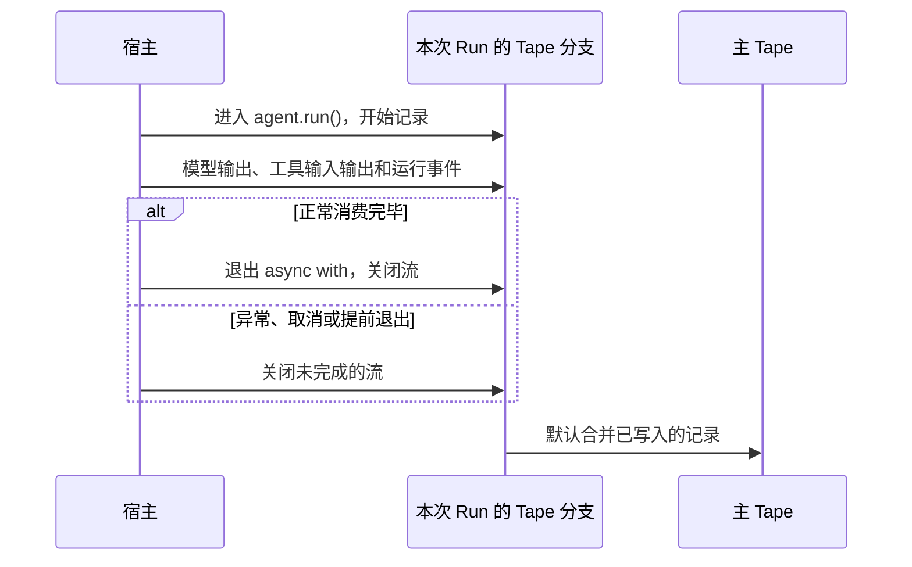

如果每次请求都只把当前消息交给模型，Agent 就无法接续之前的对话。要让它记得你刚才说过什么，就需要保存对话记录，并在下一轮请求中把相关历史交给模型。

Bub 用 Tape 保存对话、工具调用输入输出和运行记录，让你的 Agent 具备记忆和连续对话的能力。历史与模型上下文为什么分开、`TapeContext` 从哪里开始读取，见 [Tape 与模型上下文](/zh-cn/docs/concepts/tape/#history-and-context)。

## 连续对话 {#remember-previous-turn}

要让模型能与你连续对话或记住你所说的，关键在于调用 `agent.run()` 时要使用同一个 Tape 名称：

```python
import asyncio

import republic

from bub.core import Agent


async def run_turn(agent: Agent, model, prompt: str) -> None:
    async with agent.run(prompt, model=model, tape="demo-user") as stream:
        async for event in stream:
            if event.kind == "text":
                print(event.data["delta"], end="", flush=True)
    print("DONE")


async def main() -> None:
    agent = Agent(
        system_prompt="你是一个简洁的助手，并记住用户明确提出的回答偏好。",
        max_steps=6,
    )

    async with republic.get_model("openai:gpt-5-mini") as model:
        await run_turn(agent, model, "以后请用简短的编号清单回答。记住了吗？")
        await run_turn(agent, model, "我偏好什么回答格式？")


if __name__ == "__main__":
    asyncio.run(main())

```

两次调用都使用 `demo-user` 这一 Tape 记忆，所以第二轮可以接续第一轮的对话。Bub 默认使用 `InMemoryTapeStore` 来存储 Tape，但当你进程退出后就会丢失。此外，如果每个请求都重新创建 Agent，即使 Tape 名称相同，也不会共享默认的内存历史。

## 记忆持久化 {#persist-memory}

Bub 内置了一个 `FileTapeStore`，用于帮助你将 Tape 以持久化的方式写入到本地，后续即便退出进程重新进入时也能恢复历史对话，前提是你必须在创建 Agent 时配置：

```python
from pathlib import Path

from bub.core import Agent
from bub.core.store import FileTapeStore

agent = Agent(
    store=FileTapeStore(Path("sessions")),
    system_prompt="你是一个简洁的助手，并记住用户明确提出的回答偏好。",
)

```

于是再次运行程序时，使用同一个存储目录和 Tape 名称即可读取历史记录。于是上面的会话会保存在 `sessions/demo-user.jsonl` 文件中。

### Tape 名称决定记录延续 {#tape-names}

`agent.run(..., tape="customer-42")` 按名称选择 Tape。重复使用同一名称会延续记录，不同名称彼此独立。名称由调用方负责：`core.Agent` 不会替你加工作区、租户或用户前缀。

`FileTapeStore` 直接把 Tape 名称用作文件名。名称由用户输入或来自外部标识时，必须校验字符与长度，或改用随机标识；多租户服务还应把租户与用户身份纳入命名空间。

### 存储方案怎么选？ {#storage}

| 存储 | 生命周期 | 适用场景 |
| --- | --- | --- |
| `InMemoryTapeStore`（默认） | 当前 Agent 实例与进程 | 测试、临时脚本 |
| `FileTapeStore` | 每个 Tape 一个 `.jsonl` 文件 | 单机 CLI、开发环境、单节点服务 |
| 自定义 `TapeStore` / `AsyncTapeStore` | 由宿主实现决定 | Redis、SQL、分布式存储 |

:::note[注意事项]

* `FileTapeStore` 会把 Tape 名称用于文件名。如 Tape 名称由用户传入，需进行必要安全校验，如严格限制名称字符与长度或使用随机生成的标识；对于多租户服务还应把租户和用户身份纳入会话命名空间。
* 面向生产时建议自定义并实现 Tape 存储。完整协议见 [Python API](/zh-cn/docs/reference/python-api/#tape)。也可参考数据库接入示例见 [存储集成](/zh-cn/docs/integrations/storage/)。
:::

### 在 Run 之外查看记录 {#inspect}

不在 Run 中时，通过 `agent.tape(name)` 拿到同一份记录，并分别查看两种视图：

```python
async def inspect_history(agent: Agent) -> None:
    tape = agent.tape("customer-42")
    messages = await tape.read_messages()
    entries = list(await tape.query().all())
    print(f"模型消息：{len(messages)}，存储条目：{len(entries)}")
```

`read_messages()` 应用投影，`query()` 返回原始条目。

## TapeContext {#history-and-context}

Tape 与模型上下文的区别，以及原始条目和投影消息的读取方式，见[一份记录，两种视图](/zh-cn/docs/concepts/tape/#history-and-context)。下面介绍如何自定义投影。

### 默认上下文与自定义 {#default-context}

每个 Agent 都绑定了一个 `context`（默认是 `default_tape_context()`）。上面的 `agent` 等价于：

```python
from bub.core import Agent, default_tape_context

agent = Agent(
    context=default_tape_context(),  # 默认值：每个 agent.tape(name) 都会携带它
    # ...
)

```

### TapeContext 的构成 {#tape-context-fields}

`TapeContext` 是一个数据类，控制着上下文的裁剪与转换行为。其核心字段包括：

| 字段 | 默认值 | 作用说明 |
| --- | --- | --- |
| `anchor` | `LAST_ANCHOR` | 过滤锚点（anchor）：只读取最近一个 anchor 之后的条目；可传具体的 anchor 名称字符串，或传 `None` 表示不按 anchor 过滤。 |
| `select` | `None` | 自定义转换函数：将选中的 Tape 条目转换为模型消息列表。若为 `None`，则使用运行时内置的标准转换规则（支持标准消息、工具往返等）。 |
| `state` | `{}` | 关联的临时状态字典。每次 `agent.run(state=...)` 或 `agent.tape(state=...)` 都会写入这里，工具内部的 `ToolContext.state` 访问的也是同一个字典。 |

:::tip[关于类与工厂函数]
直接调用 `TapeContext()` 构造的是一个极简的底层基础上下文（通常仅处理基础文本消息）；而 `default_tape_context()` 是官方提供的 **全功能工厂函数**，能够完美处理多轮对话、工具调用（`tool_call` / `tool_result`）与 anchor。

如果你想保留默认的所有强大特性，只是想更改一下起始的 `anchor`，推荐使用 Python 标准库的 `dataclasses.replace()` 进行微调：

```python
from dataclasses import replace
from bub.core import Agent, default_tape_context

agent = Agent(
    context=replace(default_tape_context(), anchor="order-reviewed"),
    # ...
)

```
:::

### 选择其他起点 {#custom-anchors}

`TapeContext.anchor` 控制查询范围：

| 值 | 查询范围 |
| --- | --- |
| `LAST_ANCHOR`（默认） | 最近一个 anchor 之后 |
| `"order-reviewed"` | 指定名称的 anchor 之后 |
| `None` | 不按 anchor 过滤 |

### 自定义选择器 {#custom-selectors}

需要不同投影时，向 `TapeContext(select=...)` 传入函数。它接收选中的条目和上下文，返回 Republic 消息或其 awaitable：

```python
from collections.abc import Iterable

import republic

from bub.core import Agent, TapeContext, default_tape_context
from bub.core.tape import TapeEntry, build_messages


def with_order_notes(
    entries: Iterable[TapeEntry], _context: TapeContext
) -> list[republic.Message]:
    """默认投影之外，把订单备注作为系统提醒交给模型。"""
    entries = list(entries)
    messages = build_messages(entries, default_tape_context())
    notes = [
        entry.payload.get("data", {})
        for entry in entries
        if entry.kind == "event" and entry.payload.get("name") == "order.note"
    ]
    if notes:
        messages.append(republic.system(f"已知订单备注：{notes}"))
    return messages


agent = Agent(context=TapeContext(anchor=None, select=with_order_notes))
```

两处容易写错：

- 传入的 `entries` 是 `Iterable`，可能是生成器；先 `list()` 物化再遍历，否则第二次遍历会得到空结果。
- 复用默认投影时要传一个新的 `default_tape_context()`，不要把携带当前 selector 的 `context` 再交给 `build_messages()`，否则会递归调用自己。

自定义选择器会**替换**默认选择器，因此对话、工具往返、anchor 和你关心的业务事件都需要由你有意地组合。此时 `context=False` 的条目仍会在调用选择器前被过滤。

### 临时切换读取模式 {#read-with-another-context}

如果你不想修改 Agent 默认的上下文配置，只是想在某次读取时换一种视角（例如临时跳过 anchor 限制查看全量对话），可以使用 `tape.with_context()`：

```python
from dataclasses import replace

from bub.core import default_tape_context

tape = agent.tape("demo-user")

# 临时创建一个不按 anchor 过滤、使用默认转换规则的上下文来读取全部消息
full_messages = await tape.with_context(replace(default_tape_context(), anchor=None)).read_messages()

```

这只改变本次读取的行为，不会修改 Tape 本身的存储，也不会影响 Agent 后续的调用。

### anchor 和 handoff {#anchors-and-handoff}

anchor 与交接（handoff）的概念和边界见[Tape 与模型上下文](/zh-cn/docs/concepts/tape/#anchors)。这里补充实际使用时需要注意的初始化行为：

* 当调用 `agent.run()`、`agent.start()` 或 `agent.session()` 开启会话时，如果 Tape 中尚无 anchor，系统会自动写入一个名为 `session/start` 的初始 anchor。
* 仅仅调用 `agent.tape(name)` 获取引用不会自动创建 anchor。如果一个手动初始化的空 Tape 没有任何 anchor，直接用默认的 `LAST_ANCHOR` 读取会抛出 `BubError [not_found]`（`No anchors found in tape`）。对于完全空白的 Tape，要么先执行一次 `run()`，要么显式调用 `handoff()`，或者在读取时使用 `TapeContext(anchor=None)`。

### 手动执行 handoff {#manual-handoff}

你可以在业务逻辑的关键节点（如订单确认、步骤切换）手动写入 anchor：

```python
tape = agent.tape("demo-user")

await tape.handoff(
    name="order-reviewed",
    state={"summary": "订单 A123 已完成审核并通过。"},
)

```

* `name`：后续可以通过 `TapeContext(anchor="order-reviewed")` 作为起点重新切入。
* `state`：可以携带该阶段的结构化快照供应用层读取。

handoff 之后，默认的 `read_messages()` 只会加载该 anchor 之后的对话，但历史数据依然完好：

```python
# 获取所有历史 anchor 列表及其状态
anchors = await tape.anchors()

# 依然可以查询到最原始、完整的历史条目
history = list(await tape.query().all())

```

### 该怎么使用它们？ {#when-to-use-anchors}

| 需求场景 | 推荐做法 |
| --- | --- |
| 业务阶段推进（如：查完物流后进入售后） | 当前阶段结束时调用 `await tape.handoff(name="after-shipping")` |
| 希望从某个历史存档点恢复上下文 | 配置 `TapeContext(anchor="存档名称")` |
| 需要获取绝对完整的上帝视角历史 | 配置 `TapeContext(anchor=None)` |
| 应对超长上下文溢出 | Agent 在识别到上下文长度错误时会自动写入 `handoff(name="auto_handoff/context_overflow")` 并重试原提示词一次 |
| 按预算主动压缩 | 使用 [`bub-context-budget` 插件](/zh-cn/docs/integrations/reuse-app/#agent-loop-hooks)，让模型在接近上限时调用 `tape.handoff` |

## Sidecar：让并行记录留在主上下文之外 {#sidecars}

`TapeSidecar` 是挂在会话 Tape 旁边、由配套 Tape 承载的能力。通过 `Agent(sidecars=...)` 挂载后，它随主 Tape 一起分支、合并和重置，但它的条目不会进入主 Tape 的模型上下文。

Bub 应用用 spill sidecar 保存大型工具结果：主对话只保留预览和读取句柄，模型再通过 `spill.read` 分块取回完整内容。阈值由 [`BUB_SPILL_THRESHOLD`](/zh-cn/docs/reference/settings/#spill-settings) 控制，行为说明见 [代码模式 与 spill](/zh-cn/docs/reference/tools/#code-and-spill)。

自定义 sidecar 需要在插件中实现 `provide_tape_sidecar`，协议见 [Hooks 参考](/zh-cn/docs/reference/hooks/#provide_tape_sidecar)。

## 媒体有独立的存储边界 {#media}

模型请求可以包含图片、音频和视频，但 Tape 不是媒体文件存储。通过 Agent Run 写入记录时，Bub 会剔除提示词 `content` / `prompt` 中的非文本内容块，只保留文本，避免把内联媒体写进历史。因此，不要假定之后能从 Tape 取回用户上传的原始媒体。

需要重放或审计媒体时，由宿主把媒体保存到对象存储或文件系统，再在文本中记录可解析的引用。

工具结果的媒体走另一条路径，不与入站提示词的剔除规则混为一谈：工具需要把媒体连同文本交回当前模型调用时，使用 [`content_result()`](/zh-cn/docs/reference/python-api/#tools)，其结果作为工具结果记录，投影时由 `result_content()` 还原成图片、音频或视频。

## 调用数据与持久记忆 {#state-and-metadata}

`state`、`metadata`、Tape 条目和 anchor `state` 的生命周期与用途，统一见[数据应该放在哪里](/zh-cn/docs/concepts/tape/#state)。这里只展示如何把临时数据与持久记录组合使用：

```python
from bub.core.tools import ToolContext, tool

@tool(context=True)
async def add_order_note(note: str, *, context: ToolContext) -> str:
    """向当前会话追加一条订单备注。"""
    await context.tape.append_event(
        "order.note",
        {"text": note, "request_id": context.state.get("request_id")},
    )
    return "备注已记录。"

```

普通业务事件写入 Tape 后不会自动成为模型输入。如果希望模型在后续调用中看到这些数据，需要用 TapeContext 以合适的方式选入它们。

## 调用结束时如何处理会话历史 {#forks-and-merges}

每次 `agent.run()` 都会在 Tape 分支上记录本次 Run 写入的新条目。当调用流关闭时，Bub 默认把已写入的记录合并回主 Tape，见如下时序图：



默认合并发生在流关闭时，不要求调用成功完成。这意味着网络异常、任务取消或提前退出后，已经写入分支的部分对话和运行记录仍可能保留在主 Tape 中。如果不想保留某次 Run 的记录，可以设置 `merge_back=False` 参数：

```python
async with agent.run(
    prompt,
    model=model,
    tape="preview-demo",
    merge_back=False,
) as stream:
    async for event in stream:
        ...

```

这将丢弃本次调用的 Tape 分支记录，但不会撤销**已经执行的工具操作或其他外部副作用**。也可以自己管理作用域：`agent.session(name, merge_back=...)` 或 `tape.fork_tape(merge_back=...)`。

:::caution
分支不是针对外部世界的事务。即使设置 `merge_back=False`，工具对文件的修改、已发送的请求和外部写入也不会回滚。
:::

## 会话限制 {#concurrency}

当两个不同的 Agent 同时使用同一个 Tape 名称时，会各自基于启动时可见的历史创建分支。Bub 不会替你决定这些请求应该排队、覆盖还是交错执行。所以对于同一会话 Tape 被使用时，如同一会话的后续请求如果依赖前一次结果，应由宿主按会话串行处理；如果涉及到并发或者跨 Worker 或实例调用，那么需要考虑会话锁的问题。

`FileTapeStore` 不提供跨 worker 的会话锁；[FastAPI 示例](/zh-cn/docs/sdk/web-service/)演示了单进程内的锁。

并发 Run 需要读取彼此已完成的结果时，由应用协调执行顺序。
