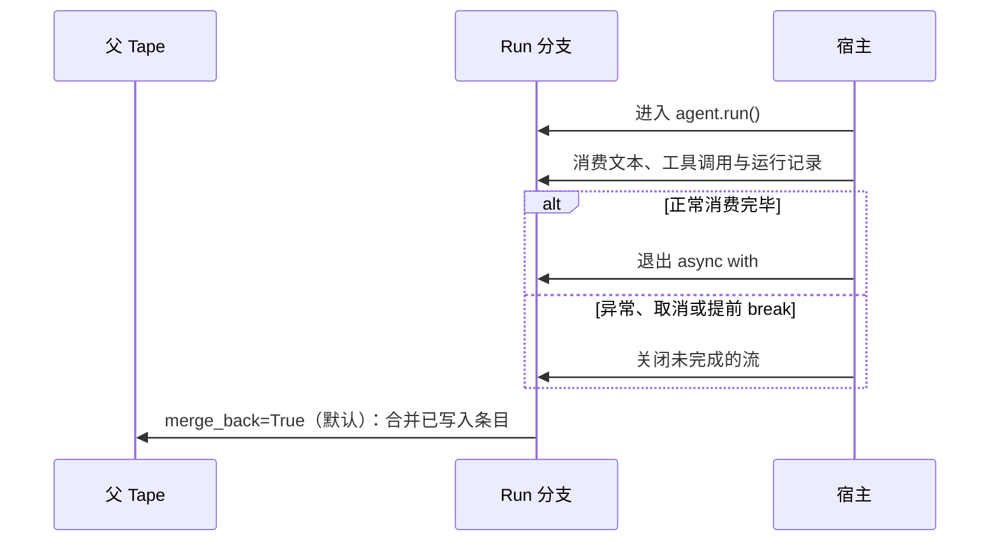

Agent 的多轮记忆不是简单复用一个 `messages` 列表。Bub 用 **Tape** 保存对话、工具往返和运行记录，再用 **TapeContext** 把其中一部分投影成下一次模型输入。

正常执行只追加记录；`reset()` 等显式操作仍可清空 Tape，因此不要把它理解为不可变的合规审计日志。

## 跨请求保留订单会话 {#complete-example}

下面的例子沿用上一章的 `get_order`，并使用 `FileTapeStore` 把记录写入 `./sessions`。完整的 `main.py` 如下：

```python
import asyncio
from pathlib import Path

import republic

from bub.core import Agent
from bub.core.store import FileTapeStore
from bub.core.tools import tool


@tool
async def get_order(order_id: str) -> dict[str, str]:
    """按订单号查询订单状态。"""
    await asyncio.sleep(0.1)
    if order_id == "A123":
        return {"order_id": "A123", "status": "shipped"}
    return {"order_id": order_id, "error": "order_not_found"}


async def run_turn(agent: Agent, model, prompt: str) -> None:
    print(f"\n用户：{prompt}\n助手：", end="", flush=True)
    async with agent.run(
        prompt,
        model=model,
        tape="customer-42",
        state={"session_id": "customer-42"},
    ) as stream:
        async for event in stream:
            if event.kind == "text":
                print(event.data["delta"], end="", flush=True)
    print()


async def main() -> None:
    agent = Agent(
        store=FileTapeStore(Path("sessions")),
        tools=[get_order],
        system_prompt="你是订单客服助手。查询订单使用工具，并记住用户提供的配送偏好。",
        max_steps=6,
    )

    async with republic.get_model("openai:gpt-5-mini") as model:
        await run_turn(agent, model, "我的订单是 A123，配送时请放在前台。")
        await run_turn(agent, model, "我刚才留了哪条配送备注？")


if __name__ == "__main__":
    asyncio.run(main())
```

运行：

```bash
uv run python main.py
```

两个 Run 使用同一个 `tape="customer-42"`，第二个 Run 会读取第一个 Run 已合并的对话。记录保存在：

```text
sessions/customer-42.jsonl
```

进程重启后，只要新 Agent 使用同一个存储目录和 Tape 名称，就能继续这段会话。

:::note
默认 `InMemoryTapeStore` 也能在同一个 Agent 实例的多个 Run 之间保留记忆，但进程退出即丢失。如果每个请求都重新创建 Agent，即使 Tape 名称相同，也不会共享默认内存历史。
:::

## 历史记录不等于模型上下文 {#history-and-context}

Tape 中有两类读取视图：

| 视图 | 读取方式 | 回答的问题 |
| --- | --- | --- |
| 原始历史 | `tape.query()` / `store.fetch_all()` | 实际记录了哪些消息、工具调用、anchor 和运行事件？ |
| 模型上下文 | `tape.read_messages()` | 下一次模型调用能看到哪些消息？ |

在两个 Run 后检查这两种视图：

```python
tape = agent.tape("customer-42")
entries = list(await tape.store.fetch_all(tape.query()))
messages = await tape.read_messages()

print("条目类型：", [entry.kind for entry in entries])
print("模型消息角色：", [message.role for message in messages])
```

`default_tape_context()` 默认选择最近一个 anchor 之后的对话和工具往返，过滤普通运行事件。于是你可以把审计事实留在历史中，而不让它们自动占用上下文 token。

`agent.session()` 和 `agent.start()` 会为新会话创建 `session/start` anchor。显式 `handoff()` 会移动默认上下文起点，但不会删除此前历史，也不会自动生成摘要。完整选择策略见 [Tape 核心概念](/zh-cn/docs/concepts/tape/#context)。

## `state`、`metadata` 与 Tape 的分工 {#state-and-metadata}

这三个入口都可能携带“本次请求的数据”，但用途不同：

| 数据 | 生命周期与用途 |
| --- | --- |
| `state={...}` | 当前 Run 的可变字典，供工具和 Agent 事件共享；不会自动持久化或恢复 |
| `metadata={...}` | Run 级观测信息，进入 `RunStarted` 及对应 Tape 记录；不会自动成为模型提示 |
| Tape 条目 | 持久保存的对话、工具往返或显式业务事实；是否进入模型输入由 `TapeContext` 决定 |

例如，请求 ID 适合放入 `state` 和可观测元数据；需要事后查询的订单备注可显式 `append_event()`；需要下次 Run 自动看到的对话则依赖消息记录与上下文投影。

## 分支关闭时默认合并 {#forks-and-merges}

每次 `agent.run()` 都在 Tape 分支上记录新条目，让本次 Run 的写入在关闭前与父 Tape 隔离。**默认行为是关闭时合并，而不是只有成功才合并：**



这意味着：

- 网络异常或提前取消后，已经记录的部分对话和错误信息仍可能进入主 Tape。
- `RunFinished` 可以显示 `ok`、`error` 或 `cancelled`；不要把这些状态误认为数据库事务的提交或回滚。
- 工具已经产生的外部副作用始终由业务层负责，Tape 是否合并都不会撤销它们。

如果本次 Run 的记录不应保留，必须显式关闭合并：

```python
async with agent.run(
    prompt,
    model=model,
    tape="preview-42",
    merge_back=False,
) as stream:
    async for event in stream:
        ...
```

`merge_back=False` 丢弃的是该分支的 Tape 记录，不是外部世界的副作用，也不是模型或工具已经执行的事实。

## 选择合适的存储 {#storage}

`Agent(store=...)` 决定 Tape 的保存位置：

| 存储 | 生命周期 | 适用场景 |
| --- | --- | --- |
| `InMemoryTapeStore`（默认） | 当前 Agent 实例与进程 | 测试、临时脚本 |
| `FileTapeStore` | 每个 Tape 一个 `.jsonl` 文件 | 单机 CLI、开发环境、单节点服务 |
| 自定义 `TapeStore` / `AsyncTapeStore` | 由宿主实现决定 | Redis、SQL、分布式存储 |

自定义协议使用 `list_tapes`、`reset`、`fetch_all` 和 `append`，不是虚构的 `get` / `save` 接口。完整的数据库存储接入见[存储集成](/zh-cn/docs/integrations/storage/)。

`FileTapeStore` 会把 Tape 名称拼入文件名。Web 服务应使用服务端生成的安全标识，或严格限制名称字符与长度，并在多租户场景中把租户和用户纳入会话命名空间。

## 同会话并发需要宿主协调 {#concurrency}

两个 Run 同时使用同一个 Tape 名称时，会各自基于当时的历史创建分支。Bub 核心不会替应用决定这两个请求应该排队、覆盖还是允许交错。

- 不同会话通常可以并行。
- 同一会话的后续请求若依赖前一次结果，应按会话串行化。
- `asyncio.Lock` 只能协调单进程；`FileTapeStore` 不提供跨 worker 或跨实例锁。

[FastAPI 综合案例](/zh-cn/docs/sdk/web-service/)会演示单进程的会话锁及其边界。下一步先给订单助手增加审计与退款拦截：[事件](/zh-cn/docs/sdk/events/)。
