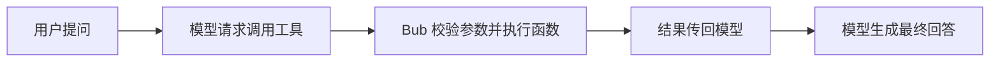

大模型能听懂用户的需求，但要真正查数据或改状态，还得靠外部能力。工具（Tool）就是 Agent 的**「手脚」**：你可以把任何数据查询或业务操作写成普通的 Python 函数，交给 Agent 按需调用。

本节从一个查询订单的例子出发，带你逐步了解如何定义工具、模型怎样调用它，以及如何处理参数校验、运行上下文与并发控制。

## 定义自定义工具 {#add-a-tool}

假设我们已经写好了一个查询订单的 Python 函数。要让 Agent 能调用它，只需用 `@tool` 装饰器标记，并在创建 `Agent` 时传入 `tools`：

```python "@tool" "tools=[get_order]"
from bub.core import Agent
from bub.core.tools import tool


ORDERS = {
    "A123": {
        "order_id": "A123",
        "status": "shipped",
        "item": "机械键盘",
        "amount": 399.0,
    }
}


@tool
def get_order(order_id: str) -> dict[str, str | float]:
    """按订单号查询订单状态、商品和金额。"""
    if order := ORDERS.get(order_id):
        return order
    return {"order_id": order_id, "error": "order_not_found"}


agent = Agent(
    tools=[get_order],
    system_prompt="用户询问订单时，使用工具查询，不要猜测订单状态。",
)
```

`@tool` 会根据函数的类型标注和 docstring 自动生成供模型阅读的工具描述与参数 Schema。

## 工具调用流程 {#tool-call-flow}

模型不会直接执行 Python 代码，而是先发起工具调用请求，由 Bub 校验参数并运行函数，再将结果传回模型：



在事件流中可以观察到完整的调用往返（1 次工具调用 + 1 次最终回答共经历 2 个 Step）：

```python
async with agent.run(prompt, model=model, tape="tools-demo") as stream:
    async for event in stream:
        if event.kind == "tool_call":
            for call in event.data["tool_calls"]:
                print(f"模型请求：{call['name']}，参数：{call['arguments']}")
        elif event.kind == "tool_result":
            print(f"工具结果：{event.data['tool_results']}")
        elif event.kind == "text":
            print(event.data["delta"], end="", flush=True)
```

可以看到，一次工具调用会经历两个 Step：模型先请求 `get_order` 并收到工具结果，再结合结果生成最终回答。当然，究竟要不要调用工具，最终决定权仍在模型手里。

## 参数描述与 Pydantic 校验 {#tool-schema}

用 `@tool` 装饰函数时，参数类型会被转为 JSON Schema，而 [docstring](https://peps.python.org/pep-0257/) 就是给模型看的使用说明书。因此，参数名、类型标注和 docstring 都是工具接口的一部分，写清楚能让模型更准确地传参：

```python
@tool
def get_order(order_id: str) -> dict[str, str | float]:
    """按订单号查询订单。order_id 是完整订单编号，例如 A123。"""
    ...
```

当参数较多或需要限制数值范围、字符串长度时，可定义 [Pydantic](https://pydantic.dev/) 模型并传给 `@tool(model=...)`：

```python
from pydantic import BaseModel, Field
from bub.core.tools import tool


class RefundInput(BaseModel):
    order_id: str = Field(description="完整订单编号，例如 A123")
    amount: float = Field(gt=0, description="退款金额，必须大于 0")
    reason: str = Field(min_length=1, description="用户提供的退款原因")


@tool(name="refund_order", model=RefundInput)
def refund_order(param: RefundInput) -> dict[str, str | float]:
    """为已支付订单申请退款。"""
    return {
        "order_id": param.order_id,
        "amount": param.amount,
        "status": "refund_requested",
    }
```

编写实际业务工具时，建议把**「预期的业务结果」**和**「程序执行错误」**区分开——返回结构化字典（如 `{"error": "order_not_found"}`）而非直接抛异常，能让模型和调用方清晰识别已知的业务状态：

| 情况 | Bub 的处理行为 |
| --- | --- |
| 参数类型不匹配或 Pydantic 校验失败 | 包装为工具错误传回模型，模型可修正参数后重试 |
| 工具函数抛出普通异常 | 包装为工具错误传回模型 |
| 工具返回结构化业务状态（如 `{"error": "order_not_found"}`） | 作为正常工具结果传回模型（推荐用于预期的业务错误） |
| 存储、模型连接或事件处理器抛出异常 | 从事件流迭代处直接向上抛出，由宿主代码捕获 |

## 注入运行上下文（ToolContext） {#tool-context}

有时工具内部不只是处理入参，还需要访问当前会话的 Tape、请求级 `state` 或事件总线。这时可以设置 `@tool(context=True)`，让 Bub 自动注入 `ToolContext`：

```python "context=True" "context: ToolContext"
from bub.core.tools import ToolContext, tool


@tool(context=True)
async def add_order_note(note: str, *, context: ToolContext) -> str:
    """向当前会话追加一条订单备注。"""
    await context.tape.append_event(
        "order.note",
        {"text": note, "request_id": context.state.get("request_id")},
    )
    return f"备注已写入会话 {context.tape.name}"
```

调用 `agent.run()` 时传入 `state`，即可在工具内通过 `context.state` 读取：

```python
async with agent.run(
    prompt,
    model=model,
    tape="tools-demo",
    state={"session_id": "tools-demo", "request_id": "req-01"},
) as stream:
    ...
```

:::tip
`context` 参数由 Bub 自动注入，不会暴露在发给模型的参数 Schema 中。`context.state` 仅在单次调用内有效，不会自动持久化。
:::

## 异步函数与并发限制 {#concurrency}

`@tool` 同时支持同步函数和 `async def` 异步函数。含阻塞 I/O 的逻辑应使用异步函数，或用 `asyncio.to_thread()` 放入线程执行：

```python
import asyncio
import time
from bub.core.tools import tool


def build_report_blocking(order_id: str) -> str:
    time.sleep(3)
    return f"https://example.com/reports/{order_id}.pdf"


@tool
async def export_order_report(order_id: str) -> str:
    """生成订单报表并返回下载地址。"""
    return await asyncio.to_thread(build_report_blocking, order_id)
```

模型在一次响应中可能会同时请求多个工具。为了避免并发过高拖垮下游或触及资源上限，可以通过 `max_tool_concurrency` 限制单步内的最大并发执行数：

```python
agent = Agent(
    tools=[get_order],
    system_prompt="用户询问订单时，使用工具查询。",
    max_tool_concurrency=2,
)
```

此外，`Agent(tools=[...])` 也支持传入提供商侧执行的工具（如 `republic.tools.WebSearch()`）。这类工具由模型提供商远端执行，不经过本地执行器，也不受 `max_tool_concurrency` 限制。

## 跳过模型直接调用工具 {#call-a-tool-without-a-model}

如果你已经明确知道要执行哪个工具、不需要走模型推理（也不想消耗模型 Token），可以给 Agent 设置 `command_prefix`。以该前缀开头的输入会跳过模型，直接校验参数并调用同名工具：

```python
agent = Agent(tools=[get_order], command_prefix=",")

async with agent.run(",get_order A123", model=model, tape="tools-demo") as stream:
    async for event in stream:
        if event.kind == "text":
            print(event.data["delta"], end="")
```

直接命令同样通过 `agent.run()` 产出事件流并触发工具事件；但若执行报错，异常会直接抛给调用方，不会交回模型重试。

## 代码模式 {#compose-tools-with-codemode}

当工具数量较多或任务包含循环、条件分支时，可使用 `CodeMode` 让模型通过 `run_code` 工具直接编写 Python 代码组合调用多个工具：

```python
from bub.core import Agent
from bub.core.codemode import CodeMode

code_mode = CodeMode([get_order])

agent = Agent(
    tools=[code_mode.run_code],
    system_prompt=[
        "使用可用工具完成任务；可编写 Python 调用 tools.*。",
        code_mode.prompt,
    ],
)
```

模型在 `run_code` 中生成的 Python 代码示例：

```python
order = await tools.get_order(order_id="A123")
print(order)
```

## 自定义执行环境 {#choose-an-execution-environment}

默认情况下，工具和代码模式直接在运行 Python 进程的宿主机上执行（无安全沙箱）。如需隔离文件系统、网络和进程权限，可实现自定义的 [`Environment`](/zh-cn/docs/reference/python-api/#environment)。
