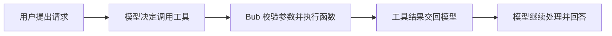

Agent 可以理解用户的请求，但要查询真实数据或执行操作，还需要有调用外部能力的途径。**工具就是 Agent 的手脚**：你用 Python 函数定义能力，Agent 再根据用户请求决定是否调用。

本节从一个订单查询工具开始，逐步说明如何定义工具、模型怎样调用它，以及怎样处理参数、结果和运行时数据。

## 给 Agent 添加一个工具 {#add-a-tool}

假设我们已经有一个查询订单的 Python 函数。用 `@tool` 标记它，再把它传给 `Agent`：

```python
from bub.core import Agent
from bub.core.tools import tool


ORDERS = {
    "A123": {
        "order_id": "A123",
        "status": "shipped",
        "item": "机械键盘",
        "amount": 399.0,
    }
}


@tool
def get_order(order_id: str) -> dict[str, str | float]:
    """按订单号查询订单状态、商品和金额。"""
    if order := ORDERS.get(order_id):
        return order
    return {"order_id": order_id, "error": "order_not_found"}


agent = Agent(
    tools=[get_order],
    system_prompt="用户询问订单时，使用工具查询，不要猜测订单状态。",
)
```

`@tool` 会把带类型标注的函数转换为 Agent 可用的工具。工具函数负责实际工作；模型看到的工具名、参数类型和说明，则帮助它判断何时以及怎样调用。

## 一次工具调用是怎样完成的 {#tool-call-flow}

模型并不会直接执行 Python。它先提出工具调用请求，Bub 再校验参数并执行对应函数，然后把结果交回模型：



在事件流中，可以分别看到模型请求的工具和工具返回的结果：

```python
async with agent.run(prompt, model=model, tape="tools-demo") as stream:
    async for event in stream:
        if event.kind == "tool_call":
            for call in event.data["tool_calls"]:
                print(f"模型请求：{call['name']}，参数：{call['arguments']}")
        elif event.kind == "tool_result":
            print(f"工具结果：{event.data['tool_results']}")
        elif event.kind == "text":
            print(event.data["delta"], end="", flush=True)
```

一次典型的调用会经过两个 Step：模型先请求 `get_order`，Bub 执行函数并把结果交回模型；模型再根据这个结果生成回答。模型是否调用工具仍由模型决定。系统提示可以引导它，但不能保证数据正确；需要真实订单状态时，应以工具返回的数据为准。

流事件的种类和读取方式见 [Agent 循环：按事件类型读取数据](/zh-cn/docs/sdk/#stream-events)。

## 设计模型能用对的参数 {#tool-schema}

工具的参数类型会转换为 JSON Schema，函数的 docstring 会成为模型可读的工具说明。因此，参数名和描述都是工具接口的一部分：描述应说明业务含义和限制，而不只是重复参数名。

```python
@tool
def get_order(order_id: str) -> dict[str, str | float]:
    """按订单号查询订单。order_id 是用户提供的完整编号，例如 A123。"""
    ...
```

参数较多或需要范围、长度等约束时，可以用 Pydantic 模型定义输入：

```python
from pydantic import BaseModel, Field

from bub.core.tools import tool


class RefundInput(BaseModel):
    order_id: str = Field(description="完整订单编号，例如 A123")
    amount: float = Field(gt=0, description="退款金额，必须大于 0")
    reason: str = Field(min_length=1, description="用户提供的退款原因")


@tool(name="refund_order", model=RefundInput)
def refund_order(param: RefundInput) -> dict[str, str | float]:
    """为已支付订单申请退款；执行前必须完成权限检查。"""
    return {
        "order_id": param.order_id,
        "amount": param.amount,
        "status": "refund_requested",
    }
```

参数类型或 Pydantic 约束校验失败时，Bub 会把错误作为工具错误交回模型。模型可以据此修正参数后重试，但不保证一定重试成功。输入模型的完整用法见 [Python API](/zh-cn/docs/reference/python-api/)。

## 工具结果和错误会怎样处理 {#results-and-errors}

工具返回的内容会交回模型，成为它继续处理请求的依据。字符串默认保持原样；字典、Pydantic 模型等结构化数据默认序列化为 JSON。需要调整呈现格式时，可以为工具提供 `renderer`。

注意区分业务结果和执行错误：

| 情况 | 默认行为 |
| --- | --- |
| 参数不符合类型或 Pydantic 约束 | 转为参数校验工具错误，交回模型 |
| 工具抛出普通异常 | 转为工具错误，交回模型 |
| 工具返回业务错误对象，例如 `order_not_found` | 作为正常工具结果交回模型 |
| 存储、模型或事件处理器中断 Run | 异常可能从事件迭代抛出，由宿主处理 |

业务错误对象不是 Python 异常。采用稳定的结构化结果，可以让模型和调用方识别“订单不存在”这类业务状态。

**工具产生的外部副作用不受 Tape 回滚。** 已退款、已发送邮件或已修改的文件，不会因为后续模型调用失败、客户端取消或 `merge_back=False` 而撤销。执行写操作时，仍需在业务层做好权限校验、幂等处理和必要的补偿；不要只依赖提示词要求模型不要重复调用。Tape 分支的行为见[记忆与 Tape：Run 结束时，记录会怎样处理](/zh-cn/docs/sdk/tape/#forks-and-merges)。

### 返回图片等媒体 {#media-results}

需要把媒体交给当前模型调用时，使用 `content_result()`，而不是把二进制数据放进 JSON：

```python
import republic

from bub.core.tools import content_result, tool


@tool
def get_invoice_preview(invoice_id: str) -> dict[str, object]:
    """返回发票说明与预览图。"""
    return content_result([
        f"发票 {invoice_id} 的预览",
        republic.Image("image/png", url="https://example.test/invoice.png"),
    ])
```

媒体结果用于当前模型输入，不等于媒体持久化方案。需要审计或重放时，由宿主保存文件，并在业务记录中保存可解析的引用。

## 给工具传入本次 Run 的数据 {#tool-context}

有些工具还需要当前会话、请求级权限或事件总线等信息。这些数据不应该让模型来填写，可以通过 Bub 注入的 `ToolContext` 传给工具：

```python
from bub.core.tools import ToolContext, tool


@tool(context=True)
async def add_order_note(note: str, *, context: ToolContext) -> str:
    """向当前会话追加一条订单备注。"""
    await context.tape.append_event(
        "order.note",
        {"text": note, "request_id": context.state.get("request_id")},
    )
    return f"备注已写入会话 {context.tape.name}"
```

在启动 Run 时传入状态，工具就能从 `context.state` 读取：

```python
async with agent.run(
    prompt,
    model=model,
    tape="tools-demo",
    state={"session_id": "tools-demo", "request_id": "req-01"},
) as stream:
    ...
```

`context` 参数由 Bub 注入，不会出现在模型可见的参数 Schema 中。`context.state` 只在当前 Run 内共享，不会自动持久化或恢复。Tape 记录如何被保存，以及为什么记录不一定会进入后续模型上下文，见[记忆与 Tape：历史记录不等于模型上下文](/zh-cn/docs/sdk/tape/#history-and-context)。

## 处理同步、异步和一批工具调用 {#concurrency}

模型可能在一次响应中请求多个工具。`Agent(max_tool_concurrency=...)` 限制这一批调用的并发数：`None` 表示不限制，`1` 表示依次执行。它不是整个应用的全局限流器。

同步工具函数会直接在当前事件循环中执行。如果数据库驱动、文件处理或第三方客户端会阻塞，应将阻塞操作卸载到线程：

```python
import asyncio


@tool
async def export_order_report(order_id: str) -> str:
    """生成订单报表并返回下载地址。"""
    return await asyncio.to_thread(build_report_blocking, order_id)
```

`async def` 本身不会让阻塞代码变成非阻塞代码；应使用真正的异步 I/O，或显式将阻塞工作卸载到线程。

传给 `Agent(tools=[...])` 的还可以是 `republic.tools.WebSearch()` 等提供商工具。它们由模型提供商执行，不经过本地 `ToolExecutor`，也不受 `max_tool_concurrency` 的本地并发限制。

## 不经过模型，直接调用工具 {#call-a-tool-without-a-model}

如果还需要一个确定性的命令入口，可以给 Agent 设置 `command_prefix`。命令仍使用同一份工具实现和参数校验，但不调用模型：

```python
agent = Agent(tools=[get_order], command_prefix=",")

async with agent.run(",get_order A123", model=model, tape="tools-demo") as stream:
    async for event in stream:
        if event.kind == "text":
            print(event.data["delta"], end="")
```

直接命令会发出 `CommandFinished` 和文本结果，不会发出 `RunStarted` 或 `RunFinished`。命令错误直接交给调用方，不会像模型工具错误那样交回模型修正；需要同时覆盖命令路径的权限策略，应放在 `ToolCallStarted`。相关事件用法见[事件](/zh-cn/docs/sdk/events/)。

## 进阶：用 Code Mode 组合工具 {#compose-tools-with-codemode}

当工具较多或任务需要条件逻辑时，可以让模型通过 `run_code` 编写 Python，在一次执行中组合多个工具：

```python
from bub.core.codemode import CodeMode

code_mode = CodeMode([get_order])

agent = Agent(
    tools=[code_mode.run_code],
    system_prompt=[
        "使用可用工具完成任务；可以编写 Python 调用 tools.*。",
        code_mode.prompt,
    ],
)
```

模型生成的代码可以调用：

```python
order = await tools.get_order(order_id="A123")
print(order)
```

### 选择执行环境 {#choose-an-execution-environment}

`Environment` 定义代码进程创建、文件读写、代码执行和关闭等契约。默认 `LocalEnvironment` 会在宿主机启动 Python 进程；远程或隔离环境可以提供不同的文件系统、网络和权限边界。

:::caution
**独立进程不等于安全沙箱。** 不要把在宿主机执行不可信模型代码误认为安全隔离。需要隔离时，应配置具备文件系统、网络和权限限制的 `Environment`；完整协议见 [Python API](/zh-cn/docs/reference/python-api/)。
:::

接下来，让 Agent 能在多轮对话之间保留信息：[记忆与 Tape](/zh-cn/docs/sdk/tape/)。
