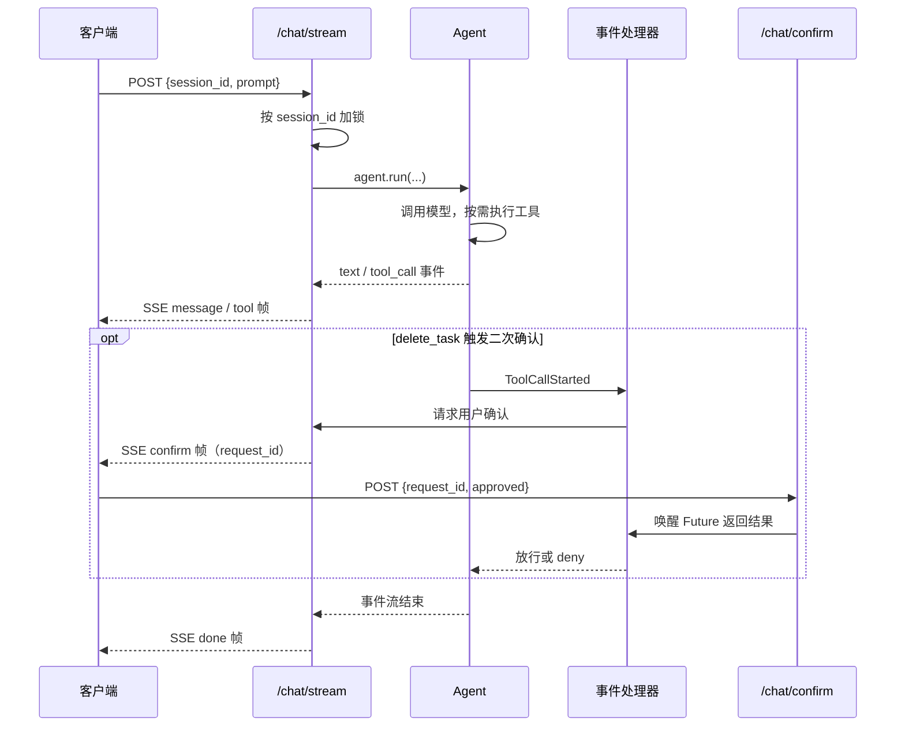

import { Code, FileTree, Steps } from '@astrojs/starlight/components';
import fullMainPy from '../../../../../../public/examples/bub-todo-agent/main.py?raw';

前面几节我们已经了解了 Bub SDK 的核心组件。本节不再引入新概念，而是把 `Agent`、工具、事件拦截和 Tape 存储串起来，基于 FastAPI 亲手搭一个带 SSE 流式输出和删除二次确认的 Todo Agent 应用。

:::tip[看不懂就问]
本节只聚焦后端逻辑，前端界面代码不在正文中展开。如果遇到不理解的概念、代码或报错，可以直接问 Bub，或者让你手头的 AI 编程工具结合本文和源码为你解答。
:::

完整源码位于 [bub-todo-agent](https://github.com/bubbuild/bub/blob/main/website/public/examples/bub-todo-agent/)，你可以直接下载试跑，或者跟着下面的步骤一步步搭起来：

<FileTree>

- bub-todo-agent/
  - **main.py** # 后端服务代码（本节重点）
  - index.html # 前端演示页面
  - static/
    - uno.global.js
    - alpine.min.js
  - sessions/ # 运行时自动生成的 Tape 存储目录

</FileTree>

:::caution
本示例仅用于教学演示，未包含生产级鉴权与持久化数据库，请勿直接暴露在公网。
:::

## 1. 初始化 Agent 与 FastAPI Lifespan {#lifespan}

首先，我们把应用骨架搭起来：在 FastAPI 的 [lifespan](https://fastapi.tiangolo.com/advanced/events/#lifespan) 中初始化模型连接与 `Agent` 实例，并挂载到 `app.state` 上供所有请求复用：

```python title="main.py" showLineNumbers collapse={1-33} {50-58}
#!/usr/bin/env -S uv run --script
# /// script
# requires-python = ">=3.12"
# dependencies = [
#   "bub @ git+https://github.com/bubbuild/bub@main",
#   "fastapi>=0.135",
#   "python-dotenv",
#   "uvicorn",
# ]
# ///

import asyncio
import logging
import os
from collections import defaultdict
from collections.abc import AsyncIterable, Awaitable, Callable
from contextlib import asynccontextmanager, suppress
from itertools import count
from pathlib import Path
from typing import Literal
from uuid import uuid4

import republic
from dotenv import load_dotenv
from fastapi import FastAPI, HTTPException, Request
from fastapi.sse import EventSourceResponse, ServerSentEvent
from pydantic import BaseModel, Field

from bub.core import Agent
from bub.core.events import ToolCallDecision, ToolCallFinished, ToolCallStarted
from bub.core.store import FileTapeStore
from bub.core.tools import tool


logger = logging.getLogger(__name__)
BASE_DIR = Path(__file__).resolve().parent

load_dotenv()

MODEL = os.getenv("BUB_MODEL", "openai:gpt-4o-mini")
BASE_URL = os.getenv("BUB_API_BASE", "https://api.openai.com/v1")
API_KEY = os.getenv("BUB_API_KEY") or os.getenv("REPUBLIC_OPENAI_API_KEY")
HOST = os.getenv("BUB_HOST", "127.0.0.1")
PORT = int(os.getenv("BUB_PORT", "8000"))


@asynccontextmanager
async def lifespan(app: FastAPI):
    async with republic.get_model(MODEL, api_base=BASE_URL, api_key=API_KEY) as model:
        agent = Agent(
            store=FileTapeStore(BASE_DIR / "sessions"),
            system_prompt=(
                "You are a personal todo assistant. Always use tools to read or change todos; "
                "never guess task state. If a request is ambiguous, look it up or ask the user "
                "first, and respect tool errors and denial reasons."
            ),
            max_steps=6,
        )

        app.state.model = model
        app.state.agent = agent
        app.state.session_locks = defaultdict(asyncio.Lock)
        # request_id -> future；删除钩子在此等待用户确认，由 POST /chat/confirm 唤醒
        app.state.pending_confirms = {}
        yield


app = FastAPI(title="Bub Todo Agent", lifespan=lifespan)
```

- 将 `Agent` 挂载在 `app.state` 上全局复用，避免每次请求重复初始化；
- `max_steps=6` 限制单次 Run 的最大步数；
- `FileTapeStore` 将会话历史持久化到本地 `sessions/` 目录。

到这一步还只是一个最基础的骨架——模型目前只能纯聊天，还干不了实事。接下来，我们给它装上真正能操作待办事项的工具。

## 2. 定义业务工具 {#tools}

Agent 就位之后，接下来让它真正能干活——把待办事项的查询、新增、完成和删除操作写成普通 Python 函数，再用 `@tool` 封装成工具交给 Agent：

```python title="main.py"
from itertools import count
from pydantic import BaseModel, Field
from bub.core.tools import tool

TASKS: dict[str, dict[str, object]] = {}
TASK_IDS = count(3)


@tool
def list_tasks() -> list[dict[str, object]]:
    """List every todo with its task ID, title, and completion state."""
    return [dict(task) for task in TASKS.values()]


class AddTaskInput(BaseModel):
    title: str = Field(min_length=1, max_length=100, description="Short, specific todo title")


@tool(name="add_task", model=AddTaskInput)
def add_task(param: AddTaskInput) -> dict[str, object]:
    """Add a new incomplete todo."""
    task_id = f"task-{next(TASK_IDS)}"
    task = {"task_id": task_id, "title": param.title, "completed": False}
    TASKS[task_id] = task
    return dict(task)


@tool
def complete_task(task_id: str) -> dict[str, object]:
    """Mark a todo complete by task ID. Call list_tasks first if the ID is unknown."""
    if task := TASKS.get(task_id):
        task["completed"] = True
        return dict(task)
    return {"task_id": task_id, "error": "task_not_found"}


@tool
def delete_task(task_id: str) -> dict[str, object]:
    """Permanently delete a todo by task ID. The host must authorize it first."""
    if task := TASKS.pop(task_id, None):
        return {"task_id": task_id, "status": "deleted", "title": task["title"]}
    return {"task_id": task_id, "error": "task_not_found"}
```

上面这几个函数都是很基础的 Python 逻辑，这里就不逐行展开了，只需记住三点：

- 函数的 docstring 和类型标注会自动生成工具 Schema，模型全靠它们决定何时调用以及怎么传参；
- 返回值必须可 JSON 序列化，业务失败（如任务不存在）直接返回 `{"error": ...}`，不要动辄抛异常中断整个流程；
- `delete_task` 是不可逆操作，稍后我们会通过事件处理器给它加上二次确认。

现在把这组工具传给 `Agent`，并设置 `max_tool_concurrency=2`：

```python title="main.py" ins={6,13}
@asynccontextmanager
async def lifespan(app: FastAPI):
    async with republic.get_model(MODEL, api_base=BASE_URL, api_key=API_KEY) as model:
        agent = Agent(
            store=FileTapeStore(BASE_DIR / "sessions"),
            tools=[list_tasks, add_task, complete_task, delete_task],
            system_prompt=(
                "You are a personal todo assistant. Always use tools to read or change todos; "
                "never guess task state. If a request is ambiguous, look it up or ask the user "
                "first, and respect tool errors and denial reasons."
            ),
            max_steps=6,
            max_tool_concurrency=2,
        )
```

## 3. 封装 Agent 调用参数 {#tape}

装上工具之后，我们的 Agent 就有了「手脚」。在接入 HTTP 路由前，先写一个轻量的包装函数 `run_agent`，把请求参数 `ChatRequest`、会话 `session_id` 和删除确认回调 `confirm_delete` 传给 `agent.run()`：

```python
ConfirmDelete = Callable[[dict[str, object]], Awaitable[bool]]


class ChatRequest(BaseModel):
    session_id: str = Field(pattern=r"^[A-Za-z0-9_-]{1,64}$")
    prompt: str = Field(min_length=1, max_length=10_000)
    think_level: Literal["auto", "low", "medium", "high"] = "auto"


def run_agent(agent: Agent, model, req: ChatRequest, confirm_delete: ConfirmDelete):
    options = None if req.think_level == "auto" else {"reasoning_effort": req.think_level}
    return agent.run(
        req.prompt,
        model=model,
        options=options,
        tape=req.session_id,
        state={"session_id": req.session_id, "confirm_delete": confirm_delete},
    )
```

- `tape=req.session_id` 让同一 `session_id` 的请求共享多轮对话历史（通过正则限制字符范围，确保作为文件名安全）；
- `state` 将当前请求的确认回调传递给接下来的事件处理器。

## 4. 注册事件处理器（日志与删除审批） {#events}

有了工具之后，我们还可以利用事件总线在关键节点「插一手」——比如记录工具调用日志，或者在执行删除前拦下来等用户点头。在 `lifespan` 中注册两个事件处理器：

1. `ToolCallFinished`：记录每次工具调用的名称、状态和耗时；
2. `ToolCallStarted`：在执行 `delete_task` 前暂停并等待前端用户确认；若用户拒绝或超时，通过 `ToolCallDecision.deny(...)` 拦截删除。

```python title="main.py" "@agent.events.on(ToolCallFinished)" "@agent.events.on(ToolCallStarted)" "ToolCallDecision.deny"
        @agent.events.on(ToolCallFinished)
        def audit_tool(event: ToolCallFinished) -> None:
            logger.info(
                "tool=%s status=%s duration_ms=%s",
                event.result.tool,
                "error" if event.result.error else "ok",
                event.result.duration_ms,
            )

        @agent.events.on(ToolCallStarted)
        async def authorize_tool(event: ToolCallStarted) -> None:
            if event.call.tool != "delete_task":
                return
            confirm: ConfirmDelete | None = event.state.get("confirm_delete")
            if confirm is None or not await confirm(event.call.arguments):
                event.decision = ToolCallDecision.deny(
                    "The user did not approve deleting this todo. Do not retry; offer to mark "
                    "the todo complete instead."
                )
```

由于 `EventBus` 会同步 `await` 异步处理器，当前 Run 会在 `await confirm(...)` 处暂停，直到用户在前端点击确认或取消。同时注意，`deny` 只会跳过这一次工具调用，不会终止整次 Run；模型会收到拒绝原因并顺势调整回复。

## 5. 会话锁与确认接口 {#concurrency}

上一节我们在删除前暂停了事件处理器，但要让「暂停等待确认」在并发 Web 服务中可靠跑起来，还需要解决两件事：同一会话的请求得排队，以及前端的确认结果得准确送回那个等待中的处理器。为此，我们在 `lifespan` 中维护了两个字典：

```python
app.state.session_locks = defaultdict(asyncio.Lock)
app.state.pending_confirms = {}
```

- `session_locks`：按 `session_id` 加锁，确保同一会话不会并发读写同一个 Tape；
- `pending_confirms`：保存 `request_id -> asyncio.Future`，当用户在前端点击确认按钮并调用 `POST /chat/confirm` 时，唤醒正在等待的事件处理器：

```python
class Confirmation(BaseModel):
    request_id: str
    approved: bool


@app.post("/chat/confirm")
async def confirm_tool_call(req: Confirmation, request: Request):
    future = request.app.state.pending_confirms.pop(req.request_id, None)
    if future is None or future.done():
        raise HTTPException(status_code=404, detail="confirmation_not_found")
    future.set_result(req.approved)
    return {"approved": req.approved}
```

好，基础设施全部就位，现在来做最后一块拼图。

## 6. 通过 SSE 流式推送响应 {#sse}

锁和确认接口就位后，最后把它们串进 `/chat/stream` 接口：后台任务驱动 Agent 运行，并通过 `asyncio.Queue` 将文本增量、工具调用、确认请求和完成信号统一作为 [SSE](https://developer.mozilla.org/en-US/docs/Web/API/Server-sent_events/)（Server-Sent Events）帧推给前端：

```python title="main.py" collapse={1-8}
import asyncio
from collections.abc import AsyncIterable
from contextlib import suppress
from uuid import uuid4

from fastapi import Request
from fastapi.sse import EventSourceResponse, ServerSentEvent


@app.post("/chat/stream", response_class=EventSourceResponse)
async def chat_stream(req: ChatRequest, request: Request) -> AsyncIterable[ServerSentEvent]:
    state = request.app.state
    lock: asyncio.Lock = state.session_locks[req.session_id]
    queue: asyncio.Queue[ServerSentEvent | None] = asyncio.Queue()

    async def confirm_delete(arguments: dict[str, object]) -> bool:
        task_id = str(arguments.get("task_id", ""))
        request_id = uuid4().hex
        future = asyncio.get_running_loop().create_future()
        state.pending_confirms[request_id] = future
        queue.put_nowait(
            ServerSentEvent(
                data={
                    "request_id": request_id,
                    "task_id": task_id,
                    "title": (TASKS.get(task_id) or {}).get("title"),
                },
                event="confirm",
            )
        )
        try:
            # 120 秒超时或客户端断开时默认拒绝删除
            return await asyncio.wait_for(future, timeout=120)
        except TimeoutError:
            return False
        finally:
            state.pending_confirms.pop(request_id, None)

    async def chat() -> None:
        try:
            async with lock, run_agent(state.agent, state.model, req, confirm_delete) as stream:
                async for event in stream:
                    if event.kind == "text":
                        queue.put_nowait(
                            ServerSentEvent(data={"delta": event.data["delta"]}, event="message")
                        )
                    elif event.kind == "tool_call":
                        names = [call["name"] for call in event.data["tool_calls"]]
                        queue.put_nowait(ServerSentEvent(data={"names": names}, event="tool"))

                # 整个 Run 结束后发送 done（final 事件仅代表单个 Step 结束）
                queue.put_nowait(
                    ServerSentEvent(data={"last_step_usage": stream.usage}, event="done")
                )
        except asyncio.CancelledError:
            raise
        except Exception:
            logger.exception("Streaming agent run failed: session=%s", req.session_id)
            queue.put_nowait(ServerSentEvent(data={"message": "Agent run failed"}, event="error"))
        finally:
            queue.put_nowait(None)

    task = asyncio.create_task(chat())
    try:
        while (frame := await queue.get()) is not None:
            yield frame
    finally:
        task.cancel()
        with suppress(asyncio.CancelledError):
            await task
```

你也可以直接在下方查看完整的 `bub-todo-agent/main.py` 源码（辅助函数与常规路由已默认折叠，点击即可展开）：

<Code
  code={fullMainPy}
  lang="python"
  title="bub-todo-agent/main.py"
  showLineNumbers
  collapse={['1-136', '185-259', '320-324']}
/>

## 交互时序总览 {#wiring}

我们快速回顾一下本章内容，整个 Demo 中一次完整的交互路径如下：



总的来说，这个应用可以清晰地分成三部分：

- **配置与集成**：在 FastAPI `lifespan` 中初始化 Bub Agent 与 Tape 存储；
- **工具与事件定制**：把待办操作封装成工具，再通过事件处理器加上审计日志与删除二次确认；
- **HTTP 与流式交互**：用会话锁、确认接口和 SSE 流把所有环节串成完整的前后端闭环。

## 运行示例 {#run}

到这里，我们的完整 Demo 就算大功告成了！现在你可以直接下载 [bub-todo-agent](https://github.com/bubbuild/bub/blob/main/website/public/examples/bub-todo-agent/) 在本地启动，打开浏览器体验一下：

<Steps>

1. 将 `.env.example` 复制为 `.env` 并填入模型配置：

   ```bash title=".env"
   BUB_MODEL=openai:gpt-4o-mini
   BUB_API_BASE=https://api.openai.com/v1
   BUB_API_KEY=sk-...
   BUB_HOST=127.0.0.1
   BUB_PORT=8000
   ```

2. 使用 `uv` 启动服务：

   ```shell
   uv run main.py
   ```

3. 在浏览器中访问 `http://127.0.0.1:8000`：

   ```text
   $ uv run main.py
   INFO:     Started server process [85377]
   INFO:     Waiting for application startup.
   INFO:     Application startup complete.
   INFO:     Uvicorn running on http://127.0.0.1:8000 (Press CTRL+C to quit)
   ```

   

</Steps>

祝你玩得愉快！
