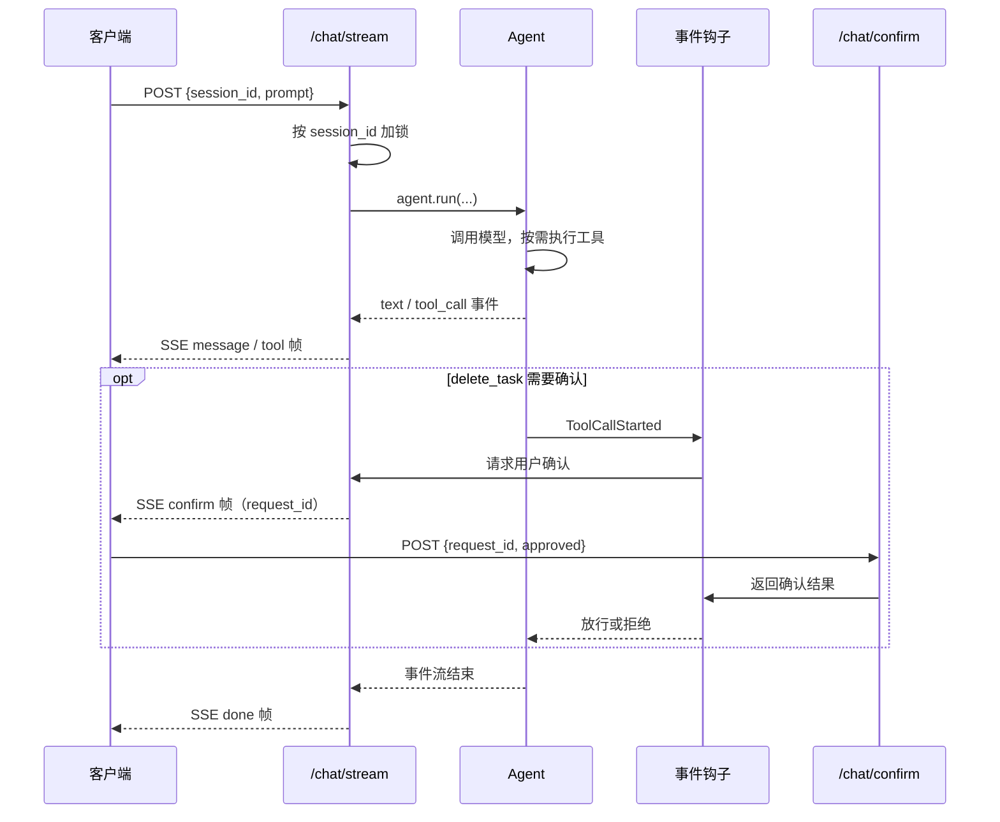

import { FileTree, Steps } from '@astrojs/starlight/components';

经过前面对于 Bub SDK 使用的基本了解后，本节不再引入新概念，而是通过一个综合示例来将所有概念串联起来，最终构建出一个完整的 Agent Demo 应用。

:::tip[看不懂就问]
本节内容仅对后端逻辑进行展开，前端界面交互部分则不涉及。如遇到不理解的概念、代码或报错，可以直接问 Bub，或让正在使用的 Agent 工具结合本教程和当前代码为你讲解。
:::

完整示例代码在 [bub-todo-agent](https://github.com/bubbuild/bub/blob/main/website/public/examples/bub-todo-agent/) 中，你可以下载后自行修改或者跟着教程构建。最终核心文件目录如结构所示：

<FileTree>

- bub-todo-agent/
  - main.py # 本文重点
  - index.html # 演示界面，不在本文展开
  - static/
    - uno.global.js
    - alpine.min.js
  - sessions/ # 运行后自动生成

</FileTree>


:::caution
本项目仅用于演示教学，不具备生产能力，请勿将其暴露在任何公网。
:::

## 1. 配置 Agent 并启动 FastAPI 服务 {#lifespan}

首先，我们把应用骨架搭起来：完成 Bub Agent 相关配置，并在 FastAPI 启动时创建 Agent。所以主要有以下事项：

1. 导入相关依赖，并将配置信息读取作为变量保存；
2. 自定义 FastAPI [生命周期](https://fastapi.tiangolo.com/advanced/events/#lifespan)（lifespan）逻辑，在启动时完成 Bub Agent 配置。

```python
#!/usr/bin/env -S uv run --script
# /// script
# requires-python = ">=3.12"
# dependencies = [
#   "bub @ git+https://github.com/bubbuild/bub@main",
#   "fastapi>=0.135",
#   "python-dotenv",
#   "uvicorn",
# ]
# ///

import asyncio
import logging
import os
from collections import defaultdict
from collections.abc import AsyncIterable, Awaitable, Callable
from contextlib import asynccontextmanager, suppress
from itertools import count
from pathlib import Path
from typing import Literal
from uuid import uuid4

import republic
from dotenv import load_dotenv
from fastapi import FastAPI, HTTPException, Request
from fastapi.sse import EventSourceResponse, ServerSentEvent
from pydantic import BaseModel, Field

from bub.core import Agent
from bub.core.events import ToolCallDecision, ToolCallFinished, ToolCallStarted
from bub.core.store import FileTapeStore
from bub.core.tools import tool


logger = logging.getLogger(__name__)
BASE_DIR = Path(__file__).resolve().parent

load_dotenv()

# ===== 通过环境变量或 .env 覆盖，也可以直接修改这里的默认值 =====
MODEL = os.getenv("BUB_MODEL", "openai:gpt-4o-mini")
BASE_URL = os.getenv("BUB_API_BASE", "https://api.openai.com/v1")
API_KEY = os.getenv("BUB_API_KEY") or os.getenv("REPUBLIC_OPENAI_API_KEY")
HOST = os.getenv("BUB_HOST", "127.0.0.1")
PORT = int(os.getenv("BUB_PORT", "8000"))
# ==========================================================


@asynccontextmanager
async def lifespan(app: FastAPI):
    async with republic.get_model(MODEL, api_base=BASE_URL, api_key=API_KEY) as model:
        agent = Agent(
            store=FileTapeStore(BASE_DIR / "sessions"),
            system_prompt=(
                "You are a personal todo assistant. Always use tools to read or change todos; "
                "never guess task state. If a request is ambiguous, look it up or ask the user "
                "first, and respect tool errors and denial reasons."
            ),
            max_steps=6,
        )

        app.state.model = model
        app.state.agent = agent
        app.state.session_locks = defaultdict(asyncio.Lock)
        # request_id -> future；删除钩子在这里等待答案，由 POST /chat/confirm 唤醒。
        app.state.pending_confirms = {}
        yield


app = FastAPI(title="Bub Todo Agent", lifespan=lifespan)
```

注意：

- 为了避免重复创建 Agent 以及全局使用，这里我们将创建好的 Agent 实例以及多个属性挂载到 FastAPI 的状态对象 `app.state` 上
- 创建 Bub Agent 时使用 `max_steps` 控制运行一次模型的最大执行步骤数，避免模型陷入死循环
- 配置 `store` 参数让 Agent 使用 Tape 的能力以确保具备记忆能力可以连续对话

但目前这只是一个非常基本的配置，模型只能回答，因此我们接下来为它赋予额外的处理任务能力。

## 2. 用工具承载业务能力 {#tools}

Agent 就位之后，接下来让它真正能做事——即我们所有涉及到 Todo 任务的操作以 Python 函数表示并封装成工具，之后交给 Agent 调用。因此我们将有以下事项：

- 用 Python 的字典对象来存储任务数据
- 提供常见的增删改查方法来让 Agent 与这个字典对象交互，即查看任务、新增任务、完成任务以及删除任务。

```python
# ...

from itertools import count

from pydantic import BaseModel, Field

from bub.core.tools import tool

TASKS: dict[str, dict[str, object]] = {}
TASK_IDS = count(3)


@tool
def list_tasks() -> list[dict[str, object]]:
    """List every todo with its task ID, title, and completion state."""
    return [dict(task) for task in TASKS.values()]


class AddTaskInput(BaseModel):
    title: str = Field(min_length=1, max_length=100, description="Short, specific todo title")


@tool(name="add_task", model=AddTaskInput)
def add_task(param: AddTaskInput) -> dict[str, object]:
    """Add a new incomplete todo."""
    task_id = f"task-{next(TASK_IDS)}"
    task = {"task_id": task_id, "title": param.title, "completed": False}
    TASKS[task_id] = task
    return dict(task)


@tool
def complete_task(task_id: str) -> dict[str, object]:
    """Mark a todo complete by task ID. Call list_tasks first if the ID is unknown."""
    if task := TASKS.get(task_id):
        task["completed"] = True
        return dict(task)
    return {"task_id": task_id, "error": "task_not_found"}


@tool
def delete_task(task_id: str) -> dict[str, object]:
    """Permanently delete a todo by task ID. The host must authorize it first."""
    if task := TASKS.pop(task_id, None):
        return {"task_id": task_id, "status": "deleted", "title": task["title"]}
    return {"task_id": task_id, "error": "task_not_found"}
```

以上代码都是较为基础的 Python 逻辑，这里就不展开，简单来说就是：

- Python 函数的 docstring 和类型标注会作为工具 schema 使用，后续 Agent 在调用前会阅读后以决定是否调用工具来触发逻辑。
- 返回值必须能 JSON 序列化；业务失败返回 `{"error": ...}`，不要动辄抛异常中断整个流程。
- `delete_task` 是不可逆操作，后续我们将会添加拦截事件以便新增二次确认逻辑。

现在让我们修改 Agent 配置：

```python

# Code snippet..

@asynccontextmanager
async def lifespan(app: FastAPI):

    # ...

    async with republic.get_model(MODEL, api_base=BASE_URL, api_key=API_KEY) as model:
        agent = Agent(
            store=FileTapeStore(BASE_DIR / "sessions"),
            tools=[list_tasks, add_task, complete_task, delete_task],
            system_prompt=(
                "You are a personal todo assistant. Always use tools to read or change todos; "
                "never guess task state. If a request is ambiguous, look it up or ask the user "
                "first, and respect tool errors and denial reasons."
            ),
            max_steps=6,
            max_tool_concurrency=2,
        )
```

这里我们把所有任务作为 `tools` 参数传递，然后设置 `max_tool_concurrency` 限制一次工具调用的最大数量上限。

## 3. 包装调用 Agent 操作 {#tape}

装配了工具的 Bub Agent 有了「手脚」，现在已经具备可以交互的能力了。

在调用前我们可能需要做一些简单的参数处理或封装，真正调用 Agent 时参数是正确的，所以我们这里的逻辑很简单：

```python
ConfirmDelete = Callable[[dict[str, object]], Awaitable[bool]]


class ChatRequest(BaseModel):
    session_id: str = Field(pattern=r"^[A-Za-z0-9_-]{1,64}$")
    prompt: str = Field(min_length=1, max_length=10_000)
    think_level: Literal["auto", "low", "medium", "high"] = "auto"


def run_agent(agent: Agent, model, req: ChatRequest, confirm_delete: ConfirmDelete):
    options = None if req.think_level == "auto" else {"reasoning_effort": req.think_level}
    return agent.run(
        req.prompt,
        model=model,
        options=options,
        tape=req.session_id,
        state={"session_id": req.session_id, "confirm_delete": confirm_delete},
    )
```

注意：

- `tape=req.session_id` 让同一会话共享历史；换一个 `session_id` 则是开启新会话。
- `state` 属于临时状态的数据存储，为后续事件 hook 共用

## 4. 注册事件 hooks {#events}

由于 Bub 提供了多种 Hook 入口，因此我们可以利用 Hook 来自定义某些阶段的业务流程，比如输出工具调用日志或拦截没有确认的删除指令等。

核心业务逻辑如下：

1. 当收到 `ToolCallFinished` 事件时，则记录工具名、状态和耗时。
2. 当收到 `ToolCallStarted` 事件时先截 `delete_task` 操作。
3. 从 `state` 取出确认回调；没有就拒绝。
4. 用户拒绝时设置 `deny`，并告诉模型替代方案。

所以在 Agent 创建后，我们再在 FastAPI 的 `lifespan`  中新增如下逻辑：

```python
# ...

from bub.core.events import ToolCallDecision, ToolCallFinished, ToolCallStarted


@asynccontextmanager
async def lifespan(app: FastAPI):
    async with republic.get_model(MODEL, api_base=BASE_URL, api_key=API_KEY) as model:


        # ...


        @agent.events.on(ToolCallFinished)
        def audit_tool(event: ToolCallFinished) -> None:
            logger.info(
                "tool=%s status=%s duration_ms=%s",
                event.result.tool,
                "error" if event.result.error else "ok",
                event.result.duration_ms,
            )


        @agent.events.on(ToolCallStarted)
        async def authorize_tool(event: ToolCallStarted) -> None:
            # 异步处理器会被等待，因此这里可以暂停 Run，直到用户在界面上作答。
            # 没人作答时默认拒绝，是更安全的失败方式。
            if event.call.tool != "delete_task":
                return
            confirm: ConfirmDelete | None = event.state.get("confirm_delete")
            if confirm is None or not await confirm(event.call.arguments):
                event.decision = ToolCallDecision.deny(
                    "The user did not approve deleting this todo. Do not retry; offer to mark "
                    "the todo complete instead."
                )
```

注意：

- 异步处理器会暂停当前 Agent 调用流程，直到用户回答。
- `deny` 操作只跳过这次工具调用，不会终止整个流程；模型会收到拒绝原因并调整回答。

## 5. 会话锁与确认操作 {#concurrency}

上一节中提到会在删除任务前暂停流程，但要让「暂停」真正成立，还缺两样东西：

1. 同一会话的请求需要排队，避免等待处理期间又有请求进来导致 Tape 会话被占用
2. 用户对删除的回答也要送回那个暂停中 Hook 逻辑

因此我们可能需要「锁」，确保同一个 Tape 存储记录只能有一次请求持有，这两项状态都在 `lifespan` 中初始化：

```python
app.state.session_locks = defaultdict(asyncio.Lock)
# request_id -> future；删除钩子在这里等待答案，由 POST /chat/confirm 唤醒。
app.state.pending_confirms = {}
```

后续在请求入口中我们按 `session_id` 取锁，让同一会话的请求就会依次执行即可：

```python
lock: asyncio.Lock = state.session_locks[req.session_id]
```

对于确认的交互，我们使用一个单独的接口逻辑处理：

```python
class Confirmation(BaseModel):
    request_id: str
    approved: bool


@app.post("/chat/confirm")
async def confirm_tool_call(req: Confirmation, request: Request):
    future = request.app.state.pending_confirms.pop(req.request_id, None)
    if future is None or future.done():
        raise HTTPException(status_code=404, detail="confirmation_not_found")
    future.set_result(req.approved)
    return {"approved": req.approved}
```

现在让我们来做最后一步构建。

## 6. 构建 API 接口并使用 SSE 传输 {#sse}

锁和确认操作就位后，就可以把它们也一同接入与 Agent 的对话中来：

1. 前端通过向 `/chat/stream` 路径进行 HTTP 请求
2. 接收请求后由 FastAPI 调用对应接口逻辑，即使用 Agent 生成内容
3. Agent 生成的输出内容被 FastAPI 用 [SSE](https://developer.mozilla.org/en-US/docs/Web/API/Server-sent_events/) 协议序列化成对应事件后返回给前端
4. 前端根据事件类型处理和展示

这里直接给出完整代码：

```python
import asyncio
from collections.abc import AsyncIterable
from contextlib import suppress
from uuid import uuid4

from fastapi import Request
from fastapi.sse import EventSourceResponse, ServerSentEvent


@app.post("/chat/stream", response_class=EventSourceResponse)
async def chat_stream(req: ChatRequest, request: Request) -> AsyncIterable[ServerSentEvent]:
    state = request.app.state
    lock: asyncio.Lock = state.session_locks[req.session_id]
    # Run 放在后台任务里推进，这样钩子也能往队列里推帧；
    # 钩子运行在 Agent 事件流内部，响应生成器此时无法直接 yield。
    queue: asyncio.Queue[ServerSentEvent | None] = asyncio.Queue()

    async def confirm_delete(arguments: dict[str, object]) -> bool:
        task_id = str(arguments.get("task_id", ""))
        request_id = uuid4().hex
        future = asyncio.get_running_loop().create_future()
        state.pending_confirms[request_id] = future
        queue.put_nowait(
            ServerSentEvent(
                data={
                    "request_id": request_id,
                    "task_id": task_id,
                    "title": (TASKS.get(task_id) or {}).get("title"),
                },
                event="confirm",
            )
        )
        try:
            # 失败即关闭：两分钟内没有回答，或客户端断开，都不执行删除。
            return await asyncio.wait_for(future, timeout=120)
        except TimeoutError:
            return False
        finally:
            state.pending_confirms.pop(request_id, None)

    async def chat() -> None:
        try:
            async with lock, run_agent(state.agent, state.model, req, confirm_delete) as stream:
                async for event in stream:
                    if event.kind == "text":
                        queue.put_nowait(
                            ServerSentEvent(data={"delta": event.data["delta"]}, event="message")
                        )
                    elif event.kind == "tool_call":
                        names = [call["name"] for call in event.data["tool_calls"]]
                        queue.put_nowait(ServerSentEvent(data={"names": names}, event="tool"))

                # 整个 Run 结束后才发送 done；final 只代表一个 Step 结束。
                queue.put_nowait(
                    ServerSentEvent(data={"last_step_usage": stream.usage}, event="done")
                )
        except asyncio.CancelledError:
            raise
        except Exception:
            logger.exception("Streaming agent run failed: session=%s", req.session_id)
            queue.put_nowait(ServerSentEvent(data={"message": "Agent run failed"}, event="error"))
        finally:
            queue.put_nowait(None)

    task = asyncio.create_task(chat())
    try:
        while (frame := await queue.get()) is not None:
            yield frame
    finally:
        task.cancel()
        with suppress(asyncio.CancelledError):
            await task
```

## 完整回顾与一次交互 {#wiring}

我们快速回顾一下本章内容，在本 Demo 中一次完整的交互路径示意如下：



总的来说，整个 Demo 可以分为三部分：

- **配置与集成**：配置 Bub Agent，并与 FastAPI 集成在一起；
- **基于工具与事件机制自定义逻辑**：将实际的交互逻辑封装成可供 Agent 调用的工具，并对工具调用时的一些事件阶段流程进行自定义；
- **通过 HTTP 接口交互**：对外交互的入口为 HTTP 接口，在接口内组合多个部分、逻辑最终完成交互流程。

## 运行与体验 {#run}

到这里，我们完整的 Demo 示例就算完成了。现在你可以直接通过 [bub-todo-agent](https://github.com/bubbuild/bub/blob/main/website/public/examples/bub-todo-agent/) 来运行整个服务然后在前端界面进行体验：

<Steps>

1. 将 `.env.example` 重命名为 `.env`，并填写模型相关参数或端口：

    ```
    BUB_MODEL=openai:gpt-4o-mini
    BUB_API_BASE=https://api.openai.com/v1

    BUB_API_KEY=sk-...

    BUB_HOST=127.0.0.1
    BUB_PORT=8000
    ```

2. 使用 uv 运行 `main.py`：

    ```shell
    uv run main.py
    ```

3. 看到日志有输出时点击或复制 URL 地址通过浏览器进入页面即可：

    ```
    $ uv run main.py
    INFO:     Started server process [85377]
    INFO:     Waiting for application startup.
    INFO:     Application startup complete.
    INFO:     Uvicorn running on http://127.0.0.1:8000 (Press CTRL+C to quit)
    ```

    

</Steps>


祝你玩得愉快！
